# Risk Parity Project: Extended Analysis

The full write-ups behind `risk-parity-project.ipynb`, with every table, printed result and figure from the notebook placed in its section. The notebook holds the concise answers; this file keeps the detailed reasoning, intermediate results and a guide to reading each figure. Figures are saved in `rp_project_figures/`.

## Data Preview

```text
18 series, 2002-07-29 to 2026-10-23; yields to 2026-07-31
```

<table>
  <caption>Available daily fund returns</caption>
  <thead>
    <tr>
      <th>&nbsp;</th>
      <th>First return</th>
      <th>Last return</th>
      <th>Daily observations</th>
    </tr>
    <tr>
      <th>Fund</th>
      <th>&nbsp;</th>
      <th>&nbsp;</th>
      <th>&nbsp;</th>
    </tr>
  </thead>
  <tbody>
    <tr>
      <th>RPAR</th>
      <td>2019-12-16</td>
      <td>2026-10-23</td>
      <td>1,723</td>
    </tr>
    <tr>
      <th>UPAR</th>
      <td>2022-01-05</td>
      <td>2026-10-23</td>
      <td>1,205</td>
    </tr>
    <tr>
      <th>ALLW</th>
      <td>2025-03-07</td>
      <td>2026-10-23</td>
      <td>411</td>
    </tr>
    <tr>
      <th>NTSX</th>
      <td>2018-08-03</td>
      <td>2026-10-23</td>
      <td>2,053</td>
    </tr>
    <tr>
      <th>DBMF</th>
      <td>2019-05-09</td>
      <td>2026-10-23</td>
      <td>1,876</td>
    </tr>
  </tbody>
</table>

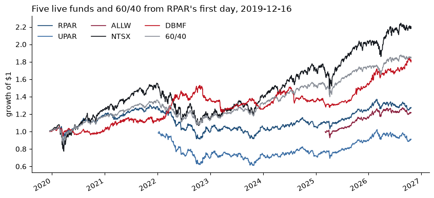

# 1. The Products

## 1.1

> For `RPAR`, `UPAR`, `ALLW`, `NTSX`, `DBMF`, 60/40 and the static four-way, report over 2019-12-16 to 2026-10-23 and over 2022-01-05 to 2026-10-23:
>
> * annualized mean and volatility, Sharpe ratio, skewness
> * empirical 5% VaR and CVaR of daily returns
> * maximum drawdown with its peak, trough and recovery dates
> * calendar-year total returns for 2020 through 2026 to date, adding `SPY`, `TLT`, `TIP`, `GLD` and `DBC`
>
> A fund that launched after a window opens starts later; mark it in the table.

<table>
  <caption>&#42; launched after the window opens; statistics start at its first return</caption>
  <thead>
    <tr>
      <th>&nbsp;</th>
      <th>&nbsp;</th>
      <th>First Return</th>
      <th>Annualized Mean</th>
      <th>Annualized Volatility</th>
      <th>Sharpe Ratio</th>
      <th>Skewness</th>
      <th>VaR (0.05)</th>
      <th>CVaR (0.05)</th>
      <th>Max Drawdown</th>
      <th>Peak Date</th>
      <th>Trough Date</th>
      <th>Recovery Date</th>
    </tr>
    <tr>
      <th>Window</th>
      <th>Fund</th>
      <th>&nbsp;</th>
      <th>&nbsp;</th>
      <th>&nbsp;</th>
      <th>&nbsp;</th>
      <th>&nbsp;</th>
      <th>&nbsp;</th>
      <th>&nbsp;</th>
      <th>&nbsp;</th>
      <th>&nbsp;</th>
      <th>&nbsp;</th>
      <th>&nbsp;</th>
    </tr>
  </thead>
  <tbody>
    <tr>
      <th rowspan="7">2019-12-16 to 2026-10-23</th>
      <th>RPAR</th>
      <td>2019-12-16</td>
      <td>4.32%</td>
      <td>12.56%</td>
      <td>0.13</td>
      <td>-0.30</td>
      <td>-1.26%</td>
      <td>-1.84%</td>
      <td>-30.14%</td>
      <td>2021-11-09</td>
      <td>2022-10-20</td>
      <td>2026-01-26</td>
    </tr>
    <tr>
      <th>UPAR*</th>
      <td>2022-01-05</td>
      <td>-0.36%</td>
      <td>17.80%</td>
      <td>-0.23</td>
      <td>0.10</td>
      <td>-1.80%</td>
      <td>-2.60%</td>
      <td>-38.97%</td>
      <td>2022-01-12</td>
      <td>2023-10-25</td>
      <td>2026-02-23</td>
    </tr>
    <tr>
      <th>ALLW*</th>
      <td>2025-03-07</td>
      <td>12.80%</td>
      <td>12.10%</td>
      <td>0.74</td>
      <td>-0.48</td>
      <td>-1.00%</td>
      <td>-1.84%</td>
      <td>-8.78%</td>
      <td>2025-04-02</td>
      <td>2025-04-08</td>
      <td>2025-06-02</td>
    </tr>
    <tr>
      <th>NTSX</th>
      <td>2019-12-16</td>
      <td>13.25%</td>
      <td>19.08%</td>
      <td>0.55</td>
      <td>-0.57</td>
      <td>-1.80%</td>
      <td>-2.85%</td>
      <td>-31.34%</td>
      <td>2021-12-27</td>
      <td>2022-10-14</td>
      <td>2024-06-12</td>
    </tr>
    <tr>
      <th>DBMF</th>
      <td>2019-12-16</td>
      <td>9.47%</td>
      <td>12.46%</td>
      <td>0.54</td>
      <td>-0.60</td>
      <td>-1.30%</td>
      <td>-1.92%</td>
      <td>-20.44%</td>
      <td>2022-10-20</td>
      <td>2023-03-24</td>
      <td>2025-12-19</td>
    </tr>
    <tr>
      <th>60/40</th>
      <td>2019-12-16</td>
      <td>9.69%</td>
      <td>12.14%</td>
      <td>0.57</td>
      <td>-0.15</td>
      <td>-1.11%</td>
      <td>-1.80%</td>
      <td>-21.02%</td>
      <td>2021-12-27</td>
      <td>2022-10-14</td>
      <td>2024-02-22</td>
    </tr>
    <tr>
      <th>static four-way</th>
      <td>2019-12-16</td>
      <td>11.01%</td>
      <td>10.84%</td>
      <td>0.77</td>
      <td>-0.41</td>
      <td>-1.07%</td>
      <td>-1.62%</td>
      <td>-18.00%</td>
      <td>2022-03-08</td>
      <td>2022-10-20</td>
      <td>2024-04-08</td>
    </tr>
    <tr>
      <th rowspan="7">2022-01-05 to 2026-10-23</th>
      <th>RPAR</th>
      <td>2022-01-05</td>
      <td>0.92%</td>
      <td>12.68%</td>
      <td>-0.22</td>
      <td>-0.01</td>
      <td>-1.33%</td>
      <td>-1.80%</td>
      <td>-27.86%</td>
      <td>2022-01-12</td>
      <td>2022-10-20</td>
      <td>2026-01-06</td>
    </tr>
    <tr>
      <th>UPAR</th>
      <td>2022-01-05</td>
      <td>-0.36%</td>
      <td>17.80%</td>
      <td>-0.23</td>
      <td>0.10</td>
      <td>-1.80%</td>
      <td>-2.60%</td>
      <td>-38.97%</td>
      <td>2022-01-12</td>
      <td>2023-10-25</td>
      <td>2026-02-23</td>
    </tr>
    <tr>
      <th>ALLW*</th>
      <td>2025-03-07</td>
      <td>12.80%</td>
      <td>12.10%</td>
      <td>0.74</td>
      <td>-0.48</td>
      <td>-1.00%</td>
      <td>-1.84%</td>
      <td>-8.78%</td>
      <td>2025-04-02</td>
      <td>2025-04-08</td>
      <td>2025-06-02</td>
    </tr>
    <tr>
      <th>NTSX</th>
      <td>2022-01-05</td>
      <td>8.78%</td>
      <td>17.41%</td>
      <td>0.29</td>
      <td>-0.07</td>
      <td>-1.78%</td>
      <td>-2.53%</td>
      <td>-30.77%</td>
      <td>2022-01-04</td>
      <td>2022-10-14</td>
      <td>2024-06-05</td>
    </tr>
    <tr>
      <th>DBMF</th>
      <td>2022-01-05</td>
      <td>10.51%</td>
      <td>12.14%</td>
      <td>0.55</td>
      <td>-0.45</td>
      <td>-1.20%</td>
      <td>-1.81%</td>
      <td>-20.44%</td>
      <td>2022-10-20</td>
      <td>2023-03-24</td>
      <td>2025-12-19</td>
    </tr>
    <tr>
      <th>60/40</th>
      <td>2022-01-05</td>
      <td>7.03%</td>
      <td>11.14%</td>
      <td>0.30</td>
      <td>0.32</td>
      <td>-1.09%</td>
      <td>-1.59%</td>
      <td>-20.64%</td>
      <td>2022-01-04</td>
      <td>2022-10-14</td>
      <td>2024-02-07</td>
    </tr>
    <tr>
      <th>static four-way</th>
      <td>2022-01-05</td>
      <td>9.57%</td>
      <td>10.69%</td>
      <td>0.55</td>
      <td>-0.04</td>
      <td>-1.06%</td>
      <td>-1.52%</td>
      <td>-18.00%</td>
      <td>2022-03-08</td>
      <td>2022-10-20</td>
      <td>2024-04-08</td>
    </tr>
  </tbody>
</table>

<table>
  <caption>Calendar-year total returns, 2020 through 2026-10-23</caption>
  <thead>
    <tr>
      <th>Date</th>
      <th>2020</th>
      <th>2021</th>
      <th>2022</th>
      <th>2023</th>
      <th>2024</th>
      <th>2025</th>
      <th>2026 YTD</th>
    </tr>
  </thead>
  <tbody>
    <tr>
      <th>RPAR</th>
      <td>19.40%</td>
      <td>7.55%</td>
      <td>-22.80%</td>
      <td>6.03%</td>
      <td>0.07%</td>
      <td>17.91%</td>
      <td>2.53%</td>
    </tr>
    <tr>
      <th>UPAR</th>
      <td>—</td>
      <td>—</td>
      <td>-30.27%</td>
      <td>5.73%</td>
      <td>-2.24%</td>
      <td>23.87%</td>
      <td>2.06%</td>
    </tr>
    <tr>
      <th>ALLW</th>
      <td>—</td>
      <td>—</td>
      <td>—</td>
      <td>—</td>
      <td>—</td>
      <td>15.08%</td>
      <td>5.78%</td>
    </tr>
    <tr>
      <th>NTSX</th>
      <td>24.85%</td>
      <td>22.20%</td>
      <td>-25.84%</td>
      <td>22.70%</td>
      <td>20.20%</td>
      <td>18.83%</td>
      <td>8.71%</td>
    </tr>
    <tr>
      <th>DBMF</th>
      <td>1.80%</td>
      <td>11.38%</td>
      <td>21.53%</td>
      <td>-8.94%</td>
      <td>7.25%</td>
      <td>13.84%</td>
      <td>18.22%</td>
    </tr>
    <tr>
      <th>60/40</th>
      <td>16.94%</td>
      <td>15.09%</td>
      <td>-16.38%</td>
      <td>16.98%</td>
      <td>14.24%</td>
      <td>14.32%</td>
      <td>6.32%</td>
    </tr>
    <tr>
      <th>static four-way</th>
      <td>15.07%</td>
      <td>14.49%</td>
      <td>-8.29%</td>
      <td>8.99%</td>
      <td>11.08%</td>
      <td>22.51%</td>
      <td>12.54%</td>
    </tr>
    <tr>
      <th>SPY</th>
      <td>18.37%</td>
      <td>28.75%</td>
      <td>-18.17%</td>
      <td>26.19%</td>
      <td>24.89%</td>
      <td>17.72%</td>
      <td>12.32%</td>
    </tr>
    <tr>
      <th>TLT</th>
      <td>18.15%</td>
      <td>-4.60%</td>
      <td>-31.24%</td>
      <td>2.77%</td>
      <td>-8.06%</td>
      <td>4.25%</td>
      <td>-3.42%</td>
    </tr>
    <tr>
      <th>TIP</th>
      <td>10.84%</td>
      <td>5.67%</td>
      <td>-12.24%</td>
      <td>3.81%</td>
      <td>1.65%</td>
      <td>6.77%</td>
      <td>-0.03%</td>
    </tr>
    <tr>
      <th>GLD</th>
      <td>24.81%</td>
      <td>-4.15%</td>
      <td>-0.77%</td>
      <td>12.69%</td>
      <td>26.66%</td>
      <td>63.68%</td>
      <td>-7.49%</td>
    </tr>
    <tr>
      <th>DBC</th>
      <td>-7.84%</td>
      <td>41.36%</td>
      <td>19.34%</td>
      <td>-6.22%</td>
      <td>2.18%</td>
      <td>8.06%</td>
      <td>52.50%</td>
    </tr>
  </tbody>
</table>

```text
Partial years: UPAR 2022 (from 2022-01-05); ALLW 2025 (from 2025-03-07)
```

## 1.2

> Regress `UPAR`'s daily excess return on `RPAR`'s over their common sample. Report
>
> * the slope, the annualized intercept and $R^2$
> * the ratio of `UPAR`'s volatility to `RPAR`'s and the ratio of the two maximum drawdowns over the same sample
>
> The issuer describes `UPAR` as a more levered `RPAR`. What multiple do the data support, which of the statistics in 1.1 does it scale, and which does it leave where they were?

```text
Common sample: 2022-01-05 to 2026-10-23, 1,205 days
```

<table>
  <thead>
    <tr>
      <th>&nbsp;</th>
      <th>UPAR on RPAR, daily excess returns</th>
    </tr>
  </thead>
  <tbody>
    <tr>
      <th>Slope (beta on RPAR)</th>
      <td>1.2964</td>
    </tr>
    <tr>
      <th>Annualized Intercept</th>
      <td>-0.45%</td>
    </tr>
    <tr>
      <th>Alpha t-stat</th>
      <td>-0.1433</td>
    </tr>
    <tr>
      <th>R-squared</th>
      <td>0.8499</td>
    </tr>
    <tr>
      <th>Tracking Error</th>
      <td>6.87%</td>
    </tr>
  </tbody>
</table>

<table>
  <caption>RPAR and UPAR over the common sample</caption>
  <thead>
    <tr>
      <th>&nbsp;</th>
      <th>RPAR</th>
      <th>UPAR</th>
      <th>UPAR / RPAR</th>
    </tr>
  </thead>
  <tbody>
    <tr>
      <th>Annualized Excess Mean</th>
      <td>-2.80%</td>
      <td>-4.09%</td>
      <td>1.46</td>
    </tr>
    <tr>
      <th>Annualized Volatility</th>
      <td>12.68%</td>
      <td>17.80%</td>
      <td>1.40</td>
    </tr>
    <tr>
      <th>Sharpe Ratio</th>
      <td>-0.22</td>
      <td>-0.23</td>
      <td>1.04</td>
    </tr>
    <tr>
      <th>Skewness</th>
      <td>-0.01</td>
      <td>0.10</td>
      <td>-7.24</td>
    </tr>
    <tr>
      <th>VaR (0.05)</th>
      <td>-1.33%</td>
      <td>-1.80%</td>
      <td>1.35</td>
    </tr>
    <tr>
      <th>CVaR (0.05)</th>
      <td>-1.80%</td>
      <td>-2.60%</td>
      <td>1.44</td>
    </tr>
    <tr>
      <th>Max Drawdown</th>
      <td>-27.86%</td>
      <td>-38.97%</td>
      <td>1.40</td>
    </tr>
  </tbody>
</table>

<table>
  <caption>UPAR on RPAR by return horizon, non-overlapping excess returns</caption>
  <thead>
    <tr>
      <th>&nbsp;</th>
      <th>Slope</th>
      <th>Annualized Intercept</th>
      <th>Alpha t-stat</th>
      <th>R-squared</th>
      <th>Tracking Error</th>
    </tr>
  </thead>
  <tbody>
    <tr>
      <th>1 day</th>
      <td>1.30</td>
      <td>-0.45%</td>
      <td>-0.14</td>
      <td>0.85</td>
      <td>6.87%</td>
    </tr>
    <tr>
      <th>2 days</th>
      <td>1.36</td>
      <td>-0.30%</td>
      <td>-0.15</td>
      <td>0.94</td>
      <td>4.40%</td>
    </tr>
    <tr>
      <th>5 days</th>
      <td>1.37</td>
      <td>-0.24%</td>
      <td>-0.14</td>
      <td>0.95</td>
      <td>3.76%</td>
    </tr>
    <tr>
      <th>21 days</th>
      <td>1.39</td>
      <td>-0.24%</td>
      <td>-0.32</td>
      <td>0.99</td>
      <td>1.63%</td>
    </tr>
  </tbody>
</table>

```text
Correlation of UPAR with RPAR's previous-day excess return: 0.09
```

**What multiple do the data support?** 
About 1.4. Over the common sample (2022-01-05 to 2026-10-23), `UPAR`'s volatility is 1.40 times `RPAR`'s and its maximum drawdown is 1.40 times as deep, consistent with the issuer's 1.4 times the RPAR Index exposures. The daily slope is lower, 1.30 with $R^2$ = 0.85, but that is attenuation from daily timing noise rather than a lower multiple: `UPAR` still co-moves with `RPAR`'s previous day (correlation 0.09), and on non-overlapping 2-, 5- and 21-day returns the slope rises to 1.36, 1.37 and 1.39 with $R^2$ reaching 0.99. The intercept, −0.45% a year with a $t$-statistic of −0.14, is not distinguishable from zero; its sign is consistent with `UPAR`'s 0.16% higher expense ratio and any financing cost on the extra exposure.

**Which statistics leverage scales.** 
Everything measured in units of return scales by roughly the multiple: the annualized excess mean (1.46×, more negative because `RPAR`'s excess return was negative), volatility (1.40×), VaR (1.35×), CVaR (1.44×) and maximum drawdown (1.40×).

**Which it leaves where they were.** 
Leverage changes scale, not shape or risk-adjusted return. The Sharpe ratio is unchanged (−0.22 against −0.23), and skewness stays close to zero for both. The drawdown peak is the same day for both funds (2022-01-12). But leverage does not simply scale the compounded path: `RPAR` bottomed on 2022-10-20, while `UPAR` kept falling to 2023-10-25 and recovered later (2026-02-23 against 2026-01-06), because volatility drag on a levered daily path compounds a negative excess return into a longer and deeper drawdown.

**The tables.**

* ***RPAR and UPAR over the common sample:*** puts the 1.1 statistics for both funds on the same dates, with their ratio. The 1.4x multiple and the unchanged Sharpe ratio come from here.
* ***UPAR on RPAR by return horizon:*** our addition. It reruns the regression on 2-, 5- and 21-day returns to test whether the low daily slope is a real multiple or a timing artifact. As the horizon lengthens, the slope rises toward 1.4, so it is an artifact.

## 1.3

> From Section 1 alone, write three claims an allocator could defend about how these products differ, each tied to a number in your tables, and name one claim about them you cannot test with these statistics.

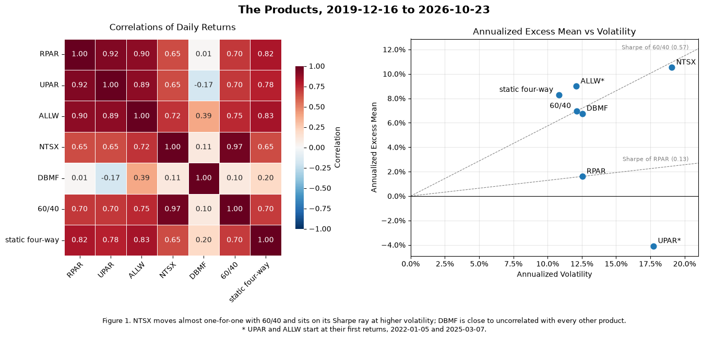

### Reading Figure 1

*Left: the correlation heatmap.* Each cell is the correlation of daily returns between its row and its column, from 2019-12-16 to 2026-10-23. Each pair uses the dates both series exist, so pairs with `UPAR` or `ALLW` cover shorter periods. Dark red means the two move together, white means unrelated, and blue means they move in opposite directions. The matrix is symmetric and the diagonal is 1 by definition, so reading one triangle is enough.

* **The risk-parity block:** `RPAR`, `UPAR`, `ALLW` and the static four-way correlate 0.78 to 0.92 with one another. They hold the same kinds of assets.
* **`NTSX` and 60/40:** 0.97, close to the same daily return.
* **`DBMF`:** its row is pale everywhere, from −0.17 to 0.39. Its highest value, 0.39 with `ALLW`, comes from `ALLW`'s short life.

*Right: excess mean against volatility.* Each point is one product: annualized volatility across, annualized mean return over `SHV` up.

* **Sharpe rays:** each dashed line from the origin is a Sharpe ray, and every point on it has the same Sharpe ratio. A steeper ray means a higher Sharpe ratio.
* **60/40's ray (0.57):** points above it beat 60/40 per unit of risk. That holds for the static four-way (0.77) and `ALLW` (0.74).
* **`NTSX`:** sits almost on 60/40's ray at about 1.6 times the volatility, which is what a levered 60/40 looks like.
* **`RPAR` and `UPAR`:** `RPAR` sits on a much flatter ray (0.13), and `UPAR` is below zero.
* **Asterisks:** these points start later. `ALLW*` covers about a year and a half, so its point is far less reliable than the others.

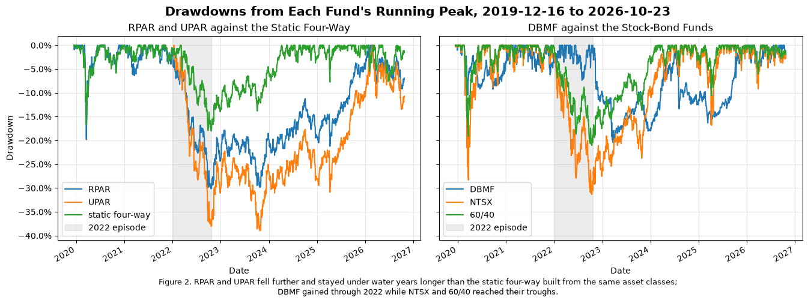

### Reading Figure 2

*What is plotted.* Each line is a drawdown: how far the fund's wealth sits below the highest level it had reached so far. Wealth starts at 1 at the close before the first return.

* **0%** means the fund is at a new high.
* **Depth** is the loss from the peak; **width** is the time spent under water.
* **Gray band:** the 2022 episode (2022-01-03 to 2022-10-24).
* **Axes:** the panels share the vertical axis, so depths can be compared directly.

*Left: `RPAR` and `UPAR` against the static four-way.* All three hold the same asset classes, so the gaps between the lines come from weights and leverage.

| | Maximum drawdown | Trough | Recovered |
|---|---:|---|---|
| `RPAR` | −30.1% | 2022-10-20 | 2026-01-26 |
| `UPAR` | −39.0% | 2023-10-25 | 2026-02-23 |
| static four-way | −18.0% | 2022-10-20 | 2024-04-08 |

*Right: `DBMF` against the stock-bond funds.*

* **`NTSX` and 60/40:** both bottomed on 2022-10-14, at −31.3% and −21.0%.
* **`DBMF`:** its line stays near zero through most of 2022, close to its highs while the others fell. Its own largest drawdown (−20.4%) started from a peak on 2022-10-20, just as the others turned up.
* **The narrow dip in March 2020** is the COVID shock. `RPAR`, `NTSX`, 60/40 and the static four-way regained their highs by July 2020, and `DBMF` by February 2021. Recovery from 2022 took years.

**Claim 1: `NTSX` is a levered 60/40, not a different strategy.** 
Its daily returns correlate 0.97 with 60/40 (Figure 1), and its volatility is 19.1% against 60/40's 12.1%, about 1.6 times, while its Sharpe ratio is 0.55 against 0.57. As with `UPAR` and `RPAR` in 1.2, the leverage raised the mean (13.3% vs 9.7%), VaR (−1.80% vs −1.11%) and maximum drawdown (−31.3% vs −21.0%) and left the Sharpe ratio where it was. An allocator buying `NTSX` buys 60/40 risk at a higher dose, not a different risk. The CAPM relation $\text{SR}_i = \rho_{i,m}\,\text{SR}_m$, with 60/40 as the benchmark, makes this precise: a fund adds nothing to 60/40 when its Sharpe ratio equals $\rho \times$ 60/40's. For `NTSX` that hurdle is $0.97 \times 0.57 = 0.55$, essentially its own Sharpe ratio (0.552 against 0.555 unrounded), so its alpha against 60/40 is about zero.

**Claim 2: `DBMF` is the only product here that diversified the others.** 
Its daily correlation is 0.01 with `RPAR` and 0.10 with 60/40 (Figure 1). In 2022 it returned +21.5% while `RPAR` lost 22.8%, `UPAR` 30.3%, `NTSX` 25.8% and 60/40 16.4%, and its maximum drawdown began on 2022-10-20, the day `RPAR` and the static four-way reached their troughs (Figure 2). The case for it is what it does in a portfolio, not its standalone record: its Sharpe ratio of 0.54 is below 60/40's, and its skewness of −0.60 is the most negative of the seven. By the same relation as in Claim 1, a small `DBMF` weight raises 60/40's Sharpe ratio if `DBMF`'s exceeds $0.10 \times 0.57 \approx 0.06$. At 0.54 it clears that hurdle by more than any other product here.

**Claim 3: `RPAR` lagged a naive equal-weight portfolio of broadly the same asset classes.** 
Over 2019-12-16 to 2026-10-23 the static four-way had a Sharpe ratio of 0.77 against `RPAR`'s 0.13, lower volatility (10.8% vs 12.6%) and a shallower maximum drawdown (−18.0% vs −30.1%), and it recovered in April 2024, almost two years before `RPAR` did in January 2026 (Figure 2). `RPAR` beat it only in 2020 (+19.4% vs +15.1%); the widest gap was 2022 (−22.8% vs −8.3%). The two correlate 0.82, so they share most of their exposures; what `RPAR` does differently cost about 6.7% a year of excess return over this window. This is one seven-year record with one rate shock, so it judges `RPAR` as built over this period, not the risk-parity rule (Section 4).

**A claim these statistics cannot test: `RPAR` balances risk across its four asset classes, "each at 25% of target risk."** 
Every number in Section 1 comes from the fund's total return, so it shows how much risk `RPAR` carried and when it lost money, but not where the risk came from. Testing the claim needs the fund's exposures, from the factor decomposition in Section 2 or the issuer's holdings, and the risk contributions $w_i(\Sigma\boldsymbol{w})_i$ computed from them. A related caution: `ALLW`'s Sharpe ratio of 0.74 rests on 1.6 years of returns, and its standard error is roughly $\sqrt{1/1.6} \approx 0.78$, so Section 1 cannot tell it apart from zero.

# 2. What They Hold

Sections 2 and 3 use excess returns over `SHV`.

## 2.1

> Choose the factor set for the decompositions from `SPY`, `TLT`, `IEF`, `TIP`, `GLD` and `DBC`. State it and justify it in course terms, including whether both Treasury ETFs belong in one regression. Use the same set through Sections 2 and 3 unless a question asks otherwise.

<table>
  <caption>Correlations of daily excess returns over SHV</caption>
  <thead>
    <tr>
      <th>&nbsp;</th>
      <th colspan="6">2007-01-12 to 2026-10-23</th>
      <th colspan="6">RPAR's life</th>
    </tr>
    <tr>
      <th>&nbsp;</th>
      <th>SPY</th>
      <th>TLT</th>
      <th>IEF</th>
      <th>TIP</th>
      <th>GLD</th>
      <th>DBC</th>
      <th>SPY</th>
      <th>TLT</th>
      <th>IEF</th>
      <th>TIP</th>
      <th>GLD</th>
      <th>DBC</th>
    </tr>
  </thead>
  <tbody>
    <tr>
      <th>SPY</th>
      <td>1.00</td>
      <td>-0.30</td>
      <td>-0.29</td>
      <td>-0.10</td>
      <td>0.07</td>
      <td>0.40</td>
      <td>1.00</td>
      <td>-0.10</td>
      <td>-0.06</td>
      <td>0.11</td>
      <td>0.15</td>
      <td>0.29</td>
    </tr>
    <tr>
      <th>TLT</th>
      <td>-0.30</td>
      <td>1.00</td>
      <td>0.91</td>
      <td>0.70</td>
      <td>0.16</td>
      <td>-0.24</td>
      <td>-0.10</td>
      <td>1.00</td>
      <td>0.91</td>
      <td>0.71</td>
      <td>0.20</td>
      <td>-0.17</td>
    </tr>
    <tr>
      <th>IEF</th>
      <td>-0.29</td>
      <td>0.91</td>
      <td>1.00</td>
      <td>0.76</td>
      <td>0.21</td>
      <td>-0.21</td>
      <td>-0.06</td>
      <td>0.91</td>
      <td>1.00</td>
      <td>0.76</td>
      <td>0.28</td>
      <td>-0.14</td>
    </tr>
    <tr>
      <th>TIP</th>
      <td>-0.10</td>
      <td>0.70</td>
      <td>0.76</td>
      <td>1.00</td>
      <td>0.26</td>
      <td>0.05</td>
      <td>0.11</td>
      <td>0.71</td>
      <td>0.76</td>
      <td>1.00</td>
      <td>0.31</td>
      <td>0.14</td>
    </tr>
    <tr>
      <th>GLD</th>
      <td>0.07</td>
      <td>0.16</td>
      <td>0.21</td>
      <td>0.26</td>
      <td>1.00</td>
      <td>0.34</td>
      <td>0.15</td>
      <td>0.20</td>
      <td>0.28</td>
      <td>0.31</td>
      <td>1.00</td>
      <td>0.28</td>
    </tr>
    <tr>
      <th>DBC</th>
      <td>0.40</td>
      <td>-0.24</td>
      <td>-0.21</td>
      <td>0.05</td>
      <td>0.34</td>
      <td>1.00</td>
      <td>0.29</td>
      <td>-0.17</td>
      <td>-0.14</td>
      <td>0.14</td>
      <td>0.28</td>
      <td>1.00</td>
    </tr>
  </tbody>
</table>

<table>
  <caption>Variance inflation factors, 1 / (1 - R-squared) of each factor on the others</caption>
  <thead>
    <tr>
      <th>&nbsp;</th>
      <th colspan="3">2007-01-12 to 2026-10-23</th>
      <th colspan="3">RPAR's life</th>
    </tr>
    <tr>
      <th>&nbsp;</th>
      <th>All six factors</th>
      <th>Without IEF</th>
      <th>Without TLT</th>
      <th>All six factors</th>
      <th>Without IEF</th>
      <th>Without TLT</th>
    </tr>
  </thead>
  <tbody>
    <tr>
      <th>SPY</th>
      <td>1.3</td>
      <td>1.3</td>
      <td>1.3</td>
      <td>1.1</td>
      <td>1.1</td>
      <td>1.1</td>
    </tr>
    <tr>
      <th>TLT</th>
      <td>6.1</td>
      <td>2.4</td>
      <td>—</td>
      <td>6.0</td>
      <td>2.5</td>
      <td>—</td>
    </tr>
    <tr>
      <th>IEF</th>
      <td>7.4</td>
      <td>—</td>
      <td>3.0</td>
      <td>7.1</td>
      <td>—</td>
      <td>3.0</td>
    </tr>
    <tr>
      <th>TIP</th>
      <td>2.7</td>
      <td>2.2</td>
      <td>2.7</td>
      <td>2.9</td>
      <td>2.5</td>
      <td>2.9</td>
    </tr>
    <tr>
      <th>GLD</th>
      <td>1.3</td>
      <td>1.2</td>
      <td>1.3</td>
      <td>1.2</td>
      <td>1.2</td>
      <td>1.2</td>
    </tr>
    <tr>
      <th>DBC</th>
      <td>1.5</td>
      <td>1.5</td>
      <td>1.5</td>
      <td>1.4</td>
      <td>1.3</td>
      <td>1.4</td>
    </tr>
  </tbody>
</table>

<table>
  <caption>Treasury and TIPS betas, sum of betas and R-squared by factor menu, daily excess returns over each fund's life</caption>
  <thead>
    <tr>
      <th>&nbsp;</th>
      <th>&nbsp;</th>
      <th>TLT</th>
      <th>IEF</th>
      <th>TIP</th>
      <th>Sum of Betas</th>
      <th>R-squared</th>
    </tr>
    <tr>
      <th>Fund</th>
      <th>Menu</th>
      <th>&nbsp;</th>
      <th>&nbsp;</th>
      <th>&nbsp;</th>
      <th>&nbsp;</th>
      <th>&nbsp;</th>
    </tr>
  </thead>
  <tbody>
    <tr>
      <th rowspan="3">RPAR</th>
      <th>All six factors</th>
      <td>0.30</td>
      <td>-0.00</td>
      <td>0.54</td>
      <td>1.39</td>
      <td>0.865</td>
    </tr>
    <tr>
      <th>Without IEF</th>
      <td>0.30</td>
      <td>—</td>
      <td>0.54</td>
      <td>1.39</td>
      <td>0.865</td>
    </tr>
    <tr>
      <th>Without TLT</th>
      <td>—</td>
      <td>0.56</td>
      <td>0.63</td>
      <td>1.70</td>
      <td>0.839</td>
    </tr>
    <tr>
      <th rowspan="3">UPAR</th>
      <th>All six factors</th>
      <td>0.54</td>
      <td>-0.09</td>
      <td>0.55</td>
      <td>1.74</td>
      <td>0.795</td>
    </tr>
    <tr>
      <th>Without IEF</th>
      <td>0.51</td>
      <td>—</td>
      <td>0.51</td>
      <td>1.76</td>
      <td>0.795</td>
    </tr>
    <tr>
      <th>Without TLT</th>
      <td>—</td>
      <td>0.89</td>
      <td>0.61</td>
      <td>2.21</td>
      <td>0.759</td>
    </tr>
    <tr>
      <th rowspan="3">ALLW</th>
      <th>All six factors</th>
      <td>0.17</td>
      <td>0.23</td>
      <td>0.68</td>
      <td>1.73</td>
      <td>0.883</td>
    </tr>
    <tr>
      <th>Without IEF</th>
      <td>0.22</td>
      <td>—</td>
      <td>0.82</td>
      <td>1.68</td>
      <td>0.882</td>
    </tr>
    <tr>
      <th>Without TLT</th>
      <td>—</td>
      <td>0.53</td>
      <td>0.71</td>
      <td>1.89</td>
      <td>0.879</td>
    </tr>
    <tr>
      <th rowspan="3">NTSX</th>
      <th>All six factors</th>
      <td>-0.02</td>
      <td>0.48</td>
      <td>0.01</td>
      <td>1.38</td>
      <td>0.933</td>
    </tr>
    <tr>
      <th>Without IEF</th>
      <td>0.13</td>
      <td>—</td>
      <td>0.14</td>
      <td>1.18</td>
      <td>0.928</td>
    </tr>
    <tr>
      <th>Without TLT</th>
      <td>—</td>
      <td>0.44</td>
      <td>0.00</td>
      <td>1.36</td>
      <td>0.933</td>
    </tr>
    <tr>
      <th rowspan="3">DBMF</th>
      <th>All six factors</th>
      <td>0.32</td>
      <td>-1.33</td>
      <td>0.14</td>
      <td>-0.55</td>
      <td>0.239</td>
    </tr>
    <tr>
      <th>Without IEF</th>
      <td>-0.10</td>
      <td>—</td>
      <td>-0.22</td>
      <td>0.00</td>
      <td>0.158</td>
    </tr>
    <tr>
      <th>Without TLT</th>
      <td>—</td>
      <td>-0.73</td>
      <td>0.23</td>
      <td>-0.21</td>
      <td>0.211</td>
    </tr>
  </tbody>
</table>

**Factor set: `SPY`, `TLT`, `TIP`, `GLD`, `DBC`, with `IEF` dropped** 
A factor decomposition needs regressors that each stand for a distinct, investable source of risk. Correlated regressors do not bias the fit, but they inflate the standard errors of the individual betas, so the regression can no longer say which exposure a fund holds. The five chosen ETFs are each a separate asset class these funds say they hold: equities (`SPY`), nominal Treasuries (`TLT`), inflation-linked bonds (`TIP`), gold (`GLD`) and broad commodities (`DBC`). They line up with `RPAR`'s index sleeves (global equities, Treasuries, TIPS, commodities) and with `ALLW`'s stated mandate (stocks, nominal bonds, inflation-linked bonds, commodities). They are also the five assets the risk-parity portfolios of Section 4 hold, so the betas here and the ERC weights in 4.4 are in the same units. Every variance inflation factor in the five-factor set is about 2.5 at most (2.51 for `TLT` and `TIP` over `RPAR`'s life).
* **`TIP` stays despite a 0.70 correlation with `TLT`.** `TIP`'s return combines real-rate duration with breakeven inflation, and the part not explained by `TLT` is the inflation exposure, the largest sleeve of `RPAR`'s index (35%). Its VIF is 2.2 to 2.5, and `RPAR`'s `TIP` beta (0.54) is well identified.

* **`GLD` and `DBC` stay together.** They correlate only 0.28 to 0.34, and they behaved differently when it mattered: `DBC` returned +19.3% in 2022 when `GLD` returned −0.8%, and `GLD` returned +63.7% in 2025 against `DBC`'s +8.1%.

**Should both Treasury ETFs be in one regression? No.** 
* **They are the same factor at two durations.** `TLT` and `IEF` correlate 0.91 over both samples. With both in, their VIFs rise from about 2.4–3.0 to 6.1–7.4, so the standard error of each Treasury beta grows by roughly $\sqrt{6/2.4} \approx 1.6$.

* **The second one adds no fit for the risk-parity funds.** With `TLT` already in, `RPAR`'s `IEF` beta is −0.00 and $R^2$ stays 0.865; `UPAR`'s $R^2$ stays 0.795.

* **Where both get weight, the regression builds an offsetting long-short.** `DBMF` loads +0.32 on `TLT` and −1.33 on `IEF`, and its sum of betas moves from 0.00 to −0.55. That is a curve position fitted from the small differences between two nearly collinear series; it would be unstable in the rolling windows of 2.3 and would make the replicas in 3.1 take offsetting positions.

**Why `TLT` rather than `IEF`:** 
`TLT` fits the risk-parity funds better: $R^2$ of 0.865 against 0.839 for `RPAR` and 0.795 against 0.759 for `UPAR`, with `ALLW` about the same. It is also the long Treasury in the static four-way and in Section 4. The cost falls on two funds. `NTSX`, whose Treasury sleeve targets 3- to 8-year duration, fits slightly better with `IEF` (0.933 against 0.928). `DBMF` also fits better with `IEF` (0.211 against 0.158), but its $R^2$ stays below 0.24 under every menu, so its shortfall is a missing factor (trend-following across futures, taken up in 3.2), not a choice of Treasury ETF.

**Caveat for 2.4:** 
The Treasury choice changes the sum of betas. `IEF` has less than half of `TLT`'s volatility (6.8% against 15.0% a year), so the same bond exposure takes a larger `IEF` beta: `RPAR`'s sum of betas is 1.39 with `TLT` and 1.70 with `IEF`.

**The tables.**

* ***Correlations of daily excess returns over `SHV`:*** the first screen for redundancy, over both the full sample and `RPAR`'s life to check the picture is stable.
  * `TLT` and `IEF` correlate 0.91, the one pair close to being the same factor.
  * `TIP`–`TLT` (0.70) and `GLD`–`DBC` (0.28–0.34) are distinct enough to keep.
* ***Variance inflation factors:*** correlation looks at pairs; the VIF asks how well each factor is explained by all the others together. That is what inflates a beta's standard error, by a factor of $\sqrt{\text{VIF}}$.
  * With both Treasuries in, their VIFs reach 6.1–7.4.
  * Dropping `IEF` brings every VIF to about 2.5 at most (2.51 for `TLT` and `TIP` over `RPAR`'s life).
* ***Treasury and TIPS betas, sum of betas and $R^2$ by factor menu:*** the practical test, whether the choice changes the fit or the betas of the actual funds.
  * A second Treasury adds no $R^2$ for the risk-parity funds and creates `DBMF`'s offsetting long-short.
  * `TLT` fits `RPAR` and `UPAR` better than `IEF` does.

## 2.2

> Regress each of `RPAR`, `UPAR`, `ALLW`, `NTSX` and `DBMF` on your factor set over its full life, once with daily and once with monthly returns. Report
>
> * the betas and their sum
> * the annualized intercept with its $t$-statistic
> * $R^2$ and the annualized tracking error

<table>
  <caption>Full-life regressions of fund excess returns on SPY, TLT, TIP, GLD and DBC excess returns over SHV</caption>
  <thead>
    <tr>
      <th>&nbsp;</th>
      <th>&nbsp;</th>
      <th>SPY</th>
      <th>TLT</th>
      <th>TIP</th>
      <th>GLD</th>
      <th>DBC</th>
      <th>Sum of Betas</th>
      <th>Annualized Intercept</th>
      <th>Alpha t-stat</th>
      <th>R-squared</th>
      <th>Annualized Tracking Error</th>
      <th>Start</th>
      <th>Observations</th>
    </tr>
    <tr>
      <th>Frequency</th>
      <th>Fund</th>
      <th>&nbsp;</th>
      <th>&nbsp;</th>
      <th>&nbsp;</th>
      <th>&nbsp;</th>
      <th>&nbsp;</th>
      <th>&nbsp;</th>
      <th>&nbsp;</th>
      <th>&nbsp;</th>
      <th>&nbsp;</th>
      <th>&nbsp;</th>
      <th>&nbsp;</th>
      <th>&nbsp;</th>
    </tr>
  </thead>
  <tbody>
    <tr>
      <th rowspan="5">Daily</th>
      <th>RPAR</th>
      <td>0.33</td>
      <td>0.30</td>
      <td>0.54</td>
      <td>0.17</td>
      <td>0.05</td>
      <td>1.39</td>
      <td>-3.55%</td>
      <td>-2.01</td>
      <td>0.86</td>
      <td>4.61%</td>
      <td>2019-12-16</td>
      <td>1,723</td>
    </tr>
    <tr>
      <th>UPAR</th>
      <td>0.43</td>
      <td>0.51</td>
      <td>0.51</td>
      <td>0.23</td>
      <td>0.08</td>
      <td>1.76</td>
      <td>-4.68%</td>
      <td>-1.27</td>
      <td>0.79</td>
      <td>8.04%</td>
      <td>2022-01-05</td>
      <td>1,205</td>
    </tr>
    <tr>
      <th>ALLW</th>
      <td>0.37</td>
      <td>0.22</td>
      <td>0.82</td>
      <td>0.19</td>
      <td>0.07</td>
      <td>1.68</td>
      <td>-0.25%</td>
      <td>-0.08</td>
      <td>0.88</td>
      <td>4.15%</td>
      <td>2025-03-07</td>
      <td>411</td>
    </tr>
    <tr>
      <th>NTSX</th>
      <td>0.91</td>
      <td>0.13</td>
      <td>0.14</td>
      <td>0.03</td>
      <td>-0.03</td>
      <td>1.18</td>
      <td>-0.86%</td>
      <td>-0.51</td>
      <td>0.93</td>
      <td>4.85%</td>
      <td>2018-08-03</td>
      <td>2,053</td>
    </tr>
    <tr>
      <th>DBMF</th>
      <td>0.06</td>
      <td>-0.10</td>
      <td>-0.22</td>
      <td>0.11</td>
      <td>0.15</td>
      <td>0.00</td>
      <td>2.95%</td>
      <td>0.71</td>
      <td>0.16</td>
      <td>11.35%</td>
      <td>2019-05-09</td>
      <td>1,876</td>
    </tr>
    <tr>
      <th rowspan="5">Monthly</th>
      <th>RPAR</th>
      <td>0.31</td>
      <td>0.39</td>
      <td>0.55</td>
      <td>0.17</td>
      <td>0.10</td>
      <td>1.53</td>
      <td>-3.00%</td>
      <td>-2.30</td>
      <td>0.95</td>
      <td>2.98%</td>
      <td>2020-01-31</td>
      <td>81</td>
    </tr>
    <tr>
      <th>UPAR</th>
      <td>0.43</td>
      <td>0.62</td>
      <td>0.64</td>
      <td>0.24</td>
      <td>0.11</td>
      <td>2.04</td>
      <td>-2.93%</td>
      <td>-1.16</td>
      <td>0.95</td>
      <td>4.27%</td>
      <td>2022-02-28</td>
      <td>56</td>
    </tr>
    <tr>
      <th>ALLW</th>
      <td>0.20</td>
      <td>0.24</td>
      <td>1.11</td>
      <td>0.19</td>
      <td>0.08</td>
      <td>1.82</td>
      <td>5.17%</td>
      <td>3.17</td>
      <td>0.99</td>
      <td>1.23%</td>
      <td>2025-04-30</td>
      <td>18</td>
    </tr>
    <tr>
      <th>NTSX</th>
      <td>0.89</td>
      <td>0.15</td>
      <td>0.23</td>
      <td>0.00</td>
      <td>-0.03</td>
      <td>1.24</td>
      <td>-0.02%</td>
      <td>-0.03</td>
      <td>0.99</td>
      <td>1.50%</td>
      <td>2018-09-30</td>
      <td>97</td>
    </tr>
    <tr>
      <th>DBMF</th>
      <td>0.02</td>
      <td>-0.05</td>
      <td>-0.79</td>
      <td>0.17</td>
      <td>0.08</td>
      <td>-0.57</td>
      <td>2.89%</td>
      <td>0.67</td>
      <td>0.17</td>
      <td>10.28%</td>
      <td>2019-06-30</td>
      <td>88</td>
    </tr>
  </tbody>
</table>

**Notes on the table:** 
* **Monthly betas are larger than daily for the risk-parity funds.** `RPAR`'s sum of betas is 1.39 daily and 1.53 monthly, `UPAR`'s 1.76 and 2.04, and `ALLW`'s 1.68 and 1.82; $R^2$ rises from 0.79–0.88 to 0.95–0.99. As with `UPAR` on `RPAR` in 1.2, differences in closing times between the funds and the factor ETFs attenuate daily betas, and the attenuation fades as returns are summed over a month.

* **`RPAR` has a negative intercept at both frequencies.** −3.55% a year daily ($t$ = −2.01) and −3.00% monthly ($t$ = −2.30), well beyond its 0.52% expense ratio. It is the only fund whose intercept is significant on a sample of reasonable length; 3.3 takes up where it comes from.

* **`ALLW`'s monthly regression rests on 18 months for six parameters.** Its 5.17% intercept with $t$ = 3.17 and $R^2$ of 0.99 should not be read as evidence of skill; the daily regression on 411 days puts the intercept at −0.25% with $t$ = −0.08.

* **`DBMF` is not explained by a fixed mix of these factors** ($R^2$ of 0.16 daily and 0.17 monthly, tracking error above 10%). Its betas sum to about zero daily, consistent with a long-short futures book whose exposures change over time (2.3, 3.2).

## 2.3

> Repeat the daily regression on a trailing 252-day window, stepped forward 21 trading days at a time.
>
> * Plot each fund's betas, $R^2$ and sum of betas through time, and report the range of each.

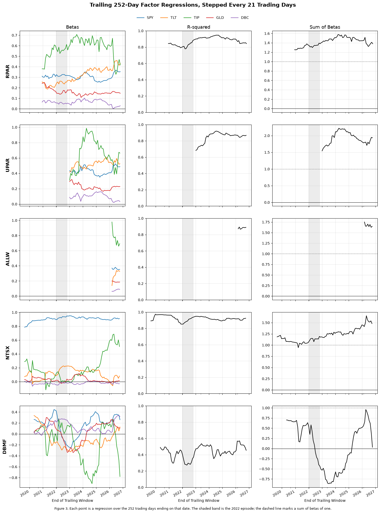

### Reading Figure 3

*Layout.* One row per fund, three columns:

* **Betas:** colors as in the legend at the top.
* **R-squared:** the share of daily variance the five factors explain, from 0 to 1.
* **Sum of betas:** the dashed line marks 1, about one dollar of factor exposure per dollar invested. Above 1 suggests leverage.

*What a point is.* Each point is a separate regression of the fund's daily excess returns on the five factors' excess returns, over the 252 trading days ending on that date.

* **Overlap:** points are 21 days apart, so neighbors share 231 of their 252 days. That makes the lines smooth, and a jump means one 21-day block entering or leaving the window changed the fit.
* **Starts:** each fund's lines begin once it has 252 days of history. `UPAR` starts in early 2023, and `ALLW` has only a few points from 2026.
* **Axes:** each panel has its own vertical scale, so compare levels by the tick labels, not by height on the page.

*What to notice*

* **`RPAR`:** stable. `TIP` has the largest beta, R-squared stays between 0.78 and 0.95, and the sum of betas between 1.25 and 1.58, always above 1.
* **`UPAR`:** a similar mix, with a sum of betas from 1.54 to 2.22, consistent with the extra leverage.
* **`NTSX`:** a `SPY` beta near 0.9 throughout and an R-squared near 0.9. In 2025–26 its `TIP` beta climbs while its `TLT` beta falls: the regression is shifting its Treasury exposure between two correlated bond factors.
* **`DBMF`:** the opposite of stable. Betas change sign, the sum of betas swings from −0.86 to 0.96, and R-squared stays between 0.27 and 0.57. A long-short trend follower has no fixed factor mix.

**How to read the rolling fits.** Each window is the time-varying-beta regression of the CAPM lecture, $r^i_t = \alpha^i + \boldsymbol{\beta}_t^{i\prime}\boldsymbol{f}_t + \epsilon^i_t$, estimated on the trailing 252 days. $R^2$ measures how well a fixed mix of the five factors tracks the fund within that year; the betas and their sum show whether that mix stays put.

* **Stable, well-tracked exposures:** `RPAR` ($R^2$ 0.78–0.95, sum of betas 1.25–1.58), `UPAR` (0.68–0.92, 1.54–2.22) and `NTSX` (0.85–0.97, 0.94–1.65). For these, a full-sample beta is a reasonable summary, which is why 3.1 replicates them closely.
* **Unstable exposures:** `DBMF` ($R^2$ 0.27–0.57, sum of betas −0.86 to 0.96). Every beta changes sign. Its rolling $R^2$ is above its full-sample 0.16 because each year's fit can follow that year's positions, a first sign of the moving exposures 3.2 tests.
* **Too short to judge:** `ALLW` has 8 windows and `UPAR` 46, against 71 to 86 for the others, so their ranges cover far fewer market conditions.
* **A caution on the sum of betas:** it measures net fitted exposure in units of the chosen ETFs, not leverage (2.4). When two correlated factors trade off, as `TLT` and `TIP` do, the sum can move without the fund's holdings changing.

<table>
  <caption>Range of trailing 252-day betas, sum of betas and R-squared across windows</caption>
  <thead>
    <tr>
      <th>&nbsp;</th>
      <th colspan="2">SPY</th>
      <th colspan="2">TLT</th>
      <th colspan="2">TIP</th>
      <th colspan="2">GLD</th>
      <th colspan="2">DBC</th>
      <th colspan="2">Sum of Betas</th>
      <th colspan="2">R-squared</th>
      <th>Windows</th>
    </tr>
    <tr>
      <th>&nbsp;</th>
      <th>min</th>
      <th>max</th>
      <th>min</th>
      <th>max</th>
      <th>min</th>
      <th>max</th>
      <th>min</th>
      <th>max</th>
      <th>min</th>
      <th>max</th>
      <th>min</th>
      <th>max</th>
      <th>min</th>
      <th>max</th>
      <th></th>
    </tr>
  </thead>
  <tbody>
    <tr>
      <th>RPAR</th>
      <td>0.25</td>
      <td>0.37</td>
      <td>0.19</td>
      <td>0.46</td>
      <td>0.33</td>
      <td>0.71</td>
      <td>0.11</td>
      <td>0.25</td>
      <td>0.00</td>
      <td>0.10</td>
      <td>1.25</td>
      <td>1.58</td>
      <td>0.78</td>
      <td>0.95</td>
      <td>71</td>
    </tr>
    <tr>
      <th>UPAR</th>
      <td>0.35</td>
      <td>0.52</td>
      <td>0.42</td>
      <td>0.61</td>
      <td>0.31</td>
      <td>0.99</td>
      <td>0.17</td>
      <td>0.32</td>
      <td>0.02</td>
      <td>0.16</td>
      <td>1.54</td>
      <td>2.22</td>
      <td>0.68</td>
      <td>0.92</td>
      <td>46</td>
    </tr>
    <tr>
      <th>ALLW</th>
      <td>0.35</td>
      <td>0.38</td>
      <td>0.14</td>
      <td>0.34</td>
      <td>0.66</td>
      <td>0.98</td>
      <td>0.18</td>
      <td>0.20</td>
      <td>0.06</td>
      <td>0.09</td>
      <td>1.63</td>
      <td>1.75</td>
      <td>0.87</td>
      <td>0.89</td>
      <td>8</td>
    </tr>
    <tr>
      <th>NTSX</th>
      <td>0.79</td>
      <td>0.95</td>
      <td>-0.06</td>
      <td>0.23</td>
      <td>-0.12</td>
      <td>0.69</td>
      <td>-0.03</td>
      <td>0.12</td>
      <td>-0.07</td>
      <td>0.01</td>
      <td>0.94</td>
      <td>1.65</td>
      <td>0.85</td>
      <td>0.97</td>
      <td>86</td>
    </tr>
    <tr>
      <th>DBMF</th>
      <td>-0.26</td>
      <td>0.45</td>
      <td>-0.33</td>
      <td>0.34</td>
      <td>-0.91</td>
      <td>0.28</td>
      <td>-0.34</td>
      <td>0.30</td>
      <td>-0.03</td>
      <td>0.34</td>
      <td>-0.86</td>
      <td>0.96</td>
      <td>0.27</td>
      <td>0.57</td>
      <td>78</td>
    </tr>
  </tbody>
</table>

**Notes on the rolling regressions:**

* **`RPAR`:** Factor exposures drift over time but remain relatively stable, with the sum of betas consistently above one (1.25–1.58) and $R^2$ ranging from 0.78 to 0.95. Within its fixed-income exposures, `TLT` and `TIP` betas move in opposite directions during parts of 2026. Given their correlation of approximately 0.70, this may reflect the regression reallocating explanatory power between correlated factors rather than substantial changes in the underlying holdings.

* **`UPAR`:** `UPAR` exhibits the highest aggregate factor exposure, with the sum of betas ranging from 1.54 to 2.22, consistent with its more leveraged risk-parity strategy. Its $R^2$ increases from approximately 0.68 in the earliest window to 0.84–0.87 in later windows, suggesting that the five-factor model explains its returns more effectively over time. However, its relatively large variation in `TIP` exposure (0.31–0.99) indicates that its factor sensitivities are not constant.

* **`NTSX`:** `NTSX` maintains the most stable equity exposure, with `SPY` beta ranging from 0.79 to 0.95 and consistently high $R^2$ (0.85–0.97). However, its fixed-income sensitivities shift substantially, particularly as `TIP` beta rises to 0.69 while `TLT` exposure remains near zero in later windows. This may reflect differences between the duration profile of `NTSX`'s Treasury futures and the longer-duration `TLT` benchmark, as well as overlapping explanatory power between Treasury factors. Its sum of betas consequently varies from 0.94 to 1.65.

* **`DBMF`:** `DBMF` exhibits the greatest instability in factor exposures, with every beta changing sign across rolling windows and the sum of betas ranging from −0.86 to 0.96. Its rolling $R^2$ (0.27–0.57) is substantially higher than its full-sample $R^2$ of approximately 0.16, suggesting that the factors explain its returns better over shorter horizons than with fixed full-sample coefficients. This is consistent with `DBMF`'s dynamic managed-futures strategy, where changing long and short positions make a static factor decomposition less effective.

* **`ALLW`:** `ALLW` has only eight rolling windows, limiting our ability to assess the persistence of its exposures. Its `TIP` beta is relatively large (0.66–0.98), and its $R^2$ remains high (0.87–0.89), indicating a strong fit over the available period. However, its short return history makes broader conclusions about exposure stability premature.

## 2.4

> State what the sum of betas measures for these funds and how it depends on the choice in 2.1. Show the dependence for one fund by re-running 2.2 under a different menu.

<table>
  <caption>RPAR's full-life regression under four factor menus</caption>
  <thead>
    <tr>
      <th>&nbsp;</th>
      <th>&nbsp;</th>
      <th>SPY</th>
      <th>TLT</th>
      <th>IEF</th>
      <th>TIP</th>
      <th>GLD</th>
      <th>DBC</th>
      <th>Sum of Betas</th>
      <th>Sum of Beta x Factor Vol</th>
      <th>Annualized Intercept</th>
      <th>Alpha t-stat</th>
      <th>R-squared</th>
      <th>Annualized Tracking Error</th>
    </tr>
    <tr>
      <th>Frequency</th>
      <th>Menu</th>
      <th>&nbsp;</th>
      <th>&nbsp;</th>
      <th>&nbsp;</th>
      <th>&nbsp;</th>
      <th>&nbsp;</th>
      <th>&nbsp;</th>
      <th>&nbsp;</th>
      <th>&nbsp;</th>
      <th>&nbsp;</th>
      <th>&nbsp;</th>
      <th>&nbsp;</th>
      <th>&nbsp;</th>
    </tr>
  </thead>
  <tbody>
    <tr>
      <th rowspan="4">Daily</th>
      <th>Chosen (SPY, TLT, TIP, GLD, DBC)</th>
      <td>0.33</td>
      <td>0.30</td>
      <td>—</td>
      <td>0.54</td>
      <td>0.17</td>
      <td>0.05</td>
      <td>1.39</td>
      <td>18.99%</td>
      <td>-3.55%</td>
      <td>-2.01</td>
      <td>0.86</td>
      <td>4.61%</td>
    </tr>
    <tr>
      <th>IEF in place of TLT</th>
      <td>0.31</td>
      <td>—</td>
      <td>0.56</td>
      <td>0.63</td>
      <td>0.16</td>
      <td>0.04</td>
      <td>1.70</td>
      <td>18.01%</td>
      <td>-3.33%</td>
      <td>-1.72</td>
      <td>0.84</td>
      <td>5.03%</td>
    </tr>
    <tr>
      <th>Both Treasuries</th>
      <td>0.33</td>
      <td>0.30</td>
      <td>-0.00</td>
      <td>0.54</td>
      <td>0.17</td>
      <td>0.05</td>
      <td>1.39</td>
      <td>18.99%</td>
      <td>-3.55%</td>
      <td>-2.01</td>
      <td>0.86</td>
      <td>4.61%</td>
    </tr>
    <tr>
      <th>Without TIP</th>
      <td>0.35</td>
      <td>0.46</td>
      <td>—</td>
      <td>—</td>
      <td>0.18</td>
      <td>0.09</td>
      <td>1.08</td>
      <td>19.53%</td>
      <td>-3.72%</td>
      <td>-1.90</td>
      <td>0.83</td>
      <td>5.11%</td>
    </tr>
    <tr>
      <th rowspan="4">Monthly</th>
      <th>Chosen (SPY, TLT, TIP, GLD, DBC)</th>
      <td>0.31</td>
      <td>0.39</td>
      <td>—</td>
      <td>0.55</td>
      <td>0.17</td>
      <td>0.10</td>
      <td>1.53</td>
      <td>18.92%</td>
      <td>-3.00%</td>
      <td>-2.30</td>
      <td>0.95</td>
      <td>2.98%</td>
    </tr>
    <tr>
      <th>IEF in place of TLT</th>
      <td>0.35</td>
      <td>—</td>
      <td>0.77</td>
      <td>0.42</td>
      <td>0.18</td>
      <td>0.09</td>
      <td>1.81</td>
      <td>18.52%</td>
      <td>-3.81%</td>
      <td>-2.40</td>
      <td>0.93</td>
      <td>3.63%</td>
    </tr>
    <tr>
      <th>Both Treasuries</th>
      <td>0.31</td>
      <td>0.41</td>
      <td>-0.04</td>
      <td>0.56</td>
      <td>0.17</td>
      <td>0.10</td>
      <td>1.52</td>
      <td>18.88%</td>
      <td>-2.98%</td>
      <td>-2.26</td>
      <td>0.95</td>
      <td>2.98%</td>
    </tr>
    <tr>
      <th>Without TIP</th>
      <td>0.39</td>
      <td>0.52</td>
      <td>—</td>
      <td>—</td>
      <td>0.20</td>
      <td>0.12</td>
      <td>1.22</td>
      <td>19.61%</td>
      <td>-4.07%</td>
      <td>-2.79</td>
      <td>0.94</td>
      <td>3.41%</td>
    </tr>
  </tbody>
</table>

**What the sum of betas measures**

Since each regression uses excess returns over `SHV`, the factor betas represent the fitted dollar exposure to each factor ETF per dollar of fund NAV, assuming the remaining position is financed through the cash benchmark. The sum of betas therefore measures aggregate **net fitted factor exposure**, rather than actual gross leverage.

For example, `RPAR` has a sum of betas of 1.39 daily (1.53 monthly), implying approximately \$1.39 of net factor exposure per dollar of NAV under the chosen factor menu. `UPAR` has a larger sum of 1.76 daily (2.04 monthly), consistent with its more leveraged strategy. Conversely, `DBMF` has a daily sum near zero (0.00), but this does not imply an absence of exposure: positive and negative factor sensitivities can offset, consistent with its rolling sum ranging from −0.86 to 0.96 in Section 2.3.

**Dependence on factor selection (Question 2.1)**

The sum of betas depends on the factor ETFs used because each beta measures exposure in units of its corresponding ETF. A less volatile ETF generally requires a larger beta to capture a comparable return sensitivity. Re-estimating `RPAR` under four factor menus illustrates this dependence:

- **Replacing `TLT` with `IEF`:** The daily Treasury beta increases from 0.30 to 0.56, while the sum of betas rises from 1.39 to 1.70 (1.53 to 1.81 monthly). Because `IEF` has lower duration and volatility than `TLT`, a larger beta is needed to capture comparable interest-rate sensitivity.
- **Excluding `TIP`:** The daily `TLT` beta increases from 0.30 to 0.46 as some previously explained variation is absorbed by the remaining factors. However, the sum of betas falls from 1.39 to 1.08 (1.53 to 1.22 monthly), demonstrating that the aggregate beta depends on how the underlying exposures are represented.
- **Including both `TLT` and `IEF`:** For `RPAR`, the additional `IEF` beta is approximately zero, leaving the sum of betas and $R^2$ nearly unchanged. However, the earlier results for `DBMF` show that including both can produce offsetting Treasury betas and materially alter the sum, illustrating the potential instability introduced by correlated regressors.

Despite these differences, the overall regression fit changes relatively little. Across the four menus, `RPAR`'s daily sum of betas ranges from 1.08 to 1.70, while $R^2$ remains between 0.83 and 0.86. Similarly, the sum of beta-weighted factor volatilities stays relatively stable at approximately 18.0%–19.5%, suggesting that the underlying fitted risk exposure is less sensitive to factor selection than the unweighted sum of betas.

**Overall, the sum of betas is useful for comparing fitted exposures under a common factor specification, but it should not be interpreted as a direct measure of a fund's actual leverage.** For example, `NTSX` targets 150% notional exposure (90% equities and 60% Treasury futures), yet its fitted sum is 1.18 using `TLT` and 1.36 using `IEF`. This difference reflects the choice of factor proxies rather than necessarily a change in the fund's underlying positions.

# 3. Replication

## 3.1

> Replicate each fund out of sample in the ProShares manner: fit on a trailing 252-day window, apply the fit to the next 21 trading days, roll forward. Build two replicas: one fitted with an intercept, which the replica keeps, and one fitted without an intercept. For each fund and each replica report
>
> * the out-of-sample correlation and tracking error
> * the annualized mean of the target beside the replica's

<table>
  <caption>Out-of-sample replication on SPY, TLT, TIP, GLD and DBC, daily excess returns; means and tracking error annualized</caption>
  <thead>
    <tr>
      <th>&nbsp;</th>
      <th>&nbsp;</th>
      <th>Start</th>
      <th>Days</th>
      <th>Correlation</th>
      <th>Tracking Error</th>
      <th>Target Mean</th>
      <th>Replica Mean</th>
      <th>Mean Gap</th>
    </tr>
    <tr>
      <th>Fund</th>
      <th>Replica</th>
      <th>&nbsp;</th>
      <th>&nbsp;</th>
      <th>&nbsp;</th>
      <th>&nbsp;</th>
      <th>&nbsp;</th>
      <th>&nbsp;</th>
      <th>&nbsp;</th>
    </tr>
  </thead>
  <tbody>
    <tr>
      <th rowspan="2">RPAR</th>
      <th>With intercept</th>
      <td>2020-12-15</td>
      <td>1,471</td>
      <td>0.94</td>
      <td>4.19%</td>
      <td>-0.90%</td>
      <td>-0.30%</td>
      <td>-0.61%</td>
    </tr>
    <tr>
      <th>No intercept</th>
      <td>2020-12-15</td>
      <td>1,471</td>
      <td>0.94</td>
      <td>4.18%</td>
      <td>-0.90%</td>
      <td>2.31%</td>
      <td>-3.22%</td>
    </tr>
    <tr>
      <th rowspan="2">UPAR</th>
      <th>With intercept</th>
      <td>2023-01-06</td>
      <td>953</td>
      <td>0.93</td>
      <td>6.03%</td>
      <td>3.58%</td>
      <td>4.54%</td>
      <td>-0.96%</td>
    </tr>
    <tr>
      <th>No intercept</th>
      <td>2023-01-06</td>
      <td>953</td>
      <td>0.93</td>
      <td>6.02%</td>
      <td>3.58%</td>
      <td>7.96%</td>
      <td>-4.38%</td>
    </tr>
    <tr>
      <th rowspan="2">ALLW</th>
      <th>With intercept</th>
      <td>2026-03-10</td>
      <td>159</td>
      <td>0.95</td>
      <td>3.76%</td>
      <td>-6.20%</td>
      <td>-5.21%</td>
      <td>-0.99%</td>
    </tr>
    <tr>
      <th>No intercept</th>
      <td>2026-03-10</td>
      <td>159</td>
      <td>0.95</td>
      <td>3.75%</td>
      <td>-6.20%</td>
      <td>-6.73%</td>
      <td>0.53%</td>
    </tr>
    <tr>
      <th rowspan="2">NTSX</th>
      <th>With intercept</th>
      <td>2019-08-26</td>
      <td>1,801</td>
      <td>0.96</td>
      <td>5.02%</td>
      <td>11.31%</td>
      <td>11.76%</td>
      <td>-0.45%</td>
    </tr>
    <tr>
      <th>No intercept</th>
      <td>2019-08-26</td>
      <td>1,801</td>
      <td>0.96</td>
      <td>5.02%</td>
      <td>11.31%</td>
      <td>11.96%</td>
      <td>-0.65%</td>
    </tr>
    <tr>
      <th rowspan="2">DBMF</th>
      <th>With intercept</th>
      <td>2020-05-08</td>
      <td>1,624</td>
      <td>0.52</td>
      <td>10.67%</td>
      <td>6.90%</td>
      <td>0.18%</td>
      <td>6.72%</td>
    </tr>
    <tr>
      <th>No intercept</th>
      <td>2020-05-08</td>
      <td>1,624</td>
      <td>0.52</td>
      <td>10.65%</td>
      <td>6.90%</td>
      <td>5.67%</td>
      <td>1.23%</td>
    </tr>
  </tbody>
</table>

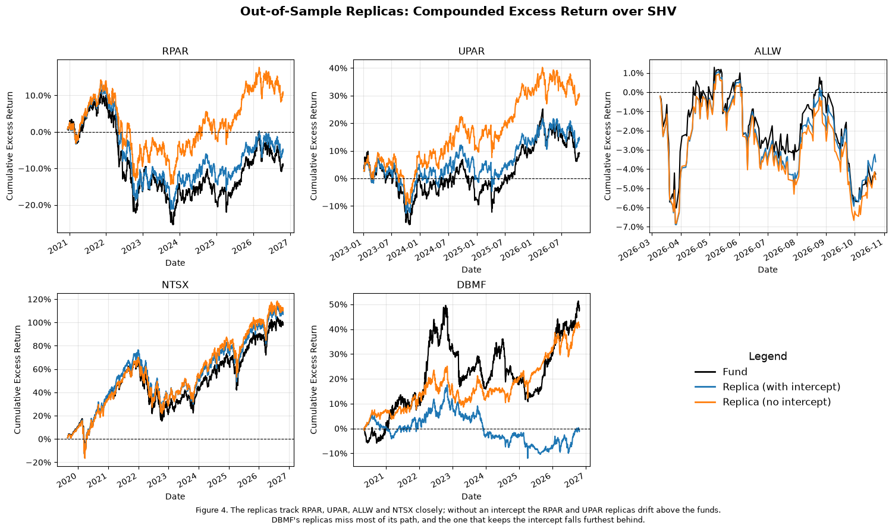

### Reading Figure 4

*What is plotted.* Each panel shows a fund's compounded excess return over `SHV` (black) and its two out-of-sample replicas. A replica is fitted on the trailing 252 days, applied unchanged to the next 21, and then refitted.

* **Blue:** the replica that keeps its fitted intercept.
* **Orange:** the replica fitted without one.
* **Panels differ:** each starts once its fund has 252 days of history (`RPAR` 2020-12-15, `UPAR` 2023-01-06, `ALLW` 2026-03-10), so the periods and vertical scales differ.

*How to read it.* Look at two things separately.

* **Whether the wiggles match.** That is correlation, how well the replica tracks day to day.
* **Whether the lines drift apart.** That is the difference in average return.

A replica can track closely and still drift, which is the main pattern here.

*What to notice*

* **`RPAR`:** the wiggles match (correlation 0.94), but the no-intercept replica drifts well above the fund. Over this window it earned 2.3% a year against `RPAR`'s −0.9%. The with-intercept replica drifts less because it carries the fund's estimated shortfall forward.
* **`UPAR`:** the same pattern.
* **`NTSX`:** close on both counts.
* **`ALLW`:** covers only about seven months, hence the narrow scale.
* **`DBMF`:** correlation only 0.52. Neither replica follows the 2022 surge, because the fund's positions changed faster than a 252-day fit can follow.

**Notes on the replicas**

* **The intercept moves the mean, not the fit.** The fitted intercept is constant within each 21-day block, so it shifts the replica's mean but adds almost no day-to-day variance. Correlations are identical to two decimals for both replicas of every fund, and tracking errors differ by at most 0.02 percentage points.

* **`RPAR`, `UPAR`, `ALLW` and `NTSX` replicate closely.** Out-of-sample correlations are 0.93 to 0.96 and tracking errors 3.8% to 6.0% a year. `NTSX` has the highest correlation (0.96); its 5.0% tracking error reflects its higher volatility.

* **For `RPAR` and `UPAR`, the kept intercept captures a persistent shortfall.** Without an intercept, the `RPAR` replica earns 2.31% a year against the fund's −0.90%, a gap of −3.22%, close to the −3.55% full-sample intercept in 2.2. Keeping the trailing intercept narrows the gap to −0.61%. `UPAR` behaves the same way: −4.38% without the intercept, −0.96% with it. The funds have lagged their factor exposures steadily enough that last year's intercept forecasts next month's.

* **For `DBMF`, the intercept does the opposite.** Its correlation is only 0.52 and its tracking error 10.7%. The replica that keeps the intercept earns 0.18% a year against the fund's 6.90%, while the replica without it comes within 1.23%. `DBMF`'s trailing intercept does not persist: it absorbs returns from exposures that have since turned (2.3) and reverses out of sample.

* **`ALLW`'s replica covers only 159 days, from 2026-03-10**, after the first 252-day fit. Its numbers are indicative only.

## 3.2

> Which of the five funds does a fixed mix of your factor ETFs replicate out of sample, and which does it not? For the fund it replicates worst, investigate whether the shortfall comes from exposures that move, from factors your menu lacks, or from both. Say what you tested and what it showed.

<table>
  <caption>Why DBMF does not replicate: fit with moving exposures and with added factors, RPAR as a control</caption>
  <thead>
    <tr>
      <th>&nbsp;</th>
      <th>DBMF</th>
      <th>RPAR</th>
    </tr>
  </thead>
  <tbody>
    <tr>
      <th>Full-sample R-squared: Menu</th>
      <td>0.16</td>
      <td>0.86</td>
    </tr>
    <tr>
      <th>Full-sample R-squared: Menu + IEF</th>
      <td>0.24</td>
      <td>0.86</td>
    </tr>
    <tr>
      <th>Full-sample R-squared: Menu + IEF + trend</th>
      <td>0.41</td>
      <td>0.87</td>
    </tr>
    <tr>
      <th>Median 63-day block adj. R-squared: Menu</th>
      <td>0.58</td>
      <td>0.86</td>
    </tr>
    <tr>
      <th>Median 63-day block adj. R-squared: Menu + IEF</th>
      <td>0.58</td>
      <td>0.87</td>
    </tr>
    <tr>
      <th>OOS correlation: Menu, 252-day fit, 21-day hold</th>
      <td>0.52</td>
      <td>0.94</td>
    </tr>
    <tr>
      <th>OOS correlation: Menu, 63-day fit, 5-day hold</th>
      <td>0.64</td>
      <td>0.93</td>
    </tr>
    <tr>
      <th>OOS correlation: Menu + IEF, 252-day fit, 21-day hold</th>
      <td>0.55</td>
      <td>0.94</td>
    </tr>
    <tr>
      <th>OOS correlation: Menu + IEF + trend, 252-day fit, 21-day hold</th>
      <td>0.61</td>
      <td>0.94</td>
    </tr>
  </tbody>
</table>

**Which funds the factor menu replicates**

A rolling mix of the menu ETFs replicates `RPAR`, `UPAR`, `ALLW`, and `NTSX` out of sample: correlations of 0.93 to 0.96 and tracking errors of 3.8% to 6.0% a year (3.1, Figure 4). The factor menu is fixed, but the betas are re-estimated every 21 trading days using the previous 252 observations. For `RPAR` and `UPAR`, the replicas track the funds' movements but not their average returns: without an intercept, they outperform the funds by 3.2% and 4.4% annually. The same approach does not replicate `DBMF` well: correlation is 0.52, tracking error is 10.7%, and the replicas miss much of its 2022 gain.

**What we tested for `DBMF`, with `RPAR` as a control**

- **Moving exposures.** We let the betas change more frequently. Fitting the menu separately in each non-overlapping 63-day block, an in-sample upper bound for a mix that changes every quarter, raises `DBMF`'s median adjusted $R^2$ from 0.16 to 0.58. Out of sample, refitting on 63 days and holding for 5 raises the correlation from 0.52 to 0.64. Neither helps `RPAR` materially (block $R^2$: 0.86, the same as the fixed mix; out-of-sample correlation: 0.93 against 0.94). This suggests that changing exposures explain an important part of `DBMF`'s replication difficulty.

- **Factors the menu lacks.** Even with exposures free to change every quarter, approximately 42% of `DBMF`'s daily variance remains unexplained, compared with 14% for `RPAR`. Adding `IEF`, the Treasury ETF excluded in 2.1, raises `DBMF`'s full-sample $R^2$ from 0.16 to 0.24 and correlation from 0.52 to 0.55, but adds little explanatory power within 63-day blocks (0.58). This is consistent with the missing exposure being more than another Treasury-duration proxy. Potential omitted markets include currencies, non-U.S. equity indices, short-rate futures, and individual commodity contracts.

- **A trend rule on the same ETFs.** Two time-series momentum factors built from the menu plus `IEF` (each asset held long or short according to the sign of its trailing 12- or 3-month excess return, scaled to 10% volatility using only information through the previous close) raise the full-sample $R^2$ to 0.41 and the out-of-sample correlation to 0.61. These factors add a dynamic trading rule rather than new underlying asset classes, supporting the hypothesis that changing long/short exposures help explain `DBMF`.

**Conclusion: both, with moving exposures playing a larger role.** Allowing time-varying betas explains substantially more of `DBMF`'s returns than a static regression (median adjusted $R^2$ of 0.58 versus full-sample $R^2$ of 0.16). However, even the flexible quarterly fit leaves approximately 42% unexplained. That residual may reflect omitted markets, nonlinear exposures, or other fund-specific effects. Because the 63-day block fit is in sample and the trend specifications are evaluated on historical data, these results indicate possible explanations rather than a fully replicable trading strategy.

**The table.** *Why `DBMF` does not replicate* holds every test above, for both funds, so each number in the summary can be traced to its source. `RPAR`'s column is the control: the tests that help `DBMF` should leave a stable fund unchanged.

## 3.3

> For `RPAR`, compute by calendar year the sum of its daily excess returns minus the sum of a replica's, where the replica applies your full-sample daily betas to the factors with no intercept.
>
> * Report the gap by year.
> * Propose at least two distinct explanations for its sign and persistence, and state what evidence, in this file or obtainable from the issuer, would separate them.

```text
Full-sample daily betas, no intercept: SPY 0.33, TLT 0.30, TIP 0.54, GLD 0.17, DBC 0.05
```

<table>
  <caption>RPAR minus its replica: sums of daily excess returns by calendar year; SPY and GLD are sums of daily excess returns</caption>
  <thead>
    <tr>
      <th>&nbsp;</th>
      <th>Days</th>
      <th>RPAR</th>
      <th>Replica</th>
      <th>Gap</th>
      <th>Gap t-stat</th>
      <th>Gap, monthly betas</th>
      <th>RPAR minus RPARTR</th>
      <th>SPY</th>
      <th>GLD</th>
    </tr>
  </thead>
  <tbody>
    <tr>
      <th>2019 (partial)</th>
      <td>11</td>
      <td>0.05%</td>
      <td>0.29%</td>
      <td>-0.25%</td>
      <td>-0.20</td>
      <td>-0.12%</td>
      <td>-0.30%</td>
      <td>1.84%</td>
      <td>2.67%</td>
    </tr>
    <tr>
      <th>2020</th>
      <td>253</td>
      <td>18.06%</td>
      <td>21.51%</td>
      <td>-3.45%</td>
      <td>-0.55</td>
      <td>-4.56%</td>
      <td>-2.11%</td>
      <td>21.70%</td>
      <td>23.27%</td>
    </tr>
    <tr>
      <th>2021</th>
      <td>252</td>
      <td>7.79%</td>
      <td>11.81%</td>
      <td>-4.02%</td>
      <td>-0.97</td>
      <td>-5.31%</td>
      <td>-1.65%</td>
      <td>26.22%</td>
      <td>-3.20%</td>
    </tr>
    <tr>
      <th>2022</th>
      <td>251</td>
      <td>-25.45%</td>
      <td>-23.33%</td>
      <td>-2.12%</td>
      <td>-0.40</td>
      <td>-0.14%</td>
      <td>0.14%</td>
      <td>-18.06%</td>
      <td>-0.55%</td>
    </tr>
    <tr>
      <th>2023</th>
      <td>250</td>
      <td>1.78%</td>
      <td>6.41%</td>
      <td>-4.62%</td>
      <td>-1.19</td>
      <td>-3.79%</td>
      <td>-0.63%</td>
      <td>19.20%</td>
      <td>7.92%</td>
    </tr>
    <tr>
      <th>2024</th>
      <td>252</td>
      <td>-4.38%</td>
      <td>3.56%</td>
      <td>-7.94%</td>
      <td>-2.34</td>
      <td>-6.53%</td>
      <td>-0.54%</td>
      <td>18.02%</td>
      <td>19.77%</td>
    </tr>
    <tr>
      <th>2025</th>
      <td>250</td>
      <td>12.91%</td>
      <td>14.32%</td>
      <td>-1.41%</td>
      <td>-0.38</td>
      <td>-1.72%</td>
      <td>-0.72%</td>
      <td>14.05%</td>
      <td>47.15%</td>
    </tr>
    <tr>
      <th>2026 (partial)</th>
      <td>204</td>
      <td>0.22%</td>
      <td>0.69%</td>
      <td>-0.46%</td>
      <td>-0.11</td>
      <td>-1.99%</td>
      <td>-0.14%</td>
      <td>9.47%</td>
      <td>-6.88%</td>
    </tr>
    <tr>
      <th>Total</th>
      <td>1,723</td>
      <td>10.99%</td>
      <td>35.27%</td>
      <td>-24.28%</td>
      <td>-2.01</td>
      <td>-24.15%</td>
      <td>-5.94%</td>
      <td>92.44%</td>
      <td>90.15%</td>
    </tr>
  </tbody>
</table>

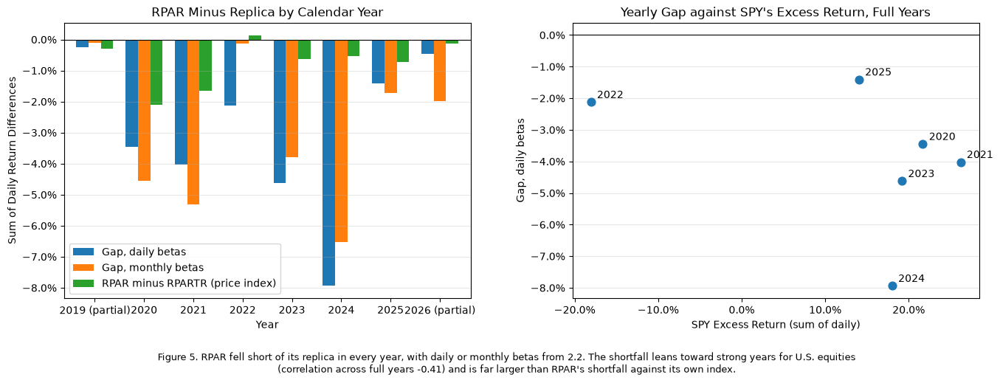

### Reading Figure 5

*Left: the gap by calendar year.* Each bar is the sum, over that year's trading days, of `RPAR`'s daily excess return minus its replica's. A negative bar means `RPAR` earned less. The replica applies `RPAR`'s full-sample betas from 2.2 to the factors, leaving out the intercept. 2019 and 2026 are partial years, so their bars are small partly because they are short.

* **Blue:** the replica built from daily betas. Negative in every year, from −1.4% (2025) to −7.9% (2024).
* **Orange:** the same replica built from the 2.2 monthly betas. A check that daily timing noise is not driving the result. Negative in every year too, with 2022 close to zero (−0.1%).
* **Green:** `RPAR` minus its own index, `RPARTR`. Much smaller (−5.9% in total, against −24.3% for blue), so most of the shortfall is against the factors, not against the index.

*Right: does the gap depend on U.S. equities?* Each point is a full calendar year, with `SPY`'s excess return across and the daily-beta gap up.

* A downward slope would mean bigger shortfalls in strong `SPY` years, which fits the explanation that `RPAR` holds global rather than U.S. equities.
* The correlation is −0.41, but it rests on six points. 2025 (a strong year with a small gap) and 2024 (a similar year with the largest gap) show how loose the relationship is.

**The gap by year**

`RPAR` fell short of the replica in every calendar year, from −1.4% (2025) to −7.9% (2024), for a total of −24.3% over its life ($t$ = −2.01), or about −3.5% a year. The sign is persistent, but no single year is significant except 2024 ($t$ = −2.34). The replica uses the 2.2 betas, which were fitted with an intercept, and leaves the intercept out. The 2.2 residuals sum to zero over the sample, so this total is exactly the 2.2 intercept (−3.55% a year) spread across the years.

**Explanation 1: the funds hold different assets from the factor ETFs (basis).**

`RPAR`'s sleeves are not `SPY`, `GLD` and `DBC`. Its equity sleeve is global (U.S., developed ex-U.S. and emerging markets), its commodity sleeve includes commodity-producer equities and gold, and its Treasuries are futures. The regression projects these onto the menu, so the replica earns the menu's returns. U.S. large caps outran global equities over most of this period, which would make a replica that holds `SPY` earn more than `RPAR`'s equity sleeve, with the gap widest when U.S. equities lead. The data lean that way but only weakly: across the six full years the gap correlates −0.41 with `SPY`'s excess return, and 2022, when `SPY` fell 18%, had the second-smallest gap (−2.1%, after 2025's −1.4%).

**Explanation 2: implementation costs.**

These include the 0.52% expense ratio, trading costs from rebalancing and rolling futures, and financing on Treasury-futures leverage above the `SHV` rate. Costs predict a fairly steady drag every year, unrelated to how markets moved. They would show up as `RPAR` lagging its own index, not only the replica.

**What this file already rules out: the gap is not a daily-timing artifact.** Daily betas are attenuated by asynchronous closes (1.2, 2.2). Building the replica from the full-sample monthly betas in 2.2 instead leaves the gap negative in all 8 years (total −24.2% against −24.3%), with 2022 the smallest full year at −0.1%.

**What would separate explanations 1 and 2**

* **The fund against its own index (in this file, with a caveat).** `RPAR`'s return minus `RPARTR`'s splits the gap into implementation (fund against index) and design or basis (index against replica). `RPAR` lagged `RPARTR` by −5.9% in total, about −0.9% a year, negative in 7 of 8 years, against the −3.5% a year it lagged the replica. That points to basis for most of the gap. But `RPARTR` is a price index without reinvested income, so the fund's true shortfall to its index is larger by the index's income. The total-return version of the index, from the issuer, settles how much is implementation.
* **Sleeve holdings and their benchmarks (from the issuer).** Holdings by sleeve, plus returns on the matching global equity, emerging-market and commodity-equity indexes, would show directly whether the yearly gap tracks the return of `RPAR`'s equity and commodity sleeves minus `SPY` and `DBC`. If it is basis, the gap should regress on those return differences with slopes near the sleeve weights and leave little behind. If it is cost, the residual stays a steady negative of about the size of the fund-against-index shortfall.

# 4. Before It Existed

Cash is `SHV` throughout. Choose and state the estimation window and covariance estimator.

**The table.** Beyond the gap itself, the yearly table adds three sets of columns, one for each check in this answer:

* **The gap with monthly betas:** rules out daily timing.
* **`RPAR` minus `RPARTR`:** splits the gap into fund against index and index against replica.
* **`SPY`'s and `GLD`'s yearly excess returns:** the market moves that the basis explanation says the gap should follow.

## 4.1

> Build three portfolios of `SPY`, `TLT`, `TIP`, `GLD` and `DBC`: inverse variance, inverse volatility, and equal risk contribution. Re-estimate the weights at each month-end from trailing data and hold them through the next month. The backtest begins on 2008-02-01.
>
> * State the estimation window and the covariance estimator.
> * For the ERC portfolio, verify at one date that the five risk contributions are equal, and plot its weights through time.
>
> #### Risk Contributions
>
> For weights $\boldsymbol{w}$ on $n$ assets with covariance $\Sigma$, asset $i$'s risk contribution is $\text{RC}_i = w_i\,(\Sigma\boldsymbol{w})_i$, and the contributions sum to the portfolio variance $\boldsymbol{w}'\Sigma\boldsymbol{w}$. Inverse variance sets $w_i \propto 1/\sigma_i^2$, the rule the Harvard case calls risk parity. Inverse volatility sets $w_i \propto 1/\sigma_i$. Equal risk contribution (ERC) sets every $\text{RC}_i$ equal and is solved numerically. When every pair of assets has the same correlation, ERC coincides with inverse volatility; otherwise the three rules differ.

```text
Rebalances: 225, first set at 2008-01-31, last at 2026-09-30
Backtest returns: 2008-02-01 to 2026-10-23
```

<table>
  <caption>ERC risk contributions at 2020-02-28, annualized trailing 252-day covariance</caption>
  <thead>
    <tr>
      <th>&nbsp;</th>
      <th>Weight</th>
      <th>Volatility</th>
      <th>Risk Contribution</th>
      <th>Share of Variance</th>
    </tr>
  </thead>
  <tbody>
    <tr>
      <th>SPY</th>
      <td>20.13%</td>
      <td>13.58%</td>
      <td>0.000475</td>
      <td>20.00%</td>
    </tr>
    <tr>
      <th>TLT</th>
      <td>16.70%</td>
      <td>12.63%</td>
      <td>0.000475</td>
      <td>20.00%</td>
    </tr>
    <tr>
      <th>TIP</th>
      <td>36.15%</td>
      <td>3.97%</td>
      <td>0.000475</td>
      <td>20.00%</td>
    </tr>
    <tr>
      <th>GLD</th>
      <td>13.18%</td>
      <td>12.48%</td>
      <td>0.000475</td>
      <td>20.00%</td>
    </tr>
    <tr>
      <th>DBC</th>
      <td>13.84%</td>
      <td>14.04%</td>
      <td>0.000475</td>
      <td>20.00%</td>
    </tr>
  </tbody>
</table>

```text
Portfolio variance 0.002373 (volatility 4.87%); largest minus smallest contribution 1.3e-10
```

<table>
  <caption>Weights set by each rule at 2020-02-28</caption>
  <thead>
    <tr>
      <th>&nbsp;</th>
      <th>Inverse Variance</th>
      <th>Inverse Volatility</th>
      <th>ERC</th>
    </tr>
  </thead>
  <tbody>
    <tr>
      <th>SPY</th>
      <td>6.26%</td>
      <td>13.24%</td>
      <td>20.13%</td>
    </tr>
    <tr>
      <th>TLT</th>
      <td>7.23%</td>
      <td>14.24%</td>
      <td>16.70%</td>
    </tr>
    <tr>
      <th>TIP</th>
      <td>73.23%</td>
      <td>45.30%</td>
      <td>36.15%</td>
    </tr>
    <tr>
      <th>GLD</th>
      <td>7.41%</td>
      <td>14.41%</td>
      <td>13.18%</td>
    </tr>
    <tr>
      <th>DBC</th>
      <td>5.86%</td>
      <td>12.81%</td>
      <td>13.84%</td>
    </tr>
  </tbody>
</table>

<table>
  <caption>ERC convergence at every month-end, 2008-01-31 to 2026-09-30</caption>
  <thead>
    <tr>
      <th>&nbsp;</th>
      <th>ERC convergence</th>
    </tr>
  </thead>
  <tbody>
    <tr>
      <th>Rebalance dates</th>
      <td>225</td>
    </tr>
    <tr>
      <th>Optimizer reports success</th>
      <td>221</td>
    </tr>
    <tr>
      <th>Largest share deviation from 20%, any asset, any date</th>
      <td>3.4e-08</td>
    </tr>
    <tr>
      <th>Mean across dates of each date's largest deviation</th>
      <td>1.6e-09</td>
    </tr>
    <tr>
      <th>Dates with a deviation above 1e-06</th>
      <td>0</td>
    </tr>
    <tr>
      <th>Largest difference between re-solved and stored weights</th>
      <td>0.0e+00</td>
    </tr>
  </tbody>
</table>

<table>
  <caption>Rebalance dates where the optimizer did not report success</caption>
  <thead>
    <tr>
      <th>&nbsp;</th>
      <th>Optimizer Success</th>
      <th>Message</th>
      <th>Iterations</th>
      <th>Max Share Deviation</th>
      <th>Max Weight Difference</th>
    </tr>
  </thead>
  <tbody>
    <tr>
      <th>2012-07-31 00:00:00</th>
      <td>False</td>
      <td>ABNORMAL: </td>
      <td>15</td>
      <td>9.0e-10</td>
      <td>0.0e+00</td>
    </tr>
    <tr>
      <th>2013-06-28 00:00:00</th>
      <td>False</td>
      <td>ABNORMAL: </td>
      <td>14</td>
      <td>4.3e-09</td>
      <td>0.0e+00</td>
    </tr>
    <tr>
      <th>2018-02-28 00:00:00</th>
      <td>False</td>
      <td>ABNORMAL: </td>
      <td>12</td>
      <td>3.5e-09</td>
      <td>0.0e+00</td>
    </tr>
    <tr>
      <th>2019-12-31 00:00:00</th>
      <td>False</td>
      <td>ABNORMAL: </td>
      <td>13</td>
      <td>2.9e-09</td>
      <td>0.0e+00</td>
    </tr>
  </tbody>
</table>

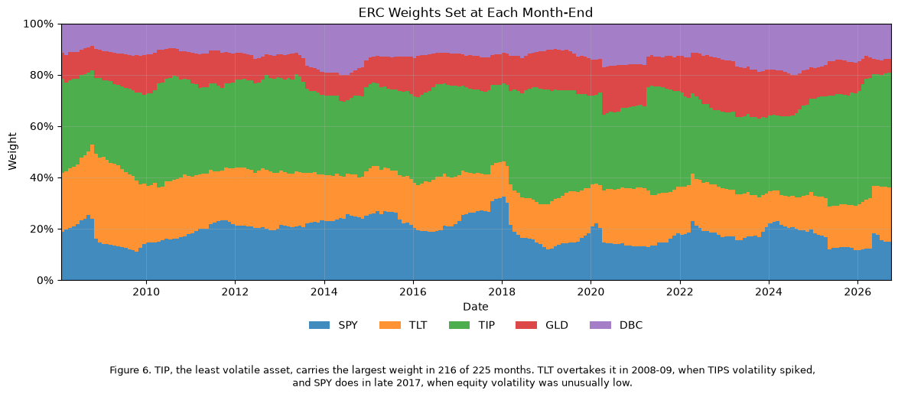

### Reading Figure 6

*What is plotted.* The ERC weights set at each month-end close, from the trailing 252-day covariance, and held through the next month.

* **Stacking:** the five bands always add up to 100%.
* **Reading a weight:** an asset's weight is the thickness of its band, not the height of its top edge. Only `SPY`, at the bottom, can be read straight off the axis.

*What to notice*

* **`TIP` (green):** the thickest band in 216 of 225 months. ERC gives the most weight to the least volatile asset, so that each asset adds the same risk.
* **When the order changes:** `TLT` (orange) widens past `TIP` in 2008–09, when TIPS volatility spiked. `SPY` (blue) is thickest at the end of 2017, when equity volatility was unusually low.
* **Gradual shifts:** most other changes are slow, because consecutive 252-day windows share eleven of their twelve months of data.

**Estimation window and covariance estimator**

* **Window:** the trailing 252 trading days (one year) of daily returns, ending at the month-end close at which the weights are set. A year is long enough to estimate a 5-by-5 covariance matrix from 252 observations, and short enough for the weights to respond to changes in volatility.
* **Estimator:** the equally weighted sample covariance matrix, annualized by 252. It is estimated on total returns rather than excess returns over `SHV`. `SHV`'s daily variance is negligible, so the two matrices are practically identical, and total returns let the window start before `SHV`'s January 2007 launch: the first full window ends 2007-02-28, the earliest start used in 4.2.
* **Holding convention:** weights are set at the close of each month-end from data through that close and act from the first trading day of the next month. The positions are then held without trading, so the weights drift with returns until the next month-end. The first weights are set on 2008-01-31, so the backtest begins on 2008-02-01, with 225 rebalances through 2026-09-30.

**ERC verification**

At 2020-02-28, each asset's contribution $w_i(\Sigma\boldsymbol{w})_i$ is 0.000475, 20% of the portfolio variance of 0.002373 (4.87% volatility). The largest and smallest contributions differ by about $10^{-10}$. The three rules set different weights that day, for example 73% in `TIP` under inverse variance, 45% under inverse volatility and 36% under ERC, because the correlations are not all equal. Relative to inverse volatility, ERC cuts `TIP` (45% to 36%), whose risk largely overlaps with `TLT`'s, and raises `SPY` (13% to 20%), whose low or negative correlation with the bond ETFs makes its marginal risk smaller.

One date does not show that every monthly optimization converged, so we re-solved all 225 rebalance dates from the same trailing covariances and tested the ERC condition directly: each asset's share of portfolio variance should be 20%.

* **Largest deviation:** across every asset and date, no share differs from 20% by more than $3.4 \times 10^{-8}$, well inside a tolerance of $10^{-6}$.
* **Optimizer flags:** scipy reports success on all but a few dates. On those, the line search stops with an "ABNORMAL" message, and which dates get the flag varies between runs at machine precision. Their shares still deviate from 20% by less than $10^{-8}$: the solver stopped because it could not improve further at machine precision, not because it failed. The share test, not the flag, is what shows the weights are correct, and its result is the same in every run.
* **Reproducibility:** re-solving gives exactly the stored weights on every date.
* **4.2:** the eleven extra month-ends from 2007-02-28 used in 4.2 and 7.2 pass the same check (printed below the start-date table).

**ERC weights through time (Figure 6)**

`TIP` has the largest weight in 216 of 225 months, between 29% and 47%. `SPY` ranges from 11% to 33%, `TLT` from 12% to 34%, `GLD` from 5% to 21% and `DBC` from 9% to 20%. The weights move with relative volatility: `TLT` overtakes `TIP` in the 2008–09 crisis, when TIPS volatility spiked, and `SPY` takes the top weight in late 2017, when equity volatility was unusually low.

**The tables.**

* ***Weights set by each rule at 2020-02-28:*** shows concretely how ERC departs from inverse volatility once the correlations are unequal.
* ***The convergence summary and the dates scipy flagged:*** show that every month, not just the one checked, satisfies the ERC condition, and that the flagged dates are a reporting quirk rather than failed solutions.

## 4.2

> For the three unlevered rules, 60/40, the static four-way, `SPY` and `TLT`, report annualized mean and volatility, Sharpe ratio and maximum drawdown over the full backtest and the sub-periods before and after 2019-12-13. Also report calendar-year total returns, including 2008, 2013, 2020 and 2022.
>
> Repeat the full-backtest statistics for the ERC rule and 60/40 with the backtest started in 2007, the earliest start the ETFs and your estimation window allow. What moves?

<table>
  <caption>Unlevered rules and benchmarks; Sharpe ratios on excess returns over SHV</caption>
  <thead>
    <tr>
      <th>&nbsp;</th>
      <th>&nbsp;</th>
      <th>Annualized Mean</th>
      <th>Annualized Volatility</th>
      <th>Sharpe Ratio</th>
      <th>Max Drawdown</th>
      <th>Peak Date</th>
      <th>Trough Date</th>
      <th>Recovery Date</th>
    </tr>
    <tr>
      <th>Period</th>
      <th>Strategy</th>
      <th>&nbsp;</th>
      <th>&nbsp;</th>
      <th>&nbsp;</th>
      <th>&nbsp;</th>
      <th>&nbsp;</th>
      <th>&nbsp;</th>
      <th>&nbsp;</th>
    </tr>
  </thead>
  <tbody>
    <tr>
      <th rowspan="7">Full backtest, 2008-02-01 to 2026-10-23</th>
      <th>Inverse Variance</th>
      <td>4.16%</td>
      <td>6.32%</td>
      <td>0.44</td>
      <td>-16.63%</td>
      <td>2022-03-08</td>
      <td>2022-10-20</td>
      <td>2024-08-26</td>
    </tr>
    <tr>
      <th>Inverse Volatility</th>
      <td>5.14%</td>
      <td>7.10%</td>
      <td>0.53</td>
      <td>-17.54%</td>
      <td>2008-07-14</td>
      <td>2008-10-27</td>
      <td>2009-11-25</td>
    </tr>
    <tr>
      <th>ERC</th>
      <td>5.51%</td>
      <td>7.26%</td>
      <td>0.57</td>
      <td>-17.97%</td>
      <td>2022-03-08</td>
      <td>2022-10-20</td>
      <td>2024-07-16</td>
    </tr>
    <tr>
      <th>60/40</th>
      <td>8.86%</td>
      <td>11.34%</td>
      <td>0.66</td>
      <td>-30.80%</td>
      <td>2008-05-19</td>
      <td>2009-03-09</td>
      <td>2010-04-23</td>
    </tr>
    <tr>
      <th>static four-way</th>
      <td>7.14%</td>
      <td>10.24%</td>
      <td>0.56</td>
      <td>-27.57%</td>
      <td>2008-07-14</td>
      <td>2008-11-20</td>
      <td>2010-09-22</td>
    </tr>
    <tr>
      <th>SPY</th>
      <td>12.92%</td>
      <td>19.68%</td>
      <td>0.58</td>
      <td>-51.49%</td>
      <td>2008-05-19</td>
      <td>2009-03-09</td>
      <td>2011-04-26</td>
    </tr>
    <tr>
      <th>TLT</th>
      <td>3.41%</td>
      <td>15.23%</td>
      <td>0.13</td>
      <td>-48.35%</td>
      <td>2020-08-04</td>
      <td>2023-10-19</td>
      <td>Not recovered</td>
    </tr>
    <tr>
      <th rowspan="7">Before RPAR, to 2019-12-12</th>
      <th>Inverse Variance</th>
      <td>3.79%</td>
      <td>5.89%</td>
      <td>0.54</td>
      <td>-13.74%</td>
      <td>2008-07-10</td>
      <td>2008-10-31</td>
      <td>2009-10-19</td>
    </tr>
    <tr>
      <th>Inverse Volatility</th>
      <td>4.15%</td>
      <td>6.56%</td>
      <td>0.54</td>
      <td>-17.54%</td>
      <td>2008-07-14</td>
      <td>2008-10-27</td>
      <td>2009-11-25</td>
    </tr>
    <tr>
      <th>ERC</th>
      <td>4.74%</td>
      <td>6.60%</td>
      <td>0.62</td>
      <td>-17.84%</td>
      <td>2008-05-21</td>
      <td>2008-10-27</td>
      <td>2010-04-30</td>
    </tr>
    <tr>
      <th>60/40</th>
      <td>8.37%</td>
      <td>10.86%</td>
      <td>0.71</td>
      <td>-30.80%</td>
      <td>2008-05-19</td>
      <td>2009-03-09</td>
      <td>2010-04-23</td>
    </tr>
    <tr>
      <th>static four-way</th>
      <td>4.86%</td>
      <td>9.87%</td>
      <td>0.43</td>
      <td>-27.57%</td>
      <td>2008-07-14</td>
      <td>2008-11-20</td>
      <td>2010-09-22</td>
    </tr>
    <tr>
      <th>SPY</th>
      <td>11.01%</td>
      <td>19.56%</td>
      <td>0.53</td>
      <td>-51.49%</td>
      <td>2008-05-19</td>
      <td>2009-03-09</td>
      <td>2011-04-26</td>
    </tr>
    <tr>
      <th>TLT</th>
      <td>7.28%</td>
      <td>14.53%</td>
      <td>0.46</td>
      <td>-26.59%</td>
      <td>2008-12-30</td>
      <td>2009-06-10</td>
      <td>2011-08-18</td>
    </tr>
    <tr>
      <th rowspan="7">After RPAR, from 2019-12-13</th>
      <th>Inverse Variance</th>
      <td>4.79%</td>
      <td>7.00%</td>
      <td>0.30</td>
      <td>-16.63%</td>
      <td>2022-03-08</td>
      <td>2022-10-20</td>
      <td>2024-08-26</td>
    </tr>
    <tr>
      <th>Inverse Volatility</th>
      <td>6.84%</td>
      <td>7.94%</td>
      <td>0.52</td>
      <td>-17.46%</td>
      <td>2022-03-08</td>
      <td>2022-10-20</td>
      <td>2024-07-16</td>
    </tr>
    <tr>
      <th>ERC</th>
      <td>6.84%</td>
      <td>8.29%</td>
      <td>0.50</td>
      <td>-17.97%</td>
      <td>2022-03-08</td>
      <td>2022-10-20</td>
      <td>2024-07-16</td>
    </tr>
    <tr>
      <th>60/40</th>
      <td>9.72%</td>
      <td>12.14%</td>
      <td>0.58</td>
      <td>-21.02%</td>
      <td>2021-12-27</td>
      <td>2022-10-14</td>
      <td>2024-02-22</td>
    </tr>
    <tr>
      <th>static four-way</th>
      <td>11.08%</td>
      <td>10.84%</td>
      <td>0.77</td>
      <td>-18.00%</td>
      <td>2022-03-08</td>
      <td>2022-10-20</td>
      <td>2024-04-08</td>
    </tr>
    <tr>
      <th>SPY</th>
      <td>16.24%</td>
      <td>19.91%</td>
      <td>0.68</td>
      <td>-33.70%</td>
      <td>2020-02-19</td>
      <td>2020-03-23</td>
      <td>2020-08-10</td>
    </tr>
    <tr>
      <th>TLT</th>
      <td>-3.30%</td>
      <td>16.38%</td>
      <td>-0.37</td>
      <td>-48.35%</td>
      <td>2020-08-04</td>
      <td>2023-10-19</td>
      <td>Not recovered</td>
    </tr>
  </tbody>
</table>

<table>
  <caption>Calendar-year total returns over the backtest; 2008 starts 2008-02-01 and 2026 ends 2026-10-23</caption>
  <thead>
    <tr>
      <th>&nbsp;</th>
      <th>2008 (Feb-Dec)</th>
      <th>2009</th>
      <th>2010</th>
      <th>2011</th>
      <th>2012</th>
      <th>2013</th>
      <th>2014</th>
      <th>2015</th>
      <th>2016</th>
      <th>2017</th>
      <th>2018</th>
      <th>2019</th>
      <th>2020</th>
      <th>2021</th>
      <th>2022</th>
      <th>2023</th>
      <th>2024</th>
      <th>2025</th>
      <th>2026 YTD</th>
    </tr>
  </thead>
  <tbody>
    <tr>
      <th>Inverse Variance</th>
      <td>0.30%</td>
      <td>4.03%</td>
      <td>8.85%</td>
      <td>12.64%</td>
      <td>6.98%</td>
      <td>-6.28%</td>
      <td>1.35%</td>
      <td>-4.26%</td>
      <td>6.39%</td>
      <td>6.67%</td>
      <td>-1.31%</td>
      <td>10.89%</td>
      <td>13.00%</td>
      <td>6.91%</td>
      <td>-11.85%</td>
      <td>6.50%</td>
      <td>6.80%</td>
      <td>9.26%</td>
      <td>2.49%</td>
    </tr>
    <tr>
      <th>Inverse Volatility</th>
      <td>-3.70%</td>
      <td>6.17%</td>
      <td>12.02%</td>
      <td>12.25%</td>
      <td>7.29%</td>
      <td>-5.91%</td>
      <td>1.23%</td>
      <td>-6.15%</td>
      <td>7.92%</td>
      <td>8.78%</td>
      <td>-2.24%</td>
      <td>13.86%</td>
      <td>13.22%</td>
      <td>9.44%</td>
      <td>-11.16%</td>
      <td>7.34%</td>
      <td>8.34%</td>
      <td>13.44%</td>
      <td>6.54%</td>
    </tr>
    <tr>
      <th>ERC</th>
      <td>-3.21%</td>
      <td>3.64%</td>
      <td>12.12%</td>
      <td>12.95%</td>
      <td>7.66%</td>
      <td>-3.63%</td>
      <td>2.73%</td>
      <td>-5.60%</td>
      <td>8.29%</td>
      <td>10.46%</td>
      <td>-1.82%</td>
      <td>15.11%</td>
      <td>11.59%</td>
      <td>9.44%</td>
      <td>-11.70%</td>
      <td>7.39%</td>
      <td>8.72%</td>
      <td>13.47%</td>
      <td>8.02%</td>
    </tr>
    <tr>
      <th>60/40</th>
      <td>-14.77%</td>
      <td>13.26%</td>
      <td>13.46%</td>
      <td>8.29%</td>
      <td>11.26%</td>
      <td>15.61%</td>
      <td>11.95%</td>
      <td>1.78%</td>
      <td>7.80%</td>
      <td>13.76%</td>
      <td>-1.95%</td>
      <td>21.77%</td>
      <td>16.94%</td>
      <td>15.09%</td>
      <td>-16.38%</td>
      <td>16.98%</td>
      <td>14.24%</td>
      <td>14.32%</td>
      <td>6.32%</td>
    </tr>
    <tr>
      <th>static four-way</th>
      <td>-10.63%</td>
      <td>11.30%</td>
      <td>17.27%</td>
      <td>11.75%</td>
      <td>7.83%</td>
      <td>-6.02%</td>
      <td>0.94%</td>
      <td>-9.62%</td>
      <td>10.69%</td>
      <td>12.34%</td>
      <td>-4.46%</td>
      <td>19.22%</td>
      <td>15.07%</td>
      <td>14.49%</td>
      <td>-8.29%</td>
      <td>8.99%</td>
      <td>11.08%</td>
      <td>22.51%</td>
      <td>12.54%</td>
    </tr>
    <tr>
      <th>SPY</th>
      <td>-32.74%</td>
      <td>26.37%</td>
      <td>15.06%</td>
      <td>1.89%</td>
      <td>15.99%</td>
      <td>32.31%</td>
      <td>13.46%</td>
      <td>1.25%</td>
      <td>12.00%</td>
      <td>21.70%</td>
      <td>-4.56%</td>
      <td>31.22%</td>
      <td>18.37%</td>
      <td>28.75%</td>
      <td>-18.17%</td>
      <td>26.19%</td>
      <td>24.89%</td>
      <td>17.72%</td>
      <td>12.32%</td>
    </tr>
    <tr>
      <th>TLT</th>
      <td>31.18%</td>
      <td>-21.80%</td>
      <td>9.05%</td>
      <td>33.96%</td>
      <td>2.63%</td>
      <td>-13.37%</td>
      <td>27.30%</td>
      <td>-1.79%</td>
      <td>1.18%</td>
      <td>9.18%</td>
      <td>-1.61%</td>
      <td>14.12%</td>
      <td>18.15%</td>
      <td>-4.60%</td>
      <td>-31.24%</td>
      <td>2.77%</td>
      <td>-8.06%</td>
      <td>4.25%</td>
      <td>-3.42%</td>
    </tr>
  </tbody>
</table>

```text
ERC convergence, 236 month-ends from 2007-02-28: largest share deviation from 20% 3.4e-08
```

<table>
  <caption>Full-backtest statistics for ERC and 60/40 by start date</caption>
  <thead>
    <tr>
      <th>&nbsp;</th>
      <th>&nbsp;</th>
      <th>Annualized Mean</th>
      <th>Annualized Volatility</th>
      <th>Sharpe Ratio</th>
      <th>Max Drawdown</th>
      <th>Peak Date</th>
      <th>Trough Date</th>
      <th>Recovery Date</th>
    </tr>
    <tr>
      <th>Strategy</th>
      <th>Start</th>
      <th>&nbsp;</th>
      <th>&nbsp;</th>
      <th>&nbsp;</th>
      <th>&nbsp;</th>
      <th>&nbsp;</th>
      <th>&nbsp;</th>
      <th>&nbsp;</th>
    </tr>
  </thead>
  <tbody>
    <tr>
      <th rowspan="2">ERC</th>
      <th>From 2007-03-01</th>
      <td>5.93%</td>
      <td>7.20%</td>
      <td>0.60</td>
      <td>-17.97%</td>
      <td>2022-03-08</td>
      <td>2022-10-20</td>
      <td>2024-07-16</td>
    </tr>
    <tr>
      <th>From 2008-02-01</th>
      <td>5.51%</td>
      <td>7.26%</td>
      <td>0.57</td>
      <td>-17.97%</td>
      <td>2022-03-08</td>
      <td>2022-10-20</td>
      <td>2024-07-16</td>
    </tr>
    <tr>
      <th rowspan="2">60/40</th>
      <th>From 2007-03-01</th>
      <td>8.70%</td>
      <td>11.25%</td>
      <td>0.63</td>
      <td>-31.41%</td>
      <td>2007-12-10</td>
      <td>2009-03-09</td>
      <td>2010-09-20</td>
    </tr>
    <tr>
      <th>From 2008-02-01</th>
      <td>8.86%</td>
      <td>11.34%</td>
      <td>0.66</td>
      <td>-30.80%</td>
      <td>2008-05-19</td>
      <td>2009-03-09</td>
      <td>2010-04-23</td>
    </tr>
  </tbody>
</table>

```text
Return from 2007-03-01 to 2008-01-31: ERC 14.09%, 60/40 4.79%
```

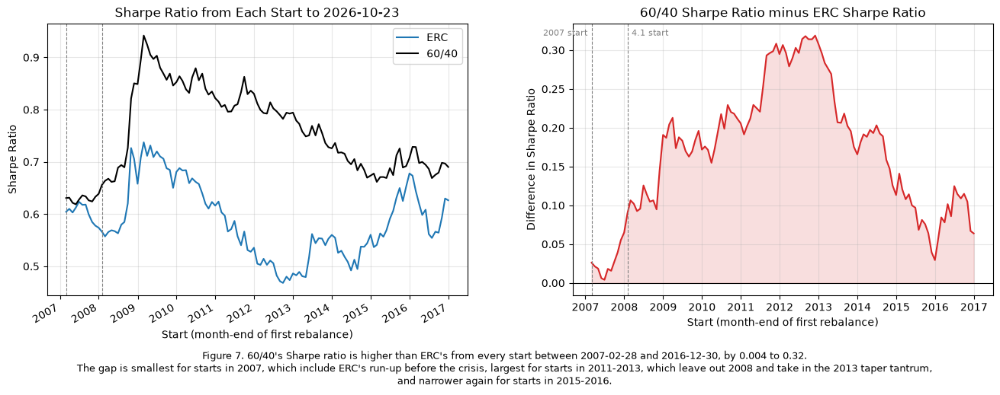

### Reading Figure 7

*What is plotted.* Each point on the horizontal axis is a different start date: a month-end from 2007-02-28 to 2016-12-30, all running to 2026-10-23.

* **Left:** the Sharpe ratio of unlevered ERC (blue) and 60/40 (black) over each run.
* **Right:** 60/40 minus ERC.
* **Dashed lines:** the earliest start the data allow (2007) and the 4.1 start (2008-01-31).

*How to read it.* The question is whether the 4.2 conclusion depends on when the backtest starts.

* **Above zero on the right:** 60/40 had the higher Sharpe ratio from that start. The line never crosses zero (0.004 to 0.32), so the conclusion holds for every start.
* **Shape:** the gap is near zero for 2007 starts, peaks for starts around 2012, which skip 2008 but include the 2013 taper tantrum, and narrows again for 2015–16 starts.
* **Overlap:** these are not independent tests. Every run shares the years after its start, and later starts have shorter samples, so neighboring points move together.

**Full backtest**

Unlevered, the three risk-parity rules run at between a half and two-thirds of 60/40's volatility (6.3% to 7.3% against 11.3%) and hold their maximum drawdowns to −16.6% to −18.0%, against −30.8% for 60/40. They also earn much less (4.2% to 5.5% a year against 8.9%), and none beats 60/40's Sharpe ratio of 0.66. ERC comes closest at 0.57, then inverse volatility (0.53) and inverse variance (0.44). The ordering follows how heavily each rule leans on the lowest-volatility asset, `TIP`: inverse variance puts the most there and earns the least for its risk. Matching 60/40's return takes leverage (4.3).

**Before and after RPAR's launch**

* **Before 2019-12-13**, ERC's Sharpe ratio was 0.62 against 60/40's 0.71, and its worst drawdown (−17.8%) came in 2008, when 60/40 fell 30.8%.
* **After**, every rule's Sharpe ratio fell (ERC to 0.50, inverse variance to 0.30) while the static four-way reached 0.77, the best of the seven. ERC's 2022 drawdown (−18.0%) was as deep as its 2008 one. For risk parity, 2022 was as bad as the financial crisis; for 60/40 it was milder (−21.0%).

**Calendar years**

* **2008 (from February):** the rules lost 3.7% at most, and inverse variance gained 0.3%, while 60/40 lost 14.8% and `SPY` 32.7%. `TLT` (up 31.2%) carried them, not TIPS: for ERC, `TLT` added 9.1%, more than offsetting `SPY`'s −8.1%, while `TIP` (−1.1%) and `DBC` (−2.6%) lost money (Figure 8). This is risk parity's best year relative to 60/40.
* **2013 (taper tantrum):** the rules lost 3.6% to 6.3% while 60/40 gained 15.6%. Bonds, TIPS and gold fell together while equities rallied, so the heavy weights in the falling assets cost them. For ERC, `SPY` added 6.2% while `TLT`, `TIP` and `GLD` each cost about 3% (Figure 8). This is their worst year relative to 60/40.
* **2020:** all gained. ERC returned 11.6% against 60/40's 16.9%: the bond weights paid off in March, but the equity weight was too small to keep up with the rebound. Gold was ERC's largest contributor (4.1%); `SPY` added only 1.3%, against 13.5% inside 60/40 (Figure 8).
* **2022:** stocks and bonds fell together. ERC lost 11.7%, less than 60/40 (−16.4%) but more than the static four-way (−8.3%), whose 50% in gold and commodities offset more of the bond losses than ERC's 27% to 34% through 2022. `TLT` and `TIP` cost ERC 10.7% between them, and `DBC` (+2.5%) was the only real offset (Figure 8).

**Starting in 2007: what moves**

Starting at the earliest date the ETFs and the 252-day window allow, 2007-03-01, adds 11 months in which ERC gained 14.1% and 60/40 4.8%, as commodities, gold and TIPS rallied into the crisis. ERC's mean rises from 5.51% to 5.93% and its Sharpe ratio from 0.57 to 0.60. 60/40's Sharpe ratio falls from 0.66 to 0.63, and its drawdown deepens from −30.8% to −31.4%, because its peak moves back to 2007-12-10 and its recovery to 2010-09-20. The Sharpe gap between 60/40 and ERC shrinks from 0.09 to 0.03, while volatilities move by less than 0.1 percentage point and ERC's drawdown does not change. Risk parity's lower volatility and shallower drawdowns hold whatever the start date. Its Sharpe ratio relative to 60/40 does not: the gap depends on a start date that moves by only eleven months.

Figure 7 repeats the comparison for every month-end start from 2007-02-28 to 2016-12-30, so every sample runs at least ten years. 60/40's Sharpe ratio is higher from every start, so the ranking never flips; only the size of the gap moves. It is smallest (0.004) for a start in mid-2007, near 0.1 for the 2008 start used here, largest (0.32) for starts in late 2012, which leave out 2008 and take in 2013, and back to 0.03 to 0.14 for starts in 2015-2016. Over this sample no start date makes ERC the better risk-adjusted strategy; the start date decides only whether it trails 60/40 slightly or by a lot.

## 4.3

> Lever the ERC portfolio, borrowing at `SHV`, to match 60/40's volatility over the full backtest. Report
>
> * the leverage applied
> * annualized mean and volatility, Sharpe ratio and maximum drawdown
> * one-way turnover per year, counting changes in both weights and leverage

```text
Leverage: 1.555x, set to match 60/40's full-backtest volatility of 11.34%
```

<table>
  <caption>Levered ERC against unlevered ERC and 60/40, 2008-02-01 to 2026-10-23</caption>
  <thead>
    <tr>
      <th>&nbsp;</th>
      <th>Leverage</th>
      <th>Annualized Mean</th>
      <th>Annualized Volatility</th>
      <th>Sharpe Ratio</th>
      <th>Max Drawdown</th>
      <th>Peak Date</th>
      <th>Trough Date</th>
      <th>Recovery Date</th>
      <th>One-Way Turnover per Year</th>
    </tr>
  </thead>
  <tbody>
    <tr>
      <th>Levered ERC</th>
      <td>1.55x</td>
      <td>7.77%</td>
      <td>11.34%</td>
      <td>0.56</td>
      <td>-27.41%</td>
      <td>2008-05-21</td>
      <td>2008-10-27</td>
      <td>2010-08-02</td>
      <td>0.35</td>
    </tr>
    <tr>
      <th>ERC</th>
      <td>1.00x</td>
      <td>5.51%</td>
      <td>7.26%</td>
      <td>0.57</td>
      <td>-17.97%</td>
      <td>2022-03-08</td>
      <td>2022-10-20</td>
      <td>2024-07-16</td>
      <td>0.22</td>
    </tr>
    <tr>
      <th>60/40</th>
      <td>1.00x</td>
      <td>8.86%</td>
      <td>11.34%</td>
      <td>0.66</td>
      <td>-30.80%</td>
      <td>2008-05-19</td>
      <td>2009-03-09</td>
      <td>2010-04-23</td>
      <td>—</td>
    </tr>
  </tbody>
</table>

```text
Turnover per year: 0.35, of which weight changes 0.34 and restoring the drifted leverage 0.01
Leverage just before each reset: mean 1.55x, range 1.50x to 1.67x
```

<table>
  <caption>Sums of daily return contributions by asset in four calendar years (2008 from February)</caption>
  <thead>
    <tr>
      <th>&nbsp;</th>
      <th>&nbsp;</th>
      <th>SPY</th>
      <th>TLT</th>
      <th>TIP</th>
      <th>GLD</th>
      <th>DBC</th>
      <th>IEF</th>
      <th>Cash</th>
      <th>Sum</th>
      <th>Compounded Return</th>
    </tr>
    <tr>
      <th>Year</th>
      <th>Strategy</th>
      <th>&nbsp;</th>
      <th>&nbsp;</th>
      <th>&nbsp;</th>
      <th>&nbsp;</th>
      <th>&nbsp;</th>
      <th>&nbsp;</th>
      <th>&nbsp;</th>
      <th>&nbsp;</th>
      <th>&nbsp;</th>
    </tr>
  </thead>
  <tbody>
    <tr>
      <th rowspan="3">2008</th>
      <th>ERC</th>
      <td>-8.12%</td>
      <td>9.13%</td>
      <td>-1.09%</td>
      <td>-0.05%</td>
      <td>-2.57%</td>
      <td>—</td>
      <td>—</td>
      <td>-2.70%</td>
      <td>-3.21%</td>
    </tr>
    <tr>
      <th>Levered ERC</th>
      <td>-12.37%</td>
      <td>13.92%</td>
      <td>-1.94%</td>
      <td>-0.22%</td>
      <td>-4.00%</td>
      <td>—</td>
      <td>-1.15%</td>
      <td>-5.76%</td>
      <td>-6.95%</td>
    </tr>
    <tr>
      <th>60/40</th>
      <td>-18.81%</td>
      <td>—</td>
      <td>—</td>
      <td>—</td>
      <td>—</td>
      <td>5.45%</td>
      <td>—</td>
      <td>-13.36%</td>
      <td>-14.77%</td>
    </tr>
    <tr>
      <th rowspan="3">2013</th>
      <th>ERC</th>
      <td>6.21%</td>
      <td>-2.85%</td>
      <td>-3.14%</td>
      <td>-2.80%</td>
      <td>-0.91%</td>
      <td>—</td>
      <td>—</td>
      <td>-3.50%</td>
      <td>-3.63%</td>
    </tr>
    <tr>
      <th>Levered ERC</th>
      <td>9.68%</td>
      <td>-4.41%</td>
      <td>-4.89%</td>
      <td>-4.37%</td>
      <td>-1.42%</td>
      <td>—</td>
      <td>0.00%</td>
      <td>-5.40%</td>
      <td>-5.72%</td>
    </tr>
    <tr>
      <th>60/40</th>
      <td>17.17%</td>
      <td>—</td>
      <td>—</td>
      <td>—</td>
      <td>—</td>
      <td>-2.44%</td>
      <td>—</td>
      <td>14.74%</td>
      <td>15.61%</td>
    </tr>
    <tr>
      <th rowspan="3">2020</th>
      <th>ERC</th>
      <td>1.34%</td>
      <td>2.66%</td>
      <td>3.35%</td>
      <td>4.12%</td>
      <td>0.04%</td>
      <td>—</td>
      <td>—</td>
      <td>11.52%</td>
      <td>11.59%</td>
    </tr>
    <tr>
      <th>Levered ERC</th>
      <td>2.00%</td>
      <td>4.17%</td>
      <td>5.41%</td>
      <td>6.37%</td>
      <td>0.06%</td>
      <td>—</td>
      <td>-0.45%</td>
      <td>17.57%</td>
      <td>17.55%</td>
    </tr>
    <tr>
      <th>60/40</th>
      <td>13.50%</td>
      <td>—</td>
      <td>—</td>
      <td>—</td>
      <td>—</td>
      <td>3.92%</td>
      <td>—</td>
      <td>17.42%</td>
      <td>16.94%</td>
    </tr>
    <tr>
      <th rowspan="3">2022</th>
      <th>ERC</th>
      <td>-3.67%</td>
      <td>-6.66%</td>
      <td>-4.04%</td>
      <td>0.09%</td>
      <td>2.50%</td>
      <td>—</td>
      <td>—</td>
      <td>-11.78%</td>
      <td>-11.70%</td>
    </tr>
    <tr>
      <th>Levered ERC</th>
      <td>-5.75%</td>
      <td>-10.35%</td>
      <td>-6.31%</td>
      <td>0.18%</td>
      <td>3.91%</td>
      <td>—</td>
      <td>-0.52%</td>
      <td>-18.84%</td>
      <td>-18.48%</td>
    </tr>
    <tr>
      <th>60/40</th>
      <td>-10.28%</td>
      <td>—</td>
      <td>—</td>
      <td>—</td>
      <td>—</td>
      <td>-6.37%</td>
      <td>—</td>
      <td>-16.65%</td>
      <td>-16.38%</td>
    </tr>
  </tbody>
</table>

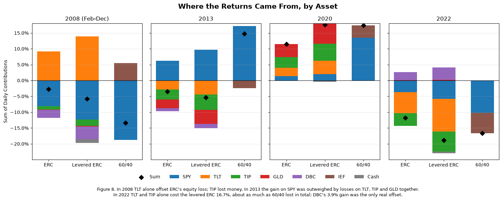

### Reading Figure 8

*What is plotted.* One panel per calendar year (2008 from February) and one bar per strategy.

* **Segments:** each asset's contribution, the weight or position held at the start of each day times that day's return, summed over the year. Segments above zero add to the result and segments below subtract.
* **Diamond:** the net, the sum of all segments. It is close to the compounded return but not equal to it.
* **Cash (gray):** the levered ERC's borrowing cost at `SHV`.
* **`IEF` (brown):** 60/40's bond leg.
* **Axes:** the panels share the vertical axis.

*What to notice*

* **2008:** `TLT` (+13.9%) almost offsets the levered ERC's `SPY` loss (−12.4%); `TIP` and `DBC` lost money. Net −5.8%, against −13.4% for 60/40.
* **2013:** the `SPY` gain is outweighed by losses on `TLT`, `TIP` and `GLD`, so the levered ERC lost 5.4% while 60/40 made 14.7%.
* **2020:** every sleeve contributes positively.
* **2022:** `TLT` and `TIP` together cost the levered ERC 16.7%, as much as 60/40 lost in total. `DBC`'s +3.9% is the only real offset. Net −18.8%, against −16.7% for 60/40.

**Construction**

At each month-end the portfolio is reset to $L$ times the ERC weights from 4.1, as fractions of net asset value, with $L - 1$ borrowed at `SHV`'s return. Between resets nothing is traded, as in 4.1, so the weights and the leverage both drift; each reset restores both. $L$ is one constant, solved so that the levered portfolio's volatility over the full backtest (2008-02-01 to 2026-10-23) equals 60/40's 11.34%. That uses the whole sample, so it is a hindsight choice: an allocator in 2008 could not have known it.

**Results**

* **Leverage: 1.55x.** Just before each reset, after a month of drift, leverage ranged from 1.50x to 1.67x.
* **Mean, volatility and Sharpe ratio.** The levered ERC earns 7.77% a year at 11.34% volatility, against 60/40's 8.86% at the same volatility. Its Sharpe ratio (0.56) equals the unlevered ERC's, as it should when the borrowing rate is the cash rate, and it stays below 60/40's 0.66. Matched for risk, ERC gives up about 1.1% a year to 60/40 over this backtest.
* **Maximum drawdown: −27.4%** (2008-05-21 to 2008-10-27, recovered 2010-08-02), against 60/40's −30.8%. Leverage brings the 2008 drawdown back: unlevered, ERC's worst loss was −18.0% in 2022.
* **Turnover: 0.35 a year one-way**, about 3% of NAV a month. Nearly all of it is the monthly change in weights (0.34, which is 1.55 times the unlevered ERC's 0.22); restoring the drifted leverage adds about 0.01.

At equal volatility, the levered ERC no longer has the drawdown advantage it had unlevered in 4.2: its worst loss is only 3.4 percentage points shallower than 60/40's. In 2022 it lost 18.5% to 60/40's 16.4%, since leverage scaled up the losses in its bond and TIPS weights: `TLT` and `TIP` alone cost it 16.7%, about what 60/40 lost in total, and `DBC`'s 3.9% gain was the only real offset (Figure 8).

## 4.4

> Over `RPAR`'s life, compare the ERC weights with `RPAR`'s revealed allocation, its betas from 2.2 scaled to sum to one, and regress `RPAR`'s daily excess return on the levered ERC portfolio's. Report
>
> * the two allocations side by side
> * the slope, the annualized intercept with its $t$-statistic, and $R^2$
>
> Does the 2008 to 2019 record change what a reader of Section 1 would conclude? Keep the allocation rule and `RPAR`'s implementation of it separate in the answer.

<table>
  <caption>ERC weights and RPAR's allocation over RPAR's life, 2019-12-16 to 2026-10-23</caption>
  <thead>
    <tr>
      <th>&nbsp;</th>
      <th>ERC, mean month-end target</th>
      <th>ERC, mean held</th>
      <th>RPAR revealed, daily betas</th>
      <th>RPAR revealed, monthly betas</th>
      <th>RPAR index, stated</th>
    </tr>
  </thead>
  <tbody>
    <tr>
      <th>SPY</th>
      <td>16.6%</td>
      <td>16.6%</td>
      <td>23.4%</td>
      <td>20.4%</td>
      <td>25.0%</td>
    </tr>
    <tr>
      <th>TLT</th>
      <td>17.7%</td>
      <td>17.6%</td>
      <td>21.9%</td>
      <td>25.8%</td>
      <td>15.0%</td>
    </tr>
    <tr>
      <th>TIP</th>
      <td>35.6%</td>
      <td>35.4%</td>
      <td>39.0%</td>
      <td>35.8%</td>
      <td>35.0%</td>
    </tr>
    <tr>
      <th>GLD</th>
      <td>14.8%</td>
      <td>14.9%</td>
      <td>12.1%</td>
      <td>11.2%</td>
      <td>12.5%</td>
    </tr>
    <tr>
      <th>DBC</th>
      <td>15.3%</td>
      <td>15.4%</td>
      <td>3.6%</td>
      <td>6.8%</td>
      <td>12.5%</td>
    </tr>
    <tr>
      <th>Sum of betas (unscaled)</th>
      <td>—</td>
      <td>—</td>
      <td>1.39</td>
      <td>1.53</td>
      <td>—</td>
    </tr>
  </tbody>
</table>

<table>
  <caption>RPAR's excess return on the levered ERC portfolio's, over RPAR's life</caption>
  <thead>
    <tr>
      <th>&nbsp;</th>
      <th>Daily</th>
      <th>Monthly (full months)</th>
    </tr>
  </thead>
  <tbody>
    <tr>
      <th>Slope</th>
      <td>0.85</td>
      <td>1.02</td>
    </tr>
    <tr>
      <th>Annualized Intercept</th>
      <td>-3.79%</td>
      <td>-4.56%</td>
    </tr>
    <tr>
      <th>Alpha t-stat</th>
      <td>-1.65</td>
      <td>-2.58</td>
    </tr>
    <tr>
      <th>R-squared</th>
      <td>0.77</td>
      <td>0.89</td>
    </tr>
    <tr>
      <th>Tracking Error</th>
      <td>6.02%</td>
      <td>4.52%</td>
    </tr>
  </tbody>
</table>

<table>
  <caption>The levered ERC rule and RPAR, each at its own volatility</caption>
  <thead>
    <tr>
      <th>&nbsp;</th>
      <th>&nbsp;</th>
      <th>Annualized Mean</th>
      <th>Annualized Volatility</th>
      <th>Sharpe Ratio</th>
      <th>Max Drawdown</th>
    </tr>
    <tr>
      <th>Period</th>
      <th>Strategy</th>
      <th>&nbsp;</th>
      <th>&nbsp;</th>
      <th>&nbsp;</th>
      <th>&nbsp;</th>
    </tr>
  </thead>
  <tbody>
    <tr>
      <th rowspan="3">RPAR's life</th>
      <th>RPAR</th>
      <td>4.32%</td>
      <td>12.56%</td>
      <td>0.13</td>
      <td>-30.14%</td>
    </tr>
    <tr>
      <th>Levered ERC</th>
      <td>9.05%</td>
      <td>12.94%</td>
      <td>0.49</td>
      <td>-26.93%</td>
    </tr>
    <tr>
      <th>60/40</th>
      <td>9.69%</td>
      <td>12.14%</td>
      <td>0.57</td>
      <td>-21.02%</td>
    </tr>
    <tr>
      <th rowspan="2">2008-02-01 to 2019-12-12</th>
      <th>Levered ERC</th>
      <td>6.97%</td>
      <td>10.31%</td>
      <td>0.61</td>
      <td>-27.41%</td>
    </tr>
    <tr>
      <th>60/40</th>
      <td>8.37%</td>
      <td>10.86%</td>
      <td>0.71</td>
      <td>-30.80%</td>
    </tr>
  </tbody>
</table>

<table>
  <caption>RPAR minus the levered ERC by calendar year, sum of daily excess returns</caption>
  <thead>
    <tr>
      <th>Date</th>
      <th>2019 (partial)</th>
      <th>2020</th>
      <th>2021</th>
      <th>2022</th>
      <th>2023</th>
      <th>2024</th>
      <th>2025</th>
      <th>2026 (partial)</th>
    </tr>
  </thead>
  <tbody>
    <tr>
      <th>RPAR minus Levered ERC</th>
      <td>-0.77%</td>
      <td>1.30%</td>
      <td>-6.72%</td>
      <td>-5.68%</td>
      <td>-2.07%</td>
      <td>-10.04%</td>
      <td>-0.80%</td>
      <td>-7.58%</td>
    </tr>
  </tbody>
</table>

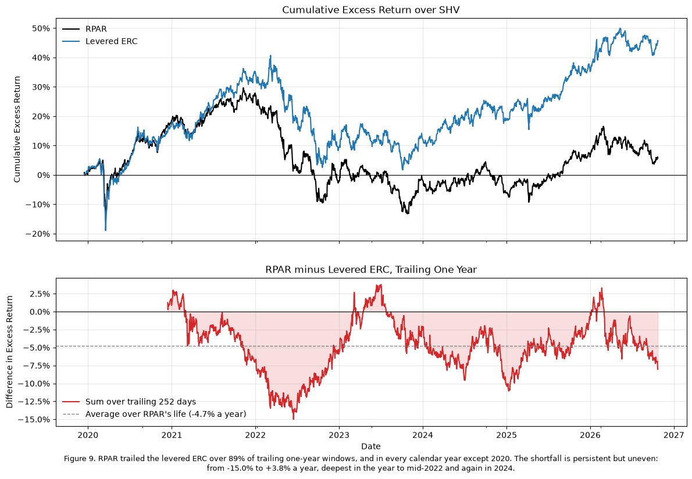

### Reading Figure 9

*Top: the two paths.* The compounded excess return over `SHV` of `RPAR` (black) and the levered ERC rule (blue), starting from `RPAR`'s first day. Each runs at its own volatility, so part of any gap is scale. What matters is where the lines separate.

*Bottom: the rolling gap.* Each point is `RPAR`'s excess return minus the levered ERC's, summed over the 252 trading days ending that day.

* **Below zero** means `RPAR` trailed over that year.
* **Dashed line:** the average over `RPAR`'s life, −4.7% a year.
* **Start:** the line begins once 252 days are available, in December 2020.

*What to notice*

* **Persistence:** the line is below zero in 89% of windows. It rises above zero only briefly: early 2021, mid-2023 (peak +3.8% on 2023-07-03) and early 2026.
* **Worst window:** the year to 2022-06-16, at −15.0%. In the top panel, that is where the two paths separate, and they never close the gap afterwards.

**The two allocations**

ERC and `RPAR`'s revealed allocation agree on the main point: `TIP` is the largest position in both (35% to 39%). They differ at the edges. `RPAR` holds more `SPY` (20% to 23% against ERC's 17%) and more `TLT` (22% to 26% against 18%), and much less `DBC` (4% to 7% against 15%). That pattern fits its commodity sleeve holding commodity-producer equities and gold rather than broad commodity futures, so its commodity risk loads on `SPY` and `GLD` instead of `DBC` (3.3). Its unscaled sum of betas, 1.39 daily and 1.53 monthly, is close to the 1.55x leverage of the levered ERC.

**`RPAR` on the levered ERC**

Daily: slope 0.85, annualized intercept −3.79% ($t$ = −1.65), $R^2$ 0.77. On monthly sums of the same returns, which remove the daily attenuation seen in 1.2 and 2.2: slope 1.02, intercept −4.56% ($t$ = −2.58), $R^2$ 0.89. At the monthly horizon, `RPAR` moves one-for-one with the levered ERC rule but trails it by about 4.5% a year.

**Is the shortfall steady?** Mostly, yes (Figure 9). `RPAR` tracked the rule closely through 2020, including the March crash, and trailed it in every calendar year since: by 6.7% in 2021, 5.7% in 2022, 2.1% in 2023, 10.0% in 2024 and 0.8% in 2025 (sums of daily excess returns). Over trailing one-year windows it was behind 89% of the time, by 4.7% a year on average. The size swings widely, though, from −15.0% in the year to mid-2022 to +3.8% in mid-2023. A shortfall present in almost every year points to something structural, not bad luck. Swings this large around it point to basis, the fund's holdings differing from the five ETFs (3.3). Costs alone would produce a smaller, smoother drag. Over `RPAR`'s life, at nearly the same volatility (12.6% against 12.9%), the rule earned 9.1% a year with a Sharpe ratio of 0.49, while `RPAR` earned 4.3% with 0.13.

**Does the 2008–2019 record change the Section 1 conclusion?**

* **The allocation rule: yes, partly.** Section 1 saw only `RPAR`'s seven years and a Sharpe ratio of 0.13. The rule's longer record is better. Levered to 60/40's risk, it had a Sharpe ratio of 0.61 from 2008 to 2019 and 0.49 over `RPAR`'s life, with a maximum drawdown of −27.4% in 2008 against 60/40's −30.8%. But it did not beat 60/40 in either period (0.71 and 0.57). The longer record says the rule works, but gives no evidence that it beats a plain stock-bond mix at equal risk. The 2022 loss is the rule's, not only `RPAR`'s: the levered ERC's drawdown over `RPAR`'s life was −26.9%, close to `RPAR`'s −30.1%.
* **`RPAR`'s implementation: no.** The 2008–2019 backtest contains no `RPAR`, so it says nothing about how well the fund implements the rule. Over the years both exist, `RPAR` trails the rule by about 4.5% a year with $R^2$ near 0.9, which accounts for most of the distance between `RPAR`'s 0.13 Sharpe ratio and the rule's 0.49. That gap cannot all be called implementation cost.
  * The levered ERC is a simplified benchmark built in hindsight from five ETFs, with a leverage chosen on the full backtest.
  * `RPAR` differs from it in what it holds (global equities, commodity producers, Treasury futures), in its index design and weights, in how it applies leverage and rebalances, and in its financing and fees.
  * The gap reflects some mix of these, and this file cannot separate them; the basis and cost explanations of 3.3 are two candidates.
  * The Section 1 finding that `RPAR` lagged the static four-way is therefore a finding about the fund as built, not about the risk-parity rule, and the longer history leaves it unchanged.

# 5. What Broke

| Episode | Window |
|---|---|
| 2020 | 2020-02-19 to 2020-03-23 |
| 2022 | 2022-01-03 to 2022-10-24 |
| Calm | 2023-01-03 to 2024-12-31 |

For the VaR backtests, extend the 2020 window to April 30 and the 2022 window to December 30. A breach is a day whose return falls below the forecast. With the 252-day burn-in, `RPAR` and `DBMF` have no historical-simulation forecast inside the 2020 window; their 2020 rows carry EWMA only. Attribution in 5.3 uses the shorter windows tabled above.

**The tables.**

* ***The levered ERC rule and `RPAR`, each at its own volatility:*** compares Sharpe ratios and drawdowns over `RPAR`'s life and over 2008–2019. It is the basis for the "does 2008–2019 change the conclusion" answer.
* ***`RPAR` minus the levered ERC by calendar year:*** shows whether the shortfall is steady or comes from a few bad years. It is steady, but uneven in size.

## 5.1

> For `RPAR`, the levered ERC portfolio from 4.3, 60/40, `NTSX` and `DBMF`, forecast the one-day 5% VaR for every day by rolling historical simulation (the trailing 252 returns) and Normal EWMA with $\lambda = 0.97$. Report
>
> * the breach rate over each series' full forecast sample and within each episode in which it has forecasts
> * a blank where a method has no forecast, and say so

<table>
  <caption>First forecast of each method: historical simulation after 252 returns, EWMA from the 22nd day</caption>
  <thead>
    <tr>
      <th>&nbsp;</th>
      <th>First Return</th>
      <th>First Historical Forecast</th>
      <th>First EWMA Forecast</th>
    </tr>
  </thead>
  <tbody>
    <tr>
      <th>RPAR</th>
      <td>2019-12-16</td>
      <td>2020-12-15</td>
      <td>2020-01-16</td>
    </tr>
    <tr>
      <th>Levered ERC</th>
      <td>2008-02-01</td>
      <td>2009-02-02</td>
      <td>2008-03-04</td>
    </tr>
    <tr>
      <th>60/40</th>
      <td>2002-07-29</td>
      <td>2003-07-29</td>
      <td>2002-08-27</td>
    </tr>
    <tr>
      <th>NTSX</th>
      <td>2018-08-03</td>
      <td>2019-08-26</td>
      <td>2018-09-04</td>
    </tr>
    <tr>
      <th>DBMF</th>
      <td>2019-05-09</td>
      <td>2020-05-08</td>
      <td>2019-06-10</td>
    </tr>
  </tbody>
</table>

<table>
  <caption>One-day 5% VaR breaches (expected rate 5%). Episodes extended to 2020-04-30 and 2022-12-30. — : no forecast in that window (historical simulation needs 252 prior returns)</caption>
  <thead>
    <tr>
      <th>&nbsp;</th>
      <th>&nbsp;</th>
      <th colspan="3">Full sample</th>
      <th colspan="3">2020</th>
      <th colspan="3">2022</th>
      <th colspan="3">Calm</th>
    </tr>
    <tr>
      <th>&nbsp;</th>
      <th>&nbsp;</th>
      <th>Breach Rate</th>
      <th>Breaches</th>
      <th>Forecast Days</th>
      <th>Breach Rate</th>
      <th>Breaches</th>
      <th>Forecast Days</th>
      <th>Breach Rate</th>
      <th>Breaches</th>
      <th>Forecast Days</th>
      <th>Breach Rate</th>
      <th>Breaches</th>
      <th>Forecast Days</th>
    </tr>
  </thead>
  <tbody>
    <tr>
      <th rowspan="2">RPAR</th>
      <th>Historical</th>
      <td>5.8%</td>
      <td>86</td>
      <td>1471</td>
      <td>—</td>
      <td>—</td>
      <td>—</td>
      <td>12.0%</td>
      <td>30</td>
      <td>251</td>
      <td>4.0%</td>
      <td>20</td>
      <td>502</td>
    </tr>
    <tr>
      <th>EWMA</th>
      <td>5.7%</td>
      <td>97</td>
      <td>1702</td>
      <td>15.7%</td>
      <td>8</td>
      <td>51</td>
      <td>9.2%</td>
      <td>23</td>
      <td>251</td>
      <td>5.0%</td>
      <td>25</td>
      <td>502</td>
    </tr>
    <tr>
      <th rowspan="2">Levered ERC</th>
      <th>Historical</th>
      <td>4.9%</td>
      <td>218</td>
      <td>4460</td>
      <td>23.5%</td>
      <td>12</td>
      <td>51</td>
      <td>12.0%</td>
      <td>30</td>
      <td>251</td>
      <td>2.4%</td>
      <td>12</td>
      <td>502</td>
    </tr>
    <tr>
      <th>EWMA</th>
      <td>4.6%</td>
      <td>214</td>
      <td>4691</td>
      <td>15.7%</td>
      <td>8</td>
      <td>51</td>
      <td>7.2%</td>
      <td>18</td>
      <td>251</td>
      <td>4.2%</td>
      <td>21</td>
      <td>502</td>
    </tr>
    <tr>
      <th rowspan="2">60/40</th>
      <th>Historical</th>
      <td>5.4%</td>
      <td>318</td>
      <td>5848</td>
      <td>27.5%</td>
      <td>14</td>
      <td>51</td>
      <td>11.2%</td>
      <td>28</td>
      <td>251</td>
      <td>3.4%</td>
      <td>17</td>
      <td>502</td>
    </tr>
    <tr>
      <th>EWMA</th>
      <td>5.1%</td>
      <td>307</td>
      <td>6079</td>
      <td>17.6%</td>
      <td>9</td>
      <td>51</td>
      <td>6.8%</td>
      <td>17</td>
      <td>251</td>
      <td>4.4%</td>
      <td>22</td>
      <td>502</td>
    </tr>
    <tr>
      <th rowspan="2">NTSX</th>
      <th>Historical</th>
      <td>5.5%</td>
      <td>99</td>
      <td>1801</td>
      <td>29.4%</td>
      <td>15</td>
      <td>51</td>
      <td>11.2%</td>
      <td>28</td>
      <td>251</td>
      <td>3.6%</td>
      <td>18</td>
      <td>502</td>
    </tr>
    <tr>
      <th>EWMA</th>
      <td>5.5%</td>
      <td>112</td>
      <td>2032</td>
      <td>15.7%</td>
      <td>8</td>
      <td>51</td>
      <td>8.0%</td>
      <td>20</td>
      <td>251</td>
      <td>4.0%</td>
      <td>20</td>
      <td>502</td>
    </tr>
    <tr>
      <th rowspan="2">DBMF</th>
      <th>Historical</th>
      <td>4.7%</td>
      <td>77</td>
      <td>1624</td>
      <td>—</td>
      <td>—</td>
      <td>—</td>
      <td>5.6%</td>
      <td>14</td>
      <td>251</td>
      <td>4.4%</td>
      <td>22</td>
      <td>502</td>
    </tr>
    <tr>
      <th>EWMA</th>
      <td>5.6%</td>
      <td>103</td>
      <td>1855</td>
      <td>11.8%</td>
      <td>6</td>
      <td>51</td>
      <td>3.2%</td>
      <td>8</td>
      <td>251</td>
      <td>5.4%</td>
      <td>27</td>
      <td>502</td>
    </tr>
  </tbody>
</table>

<table>
  <caption>Breach clustering over each full forecast sample</caption>
  <thead>
    <tr>
      <th>&nbsp;</th>
      <th>&nbsp;</th>
      <th>Breach Rate</th>
      <th>Breach Rate the Day after a Breach</th>
      <th>Days after a Breach</th>
    </tr>
  </thead>
  <tbody>
    <tr>
      <th rowspan="2">RPAR</th>
      <th>Historical</th>
      <td>5.8%</td>
      <td>10.5%</td>
      <td>86</td>
    </tr>
    <tr>
      <th>EWMA</th>
      <td>5.7%</td>
      <td>11.3%</td>
      <td>97</td>
    </tr>
    <tr>
      <th rowspan="2">Levered ERC</th>
      <th>Historical</th>
      <td>4.9%</td>
      <td>13.3%</td>
      <td>218</td>
    </tr>
    <tr>
      <th>EWMA</th>
      <td>4.6%</td>
      <td>9.3%</td>
      <td>214</td>
    </tr>
    <tr>
      <th rowspan="2">60/40</th>
      <th>Historical</th>
      <td>5.4%</td>
      <td>10.7%</td>
      <td>318</td>
    </tr>
    <tr>
      <th>EWMA</th>
      <td>5.1%</td>
      <td>7.2%</td>
      <td>307</td>
    </tr>
    <tr>
      <th rowspan="2">NTSX</th>
      <th>Historical</th>
      <td>5.5%</td>
      <td>8.1%</td>
      <td>99</td>
    </tr>
    <tr>
      <th>EWMA</th>
      <td>5.5%</td>
      <td>7.1%</td>
      <td>112</td>
    </tr>
    <tr>
      <th rowspan="2">DBMF</th>
      <th>Historical</th>
      <td>4.7%</td>
      <td>6.5%</td>
      <td>77</td>
    </tr>
    <tr>
      <th>EWMA</th>
      <td>5.6%</td>
      <td>7.8%</td>
      <td>103</td>
    </tr>
  </tbody>
</table>

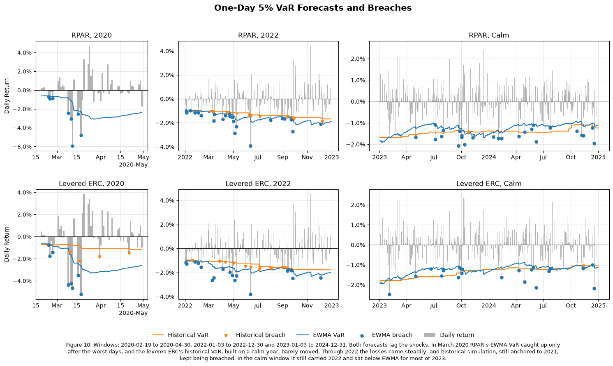

### Reading Figure 10

*Layout.* Rows are `RPAR` and the levered ERC. Columns are the three windows:

* **2020:** 2020-02-19 to 2020-04-30.
* **2022:** the full year.
* **Calm:** 2023–2024.

Each panel has its own vertical scale.

*What is plotted*

* **Gray bars:** daily returns.
* **Lines:** each day's 5% VaR forecast, made with returns through the previous day. Orange is historical simulation, the 5th percentile of the last 252 returns. Blue is EWMA with a Normal distribution.
* **Markers:** a breach, a return below that day's forecast. Orange triangles are historical breaches, blue dots EWMA breaches.
* **Expected count:** a correct 5% forecast is breached about once every 20 days, about 2.6 times in the 51-day 2020 window and about 12.6 times in 2022.
* **`RPAR`, 2020:** there is no orange line because `RPAR` did not yet have 252 returns, so historical simulation had not started.

*What to notice*

* **2020:** the blue line steps down only after the first large losses, so the worst days breach a forecast that had not yet moved. The levered ERC's historical VaR barely moves: one bad week adds few points to a 252-day window.
* **2022:** breaches are spread across the year instead of clustered. The losses were steady, not a single shock.
* **Calm window:** fewer breaches. Historical simulation sits below EWMA for most of 2023 because its window still contained 2022.

**Method**

VaR uses total returns, as the Notes require. Both forecasts for day $t$ use returns through $t-1$, and each series uses only its own history. The levered ERC therefore starts from its first return in 4.3 (2008-02-01), not from when its ETFs start.

* **Historical simulation:** the empirical 5% quantile of the trailing 252 returns, using the lecture notes' lower-quantile convention $\inf\{x : F(x) \ge 5\%\}$. That is the 13th-lowest of the 252 returns.
* **Normal EWMA:** zero mean, $\sigma_t^2 = 0.97\,\sigma_{t-1}^2 + 0.03\,r_{t-1}^2$, seeded with the variance of the first 21 returns, and $\text{VaR}_t = -1.645\,\sigma_t$.

A breach is a day whose return falls below the forecast. At a 5% rate we would expect about 2.6 breaches in the 51-day 2020 window, 12.6 in the 251-day 2022 window and 25 in the 502-day calm window.

**Blanks.** `RPAR` (first return 2019-12-16) and `DBMF` (2019-05-09) have no historical-simulation forecast until 2020-12-15 and 2020-05-08. Both dates fall after the extended 2020 window closes, so their 2020 historical cells are blank (—). That means no forecast, not zero breaches. Every other cell has a forecast on every day of its window.

**Breach rates**

* **Full sample:** both methods are close to 5% for every series (4.6% to 5.8%). On average the forecasts are calibrated; the failures come in the episodes.
* **2020:** every forecast failed.
  * Historical simulation breached on 23.5% to 29.4% of days for the levered ERC, 60/40 and `NTSX` (12 to 15 breaches against 2.6 expected). Its VaR was built on the calm year before and barely moved.
  * EWMA did better but still breached on 11.8% to 17.6% of days. `RPAR`'s eight breaches (15.7%) came in late February and from March 9 to 18, before the variance caught up (Figure 10). After March 18, its VaR of about −3% covered every loss.
* **2022:** historical simulation breached on 11.2% to 12.0% of days for every series except `DBMF` (5.6%), more than twice the target.
  * EWMA came closer for 60/40 (6.8%), the levered ERC (7.2%) and `NTSX` (8.0%).
  * `RPAR` was the worst EWMA case, at 9.2% (23 breaches against 12.6 expected).
  * `DBMF`, which gained in 2022, breached on only 3.2% of days.
* **Calm:** every rate is at or below 5.4%. Historical simulation breached less than EWMA for every series, most clearly for the levered ERC (2.4% against 4.2%) and 60/40 (3.4% against 4.4%), because through 2023 its window still held 2022's losses, while EWMA had already adjusted to lower volatility.

**Clustering.** The lecture notes ask for both the frequency and the clustering of breaches; a breach rate near 5% tests only the first. Breaches here are not independent. Over each full sample, the breach rate on the day after a breach is 6.5% to 13.3%, against 4.6% to 5.8% on any day (clustering table). Historical simulation clusters most for the levered ERC (13.3%) and 60/40 (10.7%), as expected from a forecast that does not update for volatility. In 2020 `RPAR`'s and the levered ERC's eight EWMA breaches fell on the same eight days, between February 24 and March 18. So the full-sample rates near 5% overstate how well calibrated the forecasts were.

EWMA adapts faster than historical simulation, so it breached less in both episodes and more in the calm one. Neither kept up with a jump like March 2020. 2022 failed differently: it had no single shock, just a year of high volatility and steady losses. A forecast built on calm 2021 kept underestimating those losses, and for `RPAR` even the faster EWMA did.

**The tables.**

* ***First forecast of each method:*** documents why some cells are blank. Historical simulation needs 252 prior returns, so `RPAR` and `DBMF` have no forecast in the 2020 window.
* ***Breach clustering:*** the lecture's second test. It compares the breach rate on any day with the rate on the day after a breach; independent breaches would make the two equal.

## 5.2

> On the breach days of the Normal EWMA ($\lambda = 0.97$) forecast within the extended 2020 and 2022 windows, report for each series
>
> * the number of breaches
> * the mean realized loss beside the mean CVaR forecast on those days
> * the worst day's return as a multiple of the VaR forecast made for that day

<table>
  <caption>Normal EWMA (λ = 0.97) breach days, 2020-02-19 to 2020-04-30 and 2022-01-03 to 2022-12-30; expected breaches 2.6 and 12.6</caption>
  <thead>
    <tr>
      <th>&nbsp;</th>
      <th>&nbsp;</th>
      <th>Breaches</th>
      <th>Mean Return on Breach Days</th>
      <th>Mean CVaR Forecast</th>
      <th>Realized / CVaR</th>
      <th>Worst Day</th>
      <th>Worst Return</th>
      <th>VaR Forecast that Day</th>
      <th>Worst Return / VaR</th>
    </tr>
    <tr>
      <th>Episode</th>
      <th>Series</th>
      <th>&nbsp;</th>
      <th>&nbsp;</th>
      <th>&nbsp;</th>
      <th>&nbsp;</th>
      <th>&nbsp;</th>
      <th>&nbsp;</th>
      <th>&nbsp;</th>
      <th>&nbsp;</th>
    </tr>
  </thead>
  <tbody>
    <tr>
      <th rowspan="5">2020</th>
      <th>RPAR</th>
      <td>8</td>
      <td>-2.66%</td>
      <td>-1.50%</td>
      <td>1.77x</td>
      <td>2020-03-12</td>
      <td>-5.93%</td>
      <td>-1.38%</td>
      <td>4.31x</td>
    </tr>
    <tr>
      <th>Levered ERC</th>
      <td>8</td>
      <td>-3.25%</td>
      <td>-1.86%</td>
      <td>1.75x</td>
      <td>2020-03-18</td>
      <td>-5.21%</td>
      <td>-2.61%</td>
      <td>1.99x</td>
    </tr>
    <tr>
      <th>60/40</th>
      <td>9</td>
      <td>-3.33%</td>
      <td>-2.20%</td>
      <td>1.51x</td>
      <td>2020-03-12</td>
      <td>-5.72%</td>
      <td>-2.21%</td>
      <td>2.59x</td>
    </tr>
    <tr>
      <th>NTSX</th>
      <td>8</td>
      <td>-5.21%</td>
      <td>-2.87%</td>
      <td>1.82x</td>
      <td>2020-03-16</td>
      <td>-11.98%</td>
      <td>-4.35%</td>
      <td>2.75x</td>
    </tr>
    <tr>
      <th>DBMF</th>
      <td>6</td>
      <td>-2.55%</td>
      <td>-1.67%</td>
      <td>1.53x</td>
      <td>2020-03-12</td>
      <td>-3.90%</td>
      <td>-1.66%</td>
      <td>2.36x</td>
    </tr>
    <tr>
      <th rowspan="5">2022</th>
      <th>RPAR</th>
      <td>23</td>
      <td>-1.75%</td>
      <td>-1.65%</td>
      <td>1.06x</td>
      <td>2022-06-13</td>
      <td>-3.93%</td>
      <td>-1.54%</td>
      <td>2.56x</td>
    </tr>
    <tr>
      <th>Levered ERC</th>
      <td>18</td>
      <td>-2.03%</td>
      <td>-1.86%</td>
      <td>1.09x</td>
      <td>2022-06-13</td>
      <td>-3.80%</td>
      <td>-1.70%</td>
      <td>2.24x</td>
    </tr>
    <tr>
      <th>60/40</th>
      <td>17</td>
      <td>-1.88%</td>
      <td>-1.65%</td>
      <td>1.14x</td>
      <td>2022-06-13</td>
      <td>-2.99%</td>
      <td>-1.74%</td>
      <td>1.72x</td>
    </tr>
    <tr>
      <th>NTSX</th>
      <td>20</td>
      <td>-2.87%</td>
      <td>-2.65%</td>
      <td>1.08x</td>
      <td>2022-06-13</td>
      <td>-5.48%</td>
      <td>-2.72%</td>
      <td>2.01x</td>
    </tr>
    <tr>
      <th>DBMF</th>
      <td>8</td>
      <td>-2.06%</td>
      <td>-1.93%</td>
      <td>1.07x</td>
      <td>2022-11-10</td>
      <td>-3.90%</td>
      <td>-1.50%</td>
      <td>2.60x</td>
    </tr>
  </tbody>
</table>

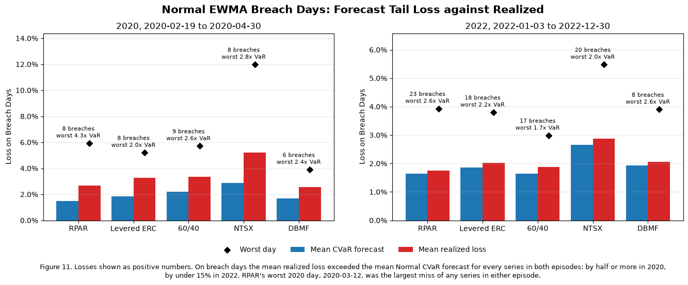

### Reading Figure 11

*What is plotted.* Only the EWMA breach days in each episode, with losses shown as positive numbers. The two panels have different vertical scales.

* **Blue bar:** the average CVaR forecast on those days, the loss the Normal model expected given that VaR was breached.
* **Red bar:** the average loss that actually occurred.
* **Diamond:** the single worst day.
* **Label:** the number of breaches, and the worst loss as a multiple of that day's VaR forecast.

*How to read it.* Compare the two bars in each pair.

* **Red taller than blue:** losses beyond VaR were bigger than the model predicted. The tail was fatter than Normal, or volatility rose faster than EWMA could follow.
* **Diamond far above the bars:** one day did much of the damage.
* **Breach counts:** compare them with the expected 2.6 in 2020 and 12.6 in 2022.

*What to notice*

* **2020:** red is 1.5 to 1.8 times blue for every series, and the worst days reached 2 to 4.3 times VaR. That is a sudden jump: the size of each loss was underestimated.
* **2022:** the bars nearly match (1.06 to 1.14), but `RPAR` breached 23 times against 12.6 expected. That is a grind: each loss was about the predicted size, but there were too many of them.

**Method**

The Normal EWMA forecasts are the ones from 5.1. For a zero-mean Normal with forecast volatility $\sigma_t$, $\text{VaR}_t = -1.645\,\sigma_t$ and $\text{CVaR}_t = -\sigma_t\,\phi(1.645)/0.05 = -2.063\,\sigma_t$. The CVaR forecast is the loss the model expects on the days its VaR is breached, so on breach days it is the forecast to compare with the realized return. The windows are the extended ones: 2020-02-19 to 2020-04-30 (51 days, 2.6 breaches expected) and 2022-01-03 to 2022-12-30 (251 days, 12.6 expected). The worst day is the window's lowest return, which is a breach day for every series.

**2020: too many breaches, and each too large**

* **Number:** 6 to 9 breaches per series, two to three and a half times the 2.6 expected.
* **Size:** on breach days the mean loss was 1.51x to 1.82x the mean CVaR forecast. For `RPAR` it was −2.66% against a forecast of −1.50%, a ratio of 1.77x.
* **Worst day:** between 1.99x and 4.31x the VaR forecast for that day, so the Normal model missed the severity as well as the frequency. `RPAR` had the largest miss of any series in either episode: −5.93% on 2020-03-12 against a VaR of −1.38%, or 4.31x. Its forecast had only begun to rise (−0.62% on 2020-02-19), and under the model a loss that size is a 7σ day. On the same day 60/40 and `DBMF` had their worst days too, but at 2.59x and 2.36x VaR: `RPAR`'s loss was as large as 60/40's (−5.93% against −5.72%) while its forecast was much smaller (−1.38% against −2.21%). The levered ERC's and `NTSX`'s worst days came later (2020-03-18 and 2020-03-16), at 1.99x and 2.75x, after their forecasts had risen further.

**2022: too many breaches, each about the right size**

* **Number:** `RPAR` breached on 23 days, the most of any series and nearly twice the 12.6 expected. The levered ERC (18), 60/40 (17) and `NTSX` (20) also breached too often, while `DBMF` (8) breached too rarely.
* **Size:** given a breach, the Normal tail was close. Mean realized losses were 1.06x to 1.14x the mean CVaR forecast (`RPAR`: −1.75% against −1.65%).
* **Worst day:** 1.72x to 2.60x VaR. For four of the five series it was 2022-06-13, after the May CPI report, when stocks and bonds sold off together. `RPAR` lost 3.93% that day against a VaR of −1.54%, or 2.56x. `DBMF`'s worst day was 2022-11-10, the softer-than-expected CPI report, when the trends it was holding reversed.

**What failed**

In 2020 the problem was speed: volatility jumped within days, faster than an EWMA with $\lambda = 0.97$ can follow. Both the number of breaches and their size were too large, and `RPAR`'s low, stale forecast made its worst day the biggest miss in the table. In 2022 the size of each breach was roughly right, but there were too many of them. Losses kept clustering at a level the forecast treated as a 5% tail, and `RPAR` was hit most often.

**What the lecture models would change.**

* **A fatter-tailed distribution (Student's t):** it would raise the CVaR-to-VaR multiple above the Normal's $2.063/1.645 = 1.25$, which addresses the 2020 size problem. It would not stop the breaches from coming too often, because the frequency problem in both episodes was a volatility forecast that lagged.
* **Filtered historical simulation (GARCH volatility with empirical shocks):** this targets that lag directly, and keeps the empirical tail shape.
* **The limit of either:** since VaR is not subadditive and says nothing about losses beyond it, CVaR is the measure to watch in episodes like these, and here the Normal CVaR was too small exactly when it mattered.

## 5.3

> Attribute each live fund's 2020 and 2022 episode to its factors day by day: each factor's excess return times the fund's full-sample daily beta from 2.2, summed over the episode by factor, beside the sum of the fund's daily excess returns. Do the same for the levered ERC portfolio with its actual daily weights and leverage.
>
> * Report the attribution for each series and episode.
> * Compute the static approximation, each beta times the factor's compounded total return over the window (episode-start weights for the ERC), and say what the gap between the two attributions contains.

```text
2020, UPAR: no returns in the window
2020, ALLW: no returns in the window
2022, UPAR: from its first return, 2022-01-05
2022, ALLW: no returns in the window
```

<table>
  <caption>Day-by-day attribution: each factor's daily excess return times the full-sample daily beta (actual positions for the levered ERC), summed over the episode</caption>
  <thead>
    <tr>
      <th>&nbsp;</th>
      <th>&nbsp;</th>
      <th>SPY</th>
      <th>TLT</th>
      <th>TIP</th>
      <th>GLD</th>
      <th>DBC</th>
      <th>Sum of Factors</th>
      <th>Excess Return (sum of daily)</th>
      <th>Residual</th>
      <th>Intercept x Days</th>
      <th>Unexplained</th>
    </tr>
    <tr>
      <th>Episode</th>
      <th>Series</th>
      <th>&nbsp;</th>
      <th>&nbsp;</th>
      <th>&nbsp;</th>
      <th>&nbsp;</th>
      <th>&nbsp;</th>
      <th>&nbsp;</th>
      <th>&nbsp;</th>
      <th>&nbsp;</th>
      <th>&nbsp;</th>
      <th>&nbsp;</th>
    </tr>
  </thead>
  <tbody>
    <tr>
      <th rowspan="4">2020</th>
      <th>RPAR</th>
      <td>-12.44%</td>
      <td>4.31%</td>
      <td>-0.51%</td>
      <td>-0.54%</td>
      <td>-1.42%</td>
      <td>-10.59%</td>
      <td>-14.58%</td>
      <td>-3.99%</td>
      <td>-0.34%</td>
      <td>-3.65%</td>
    </tr>
    <tr>
      <th>NTSX</th>
      <td>-34.87%</td>
      <td>1.86%</td>
      <td>-0.13%</td>
      <td>-0.08%</td>
      <td>0.82%</td>
      <td>-32.41%</td>
      <td>-31.10%</td>
      <td>1.31%</td>
      <td>-0.08%</td>
      <td>1.39%</td>
    </tr>
    <tr>
      <th>DBMF</th>
      <td>-2.24%</td>
      <td>-1.40%</td>
      <td>0.21%</td>
      <td>-0.36%</td>
      <td>-4.17%</td>
      <td>-7.98%</td>
      <td>-6.35%</td>
      <td>1.63%</td>
      <td>0.28%</td>
      <td>1.34%</td>
    </tr>
    <tr>
      <th>Levered ERC</th>
      <td>-12.52%</td>
      <td>3.48%</td>
      <td>-0.19%</td>
      <td>-0.90%</td>
      <td>-5.96%</td>
      <td>-16.08%</td>
      <td>-16.08%</td>
      <td>-0.00%</td>
      <td>0.00%</td>
      <td>-0.00%</td>
    </tr>
    <tr>
      <th rowspan="5">2022</th>
      <th>RPAR</th>
      <td>-6.25%</td>
      <td>-13.42%</td>
      <td>-7.66%</td>
      <td>-1.67%</td>
      <td>1.06%</td>
      <td>-27.96%</td>
      <td>-33.18%</td>
      <td>-5.22%</td>
      <td>-2.87%</td>
      <td>-2.35%</td>
    </tr>
    <tr>
      <th>UPAR</th>
      <td>-8.59%</td>
      <td>-21.16%</td>
      <td>-6.73%</td>
      <td>-2.09%</td>
      <td>1.51%</td>
      <td>-37.06%</td>
      <td>-45.92%</td>
      <td>-8.86%</td>
      <td>-3.75%</td>
      <td>-5.11%</td>
    </tr>
    <tr>
      <th>NTSX</th>
      <td>-17.52%</td>
      <td>-5.78%</td>
      <td>-2.03%</td>
      <td>-0.26%</td>
      <td>-0.61%</td>
      <td>-26.20%</td>
      <td>-30.35%</td>
      <td>-4.15%</td>
      <td>-0.70%</td>
      <td>-3.45%</td>
    </tr>
    <tr>
      <th>DBMF</th>
      <td>-1.13%</td>
      <td>4.36%</td>
      <td>3.12%</td>
      <td>-1.14%</td>
      <td>3.11%</td>
      <td>8.33%</td>
      <td>30.21%</td>
      <td>21.88%</td>
      <td>2.39%</td>
      <td>19.49%</td>
    </tr>
    <tr>
      <th>Levered ERC</th>
      <td>-6.44%</td>
      <td>-12.69%</td>
      <td>-6.96%</td>
      <td>-3.18%</td>
      <td>3.95%</td>
      <td>-25.32%</td>
      <td>-25.32%</td>
      <td>0.00%</td>
      <td>0.00%</td>
      <td>0.00%</td>
    </tr>
  </tbody>
</table>

<table>
  <caption>Static approximation: each beta (episode-start position for the levered ERC) times the factor's compounded total return over the episode</caption>
  <thead>
    <tr>
      <th>&nbsp;</th>
      <th>&nbsp;</th>
      <th>SPY</th>
      <th>TLT</th>
      <th>TIP</th>
      <th>GLD</th>
      <th>DBC</th>
      <th>Sum of Factors</th>
      <th>Total Return (compounded)</th>
    </tr>
    <tr>
      <th>Episode</th>
      <th>Series</th>
      <th>&nbsp;</th>
      <th>&nbsp;</th>
      <th>&nbsp;</th>
      <th>&nbsp;</th>
      <th>&nbsp;</th>
      <th>&nbsp;</th>
      <th>&nbsp;</th>
    </tr>
  </thead>
  <tbody>
    <tr>
      <th rowspan="4">2020</th>
      <th>RPAR</th>
      <td>-10.86%</td>
      <td>4.32%</td>
      <td>-0.35%</td>
      <td>-0.51%</td>
      <td>-1.25%</td>
      <td>-8.65%</td>
      <td>-13.55%</td>
    </tr>
    <tr>
      <th>NTSX</th>
      <td>-30.44%</td>
      <td>1.86%</td>
      <td>-0.09%</td>
      <td>-0.08%</td>
      <td>0.72%</td>
      <td>-28.04%</td>
      <td>-28.08%</td>
    </tr>
    <tr>
      <th>DBMF</th>
      <td>-1.96%</td>
      <td>-1.40%</td>
      <td>0.14%</td>
      <td>-0.35%</td>
      <td>-3.67%</td>
      <td>-7.24%</td>
      <td>-5.94%</td>
    </tr>
    <tr>
      <th>Levered ERC</th>
      <td>-11.79%</td>
      <td>3.36%</td>
      <td>-0.34%</td>
      <td>-0.65%</td>
      <td>-5.43%</td>
      <td>-14.84%</td>
      <td>-15.01%</td>
    </tr>
    <tr>
      <th rowspan="5">2022</th>
      <th>RPAR</th>
      <td>-6.28%</td>
      <td>-11.12%</td>
      <td>-7.23%</td>
      <td>-1.70%</td>
      <td>1.00%</td>
      <td>-25.33%</td>
      <td>-28.83%</td>
    </tr>
    <tr>
      <th>UPAR</th>
      <td>-8.58%</td>
      <td>-17.80%</td>
      <td>-6.37%</td>
      <td>-2.14%</td>
      <td>1.40%</td>
      <td>-33.48%</td>
      <td>-37.82%</td>
    </tr>
    <tr>
      <th>NTSX</th>
      <td>-17.61%</td>
      <td>-4.79%</td>
      <td>-1.91%</td>
      <td>-0.26%</td>
      <td>-0.58%</td>
      <td>-25.15%</td>
      <td>-27.85%</td>
    </tr>
    <tr>
      <th>DBMF</th>
      <td>-1.13%</td>
      <td>3.61%</td>
      <td>2.95%</td>
      <td>-1.15%</td>
      <td>2.95%</td>
      <td>7.22%</td>
      <td>34.20%</td>
    </tr>
    <tr>
      <th>Levered ERC</th>
      <td>-5.27%</td>
      <td>-10.67%</td>
      <td>-7.65%</td>
      <td>-2.25%</td>
      <td>3.91%</td>
      <td>-21.93%</td>
      <td>-23.18%</td>
    </tr>
  </tbody>
</table>

<table>
  <caption>Static minus day-by-day attribution, summed over factors: compounding + cash + weight drift and rebalancing</caption>
  <thead>
    <tr>
      <th>&nbsp;</th>
      <th>&nbsp;</th>
      <th>Gap (static minus dynamic)</th>
      <th>Compounding</th>
      <th>Cash (exposure x SHV)</th>
      <th>Weight Drift and Rebalancing</th>
    </tr>
    <tr>
      <th>Episode</th>
      <th>Series</th>
      <th>&nbsp;</th>
      <th>&nbsp;</th>
      <th>&nbsp;</th>
      <th>&nbsp;</th>
    </tr>
  </thead>
  <tbody>
    <tr>
      <th rowspan="4">2020</th>
      <th>RPAR</th>
      <td>1.94%</td>
      <td>1.14%</td>
      <td>0.80%</td>
      <td>0.00%</td>
    </tr>
    <tr>
      <th>NTSX</th>
      <td>4.38%</td>
      <td>3.69%</td>
      <td>0.68%</td>
      <td>-0.00%</td>
    </tr>
    <tr>
      <th>DBMF</th>
      <td>0.74%</td>
      <td>0.74%</td>
      <td>0.00%</td>
      <td>0.00%</td>
    </tr>
    <tr>
      <th>Levered ERC</th>
      <td>1.25%</td>
      <td>1.75%</td>
      <td>0.89%</td>
      <td>-1.40%</td>
    </tr>
    <tr>
      <th rowspan="5">2022</th>
      <th>RPAR</th>
      <td>2.63%</td>
      <td>2.36%</td>
      <td>0.26%</td>
      <td>0.00%</td>
    </tr>
    <tr>
      <th>UPAR</th>
      <td>3.58%</td>
      <td>3.21%</td>
      <td>0.37%</td>
      <td>-0.00%</td>
    </tr>
    <tr>
      <th>NTSX</th>
      <td>1.05%</td>
      <td>0.82%</td>
      <td>0.23%</td>
      <td>0.00%</td>
    </tr>
    <tr>
      <th>DBMF</th>
      <td>-1.11%</td>
      <td>-1.11%</td>
      <td>0.00%</td>
      <td>0.00%</td>
    </tr>
    <tr>
      <th>Levered ERC</th>
      <td>3.39%</td>
      <td>2.09%</td>
      <td>0.30%</td>
      <td>0.99%</td>
    </tr>
  </tbody>
</table>

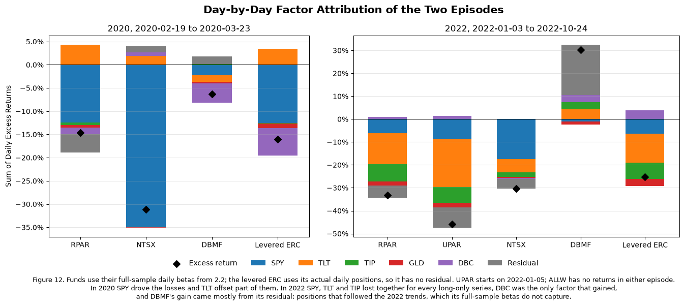

### Reading Figure 12

*What is plotted.* One bar per series per episode: 2020-02-19 to 2020-03-23 (24 days) and 2022-01-03 to 2022-10-24 (204 days).

* **Segments:** each factor's contribution, the fund's beta times the factor's summed daily excess return. For the levered ERC it is the actual daily position times the return.
* **Residual (gray):** what the factors do not explain. The levered ERC has none, because its positions are known exactly.
* **Diamond:** the actual summed excess return. The segments above zero minus those below add up to it.
* **Axes:** the two panels have different vertical scales. `UPAR` appears only in 2022, and `ALLW` has no returns in either episode.

*What to notice*

* **2020:** `SPY` (blue) dominates every long-only bar. `TLT` (orange) pushes back above zero for `RPAR` and the levered ERC, so bonds partly hedged the loss. `NTSX` is almost all `SPY`.
* **2022:** `TLT` and `TIP` (orange and green) are large negatives together with `SPY` for `RPAR`, `UPAR` and the levered ERC. Only `DBC` (purple) is positive.
* **`DBMF` in 2022:** the bar is mostly gray residual (+21.9% of its +30.2%), gains from trend positions a fixed beta cannot represent. Its `TLT` and `TIP` segments are positive because its full-sample betas on them are negative.

**Method**

The episodes are the short windows: 2020-02-19 to 2020-03-23 (24 days) and 2022-01-03 to 2022-10-24 (204 days).

* **Funds:** factor $k$'s contribution is $\beta_k \sum_t (r_{k,t} - r^f_t)$, with $\beta_k$ the fund's full-sample daily beta from 2.2. The residual is the fund's summed daily excess return minus the factor total. We split it into the fund's 2.2 intercept times the number of days and an unexplained remainder.
* **Levered ERC:** each day's contribution is the position held at the start of that day (drifted weight times leverage, reset at each month-end) times the asset's excess return. Its cash earns `SHV`, so this attribution is exact and has no residual.
* **Coverage:** `UPAR` has no 2020 episode and starts its 2022 episode on 2022-01-05. `ALLW` has no returns in either episode.

**2020: an equity shock**

* **`RPAR`:** −14.6% in summed daily excess return. `SPY` contributed −12.4%, `TLT` offset +4.3%, and `DBC`, `GLD` and `TIP` took another −2.5%.
  * Its factors explain only −10.6%. The other −4.0% is a residual, almost none of which is the usual intercept drag (−0.3%).
  * In this episode `RPAR` lost more than its betas imply. That fits its daily betas being understated (1.2 and 2.2: daily betas sum to 1.39, monthly ones to 1.53), which matters most when moves are large, and its commodity sleeve of producer equities falling with stocks (3.3).
* **Levered ERC:** −16.1%, with the same `SPY` (−12.5%) and `TLT` (+3.5%) contributions. It held far more broad commodities, though, and `DBC` cost it −6.0% against −1.4% for `RPAR`.
* **Other series:** `NTSX` lost −31.1%, nearly all of it from `SPY` (−34.9%). `DBMF` lost −6.4%, mostly through `DBC` (−4.2%).

**2022: a bond and inflation shock**

* **`RPAR`:** −33.2%. Here the losses came from the bond side: `TLT` −13.4% and `TIP` −7.7%, with `SPY` −6.3% and `GLD` −1.7%. `DBC` (+1.1%) was the only offset.
  * The residual is −5.2%: −2.9% is the intercept drag over 204 days, and −2.4% is unexplained.
* **`UPAR`:** the same pattern scaled up, at −45.9%.
* **Levered ERC:** lost less (−25.3%) with nearly the same bond losses (`TLT` −12.7%, `TIP` −7.0%). The 7.9-point difference from `RPAR` is mostly its larger `DBC` gain (+4.0% against +1.1%) and `RPAR`'s −5.2% residual.
* **`NTSX`:** lost −30.4%, mainly through `SPY` (−17.5%).
* **`DBMF`:** gained +30.2%, but its betas explain only +8.3%. The other +21.9% came from positions that followed the trends of 2022, which a full-sample beta cannot capture.

**Static against day-by-day**

The static approximation multiplies each beta (the episode-start position for the levered ERC) by the factor's compounded total return over the window. Static minus day-by-day, summed over factors, splits exactly into three pieces:

1. **Compounding:** $\beta \times$ (compounded total return − sum of daily total returns). A constant daily beta is a portfolio rebalanced every day; applying the beta to the compounded return treats the exposure as bought and held. Over large one-way moves the two differ: `TLT` summed −44.0% in 2022 but compounded to −36.6%, and `SPY` summed −37.7% in 2020 but compounded to −33.4%. This is the largest piece for every series: +1.1% for `RPAR` in 2020, +2.4% in 2022, and +3.7% for `NTSX` in 2020. It is negative only for `DBMF` in 2022 (−1.1%). Its betas on `TLT` and `TIP` are negative, and because the bond losses compounded to less than they summed to, its short exposure gained less in the static version.
2. **Cash:** $\beta \times$ the summed `SHV` return. The static version uses total returns, while the betas were fitted on excess returns. This is small (`SHV` returned 0.58% in the 2020 window and 0.19% in 2022) but scales with the sum of betas: +0.8% for `RPAR` in 2020, and zero for `DBMF`, whose betas nearly cancel.
3. **Weight drift and rebalancing (levered ERC only):** frozen episode-start positions against the positions actually held.
   * **2020: −1.4%.** As `SPY` and `DBC` fell, their positions shrank, so the portfolio lost less than its starting positions would have.
   * **2022: +1.0%.** Each month-end reset bought falling bonds back to target and restored the 1.55x leverage after losses, so it lost more than its starting positions would have.

**What the gap contains, and what it doesn't.** The gap contains three things: the compounding of the factor returns, the cash return the static version leaves in, and, for the ERC, the trading that kept its exposures from drifting. It contains none of the fund's residual. Neither attribution explains `RPAR`'s −4.0% in 2020 or `DBMF`'s +21.9% in 2022. The static total is also smaller in magnitude than the day-by-day one in every case, so it understates how much of each move the factors explain. For example, it attributes −8.7% to `RPAR`'s factors in 2020 against −10.6% day by day.

## 5.4

> Compare `RPAR` in 2020 and 2022 using the factor paths, the attribution in 5.3, the breach rates in 5.1 and 5.2, and the rolling sums of betas from 2.3. Explain the similarities and differences in at most half a page.

<table>
  <caption>RPAR in the two episodes. Factor paths and attribution over the short windows; breach statistics over the extended windows (to 2020-04-30 and 2022-12-30)</caption>
  <thead>
    <tr>
      <th>&nbsp;</th>
      <th>2020</th>
      <th>2022</th>
    </tr>
  </thead>
  <tbody>
    <tr>
      <th>Trading Days</th>
      <td>24</td>
      <td>204</td>
    </tr>
    <tr>
      <th>RPAR Total Return</th>
      <td>-13.6%</td>
      <td>-28.8%</td>
    </tr>
    <tr>
      <th>SPY Total Return</th>
      <td>-33.4%</td>
      <td>-19.3%</td>
    </tr>
    <tr>
      <th>TLT Total Return</th>
      <td>14.2%</td>
      <td>-36.6%</td>
    </tr>
    <tr>
      <th>TIP Total Return</th>
      <td>-0.6%</td>
      <td>-13.3%</td>
    </tr>
    <tr>
      <th>GLD Total Return</th>
      <td>-3.1%</td>
      <td>-10.1%</td>
    </tr>
    <tr>
      <th>DBC Total Return</th>
      <td>-25.0%</td>
      <td>20.1%</td>
    </tr>
    <tr>
      <th>SPY-TLT Correlation</th>
      <td>-0.50</td>
      <td>0.02</td>
    </tr>
    <tr>
      <th>Sum of Factors (5.3)</th>
      <td>-10.6%</td>
      <td>-28.0%</td>
    </tr>
    <tr>
      <th>Residual (5.3)</th>
      <td>-4.0%</td>
      <td>-5.2%</td>
    </tr>
    <tr>
      <th>Historical Breach Rate (5.1)</th>
      <td>—</td>
      <td>12.0%</td>
    </tr>
    <tr>
      <th>EWMA Breach Rate (5.1)</th>
      <td>15.7%</td>
      <td>9.2%</td>
    </tr>
    <tr>
      <th>EWMA Realized / CVaR (5.2)</th>
      <td>1.77</td>
      <td>1.06</td>
    </tr>
    <tr>
      <th>EWMA Worst Return / VaR (5.2)</th>
      <td>4.31</td>
      <td>2.56</td>
    </tr>
    <tr>
      <th>Sum of Betas, Last Window Before</th>
      <td>—</td>
      <td>1.36</td>
    </tr>
    <tr>
      <th>Sum of Betas, Windows Ending Inside</th>
      <td>—</td>
      <td>1.30 to 1.39</td>
    </tr>
    <tr>
      <th>Sum of Betas, First Window After</th>
      <td>1.25</td>
      <td>1.38</td>
    </tr>
  </tbody>
</table>

```text
First trailing 252-day RPAR regression ends 2020-12-14; no window ends before the 2020 episode
```

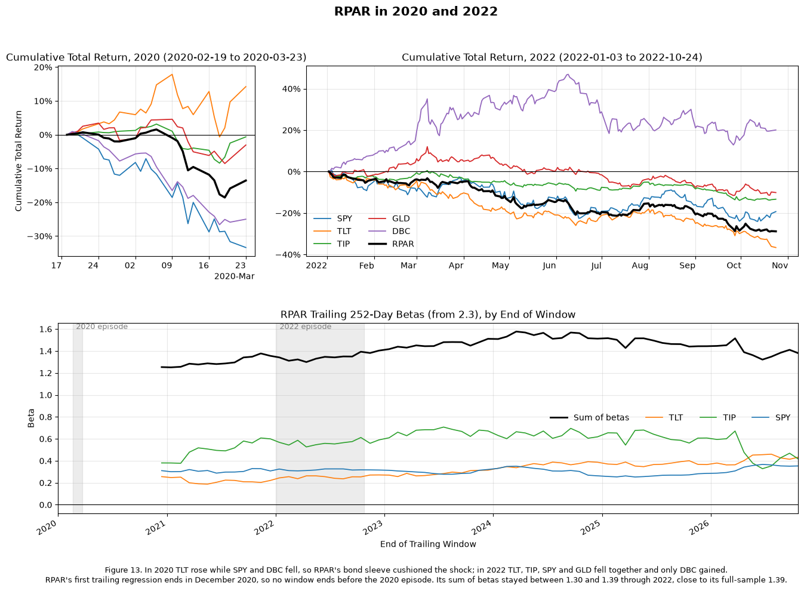

### Reading Figure 13

*Top: what happened in each episode.* Each line is the cumulative total return of one factor ETF through the episode, with `RPAR` in thick black. Every line starts at 0% at the close before the window. The 2020 panel covers about five weeks and the 2022 panel about ten months, and the vertical scales differ.

* **2020:** `TLT` (orange) rises while `SPY` (blue) and `DBC` (purple) fall, and `RPAR` ends up between them. The bond sleeve worked as a hedge.
* **2022:** every line except `DBC` ends below zero, and `RPAR` falls with `TLT` and `SPY`. Nothing in the portfolio hedged.

*Bottom: did `RPAR`'s exposure change?* These are `RPAR`'s trailing 252-day betas from Figure 3, plotted at the end of each window, for `TLT`, `TIP`, `SPY` and their sum (black). The gray bands mark the two episodes.

* **What a point covers:** a point inside the 2022 band is a regression on mostly 2021 data plus the part of 2022 so far.
* **No 2020 baseline:** the first window ends in December 2020, so there is no reading from before the 2020 episode.
* **What to look for:** a jump in the lines around the bands would mean `RPAR` changed its holdings. They are flat through 2022 (sum of betas 1.30 to 1.39), so the loss came from what it already held, not from a change in it.

**Similarities.** Both episodes were large losses for `RPAR`: −13.6% in 24 days in 2020 and −28.8% in 204 days in 2022. In both, its factor exposures explain most of the loss (−10.6% and −28.0% of summed excess return), with a negative residual on top (−4.0% and −5.2%). Both broke the VaR forecasts. EWMA breached on 15.7% and 9.2% of days against 5%, and the worst days were 4.3x and 2.6x the VaR. Its exposure did not shift going into either episode. The sum of betas was 1.25 in the first trailing window (which contains March 2020) and 1.30 to 1.39 across windows before and inside 2022, close to the full-sample 1.39. So the losses came from what `RPAR` holds, not from a change in it.

**Differences.**

* **What fell.** 2020 was an equity and commodity shock in which bonds worked as a hedge: `SPY` −33%, `DBC` −25%, `TLT` +14%, with a daily `SPY`–`TLT` correlation of −0.50. `TLT` contributed +4.3% against `SPY`'s −12.4%. 2022 was a rate shock: `TLT` −37%, `TIP` −13%, `SPY` −19% and `GLD` −10%, with a `SPY`–`TLT` correlation of 0.02. Only `DBC` gained (+20%), and `RPAR`'s small `DBC` beta captured just +1.1% of it. The bond and TIPS sleeves, the largest because they are the least volatile, supplied 21 points of the loss. Risk parity relies on its sleeves being diversifiers, and that held in 2020 but failed in 2022.
* **A jump against a grind.** In 2020 losses arrived faster than the forecasts could adapt: on breach days, realized losses were 1.77x the CVaR forecast. In 2022 the size of each breach was about right (1.06x CVaR), but there were too many of them (23 against 12.6 expected). Historical simulation, built on calm 2021, breached on 12% of days.
* **The residual.** In 2020 almost all of it is unexplained (−3.7% against an intercept of −0.3%). That fits the understated daily betas and the commodity-equity sleeve found in earlier sections. In 2022 more than half is the steady intercept drag (−2.9%), the same shortfall 4.4 found against the levered ERC.

2020 tested whether `RPAR`'s diversification held in an equity crash, and it partly did. 2022 hit the scenario risk parity is most exposed to: stocks and bonds falling together while the largest weights sit in duration. The loss was twice as large, built up slowly, and came from the portfolio's holdings, not from forecasts reacting too slowly.

# 6. Regime Drivers

**The table** gathers the inputs the question names into one view per episode: factor returns, the 5.3 attribution, the 5.1 and 5.2 breach statistics, and the rolling sums of betas.

## 6.1

> Choose two drivers from the list below. Construct each so that the value applied to month $t$ is known at the end of month $t-1$. Treat their relationships with returns as hypotheses to test.
>
> * trailing stock-bond correlation of `SPY` and `TLT`, on a 12-month window of monthly returns and on a 63-day window of daily returns
> * trailing 63-day realized volatility of `TLT`, annualized
> * trailing 63-day realized volatility of `SPY`, annualized
> * the three-month change in the 10-year zero-coupon yield on the `yields` sheet
>
> For `RPAR` over its life, and for the levered ERC portfolio and 60/40 over the full backtest, report the annualized mean, volatility and Sharpe ratio of monthly excess returns within each tercile of the driver, or on each side of zero for a correlation. The yields end 2026-07-31, so the yield driver's last month is August 2026.

```text
Yield-change terciles over the full backtest: below -0.17, between, and above +0.16 percentage points. Last yield on 2026-07-31, so the driver's last month is 2026-08.
```

<table>
  <caption>Months in each regime</caption>
  <thead>
    <tr>
      <th>&nbsp;</th>
      <th>&nbsp;</th>
      <th>Full backtest</th>
      <th>RPAR's life</th>
    </tr>
    <tr>
      <th>Driver</th>
      <th>Regime</th>
      <th>&nbsp;</th>
      <th>&nbsp;</th>
    </tr>
  </thead>
  <tbody>
    <tr>
      <th rowspan="2">Stock-Bond Correlation, 12 Months</th>
      <th>Negative</th>
      <td>137</td>
      <td>15</td>
    </tr>
    <tr>
      <th>Positive</th>
      <td>87</td>
      <td>66</td>
    </tr>
    <tr>
      <th rowspan="2">Stock-Bond Correlation, 63 Days</th>
      <th>Negative</th>
      <td>177</td>
      <td>40</td>
    </tr>
    <tr>
      <th>Positive</th>
      <td>47</td>
      <td>41</td>
    </tr>
    <tr>
      <th rowspan="3">10-Year Yield, 3-Month Change</th>
      <th>Falling</th>
      <td>75</td>
      <td>22</td>
    </tr>
    <tr>
      <th>Flat</th>
      <td>74</td>
      <td>22</td>
    </tr>
    <tr>
      <th>Rising</th>
      <td>74</td>
      <td>36</td>
    </tr>
  </tbody>
</table>

```text
Full backtest: the 12-month and 63-day correlations have the same sign in 79% of months; their correlation with each other is 0.76
RPAR's life: the 12-month and 63-day correlations have the same sign in 69% of months; their correlation with each other is 0.62
```

<table>
  <caption>Monthly excess returns by the sign of the SPY-TLT correlation over the 12 months to the end of the previous month</caption>
  <thead>
    <tr>
      <th>&nbsp;</th>
      <th>&nbsp;</th>
      <th>&nbsp;</th>
      <th>Months</th>
      <th>Annualized Mean</th>
      <th>Annualized Volatility</th>
      <th>Sharpe Ratio</th>
    </tr>
    <tr>
      <th>Sample</th>
      <th>Strategy</th>
      <th>Regime</th>
      <th>&nbsp;</th>
      <th>&nbsp;</th>
      <th>&nbsp;</th>
      <th>&nbsp;</th>
    </tr>
  </thead>
  <tbody>
    <tr>
      <th rowspan="4">Full backtest</th>
      <th rowspan="2">Levered ERC</th>
      <th>Negative</th>
      <td>137</td>
      <td>7.02%</td>
      <td>11.74%</td>
      <td>0.60</td>
    </tr>
    <tr>
      <th>Positive</th>
      <td>87</td>
      <td>5.07%</td>
      <td>11.58%</td>
      <td>0.44</td>
    </tr>
    <tr>
      <th rowspan="2">60/40</th>
      <th>Negative</th>
      <td>137</td>
      <td>7.99%</td>
      <td>8.77%</td>
      <td>0.91</td>
    </tr>
    <tr>
      <th>Positive</th>
      <td>87</td>
      <td>6.20%</td>
      <td>10.66%</td>
      <td>0.58</td>
    </tr>
    <tr>
      <th rowspan="6">RPAR's life</th>
      <th rowspan="2">RPAR</th>
      <th>Negative</th>
      <td>15</td>
      <td>10.71%</td>
      <td>12.50%</td>
      <td>0.86</td>
    </tr>
    <tr>
      <th>Positive</th>
      <td>66</td>
      <td>-0.65%</td>
      <td>13.68%</td>
      <td>-0.05</td>
    </tr>
    <tr>
      <th rowspan="2">Levered ERC</th>
      <th>Negative</th>
      <td>15</td>
      <td>9.88%</td>
      <td>14.43%</td>
      <td>0.68</td>
    </tr>
    <tr>
      <th>Positive</th>
      <td>66</td>
      <td>4.79%</td>
      <td>12.09%</td>
      <td>0.40</td>
    </tr>
    <tr>
      <th rowspan="2">60/40</th>
      <th>Negative</th>
      <td>15</td>
      <td>13.81%</td>
      <td>12.74%</td>
      <td>1.08</td>
    </tr>
    <tr>
      <th>Positive</th>
      <td>66</td>
      <td>5.18%</td>
      <td>10.86%</td>
      <td>0.48</td>
    </tr>
  </tbody>
</table>

<table>
  <caption>Monthly excess returns by the sign of the SPY-TLT correlation over the 63 trading days to the end of the previous month</caption>
  <thead>
    <tr>
      <th>&nbsp;</th>
      <th>&nbsp;</th>
      <th>&nbsp;</th>
      <th>Months</th>
      <th>Annualized Mean</th>
      <th>Annualized Volatility</th>
      <th>Sharpe Ratio</th>
    </tr>
    <tr>
      <th>Sample</th>
      <th>Strategy</th>
      <th>Regime</th>
      <th>&nbsp;</th>
      <th>&nbsp;</th>
      <th>&nbsp;</th>
      <th>&nbsp;</th>
    </tr>
  </thead>
  <tbody>
    <tr>
      <th rowspan="4">Full backtest</th>
      <th rowspan="2">Levered ERC</th>
      <th>Negative</th>
      <td>177</td>
      <td>6.04%</td>
      <td>11.53%</td>
      <td>0.52</td>
    </tr>
    <tr>
      <th>Positive</th>
      <td>47</td>
      <td>7.09%</td>
      <td>12.23%</td>
      <td>0.58</td>
    </tr>
    <tr>
      <th rowspan="2">60/40</th>
      <th>Negative</th>
      <td>177</td>
      <td>6.65%</td>
      <td>9.19%</td>
      <td>0.72</td>
    </tr>
    <tr>
      <th>Positive</th>
      <td>47</td>
      <td>9.72%</td>
      <td>10.78%</td>
      <td>0.90</td>
    </tr>
    <tr>
      <th rowspan="6">RPAR's life</th>
      <th rowspan="2">RPAR</th>
      <th>Negative</th>
      <td>40</td>
      <td>-4.00%</td>
      <td>12.39%</td>
      <td>-0.32</td>
    </tr>
    <tr>
      <th>Positive</th>
      <td>41</td>
      <td>6.78%</td>
      <td>14.41%</td>
      <td>0.47</td>
    </tr>
    <tr>
      <th rowspan="2">Levered ERC</th>
      <th>Negative</th>
      <td>40</td>
      <td>0.72%</td>
      <td>12.35%</td>
      <td>0.06</td>
    </tr>
    <tr>
      <th>Positive</th>
      <td>41</td>
      <td>10.62%</td>
      <td>12.58%</td>
      <td>0.84</td>
    </tr>
    <tr>
      <th rowspan="2">60/40</th>
      <th>Negative</th>
      <td>40</td>
      <td>2.36%</td>
      <td>11.08%</td>
      <td>0.21</td>
    </tr>
    <tr>
      <th>Positive</th>
      <td>41</td>
      <td>11.09%</td>
      <td>11.29%</td>
      <td>0.98</td>
    </tr>
  </tbody>
</table>

<table>
  <caption>Monthly excess returns by tercile of the 10-year zero-coupon yield's change over the three months to the end of the previous month</caption>
  <thead>
    <tr>
      <th>&nbsp;</th>
      <th>&nbsp;</th>
      <th>&nbsp;</th>
      <th>Months</th>
      <th>Annualized Mean</th>
      <th>Annualized Volatility</th>
      <th>Sharpe Ratio</th>
    </tr>
    <tr>
      <th>Sample</th>
      <th>Strategy</th>
      <th>Regime</th>
      <th>&nbsp;</th>
      <th>&nbsp;</th>
      <th>&nbsp;</th>
      <th>&nbsp;</th>
    </tr>
  </thead>
  <tbody>
    <tr>
      <th rowspan="6">Full backtest</th>
      <th rowspan="3">Levered ERC</th>
      <th>Falling</th>
      <td>75</td>
      <td>7.20%</td>
      <td>11.71%</td>
      <td>0.61</td>
    </tr>
    <tr>
      <th>Flat</th>
      <td>74</td>
      <td>9.05%</td>
      <td>12.26%</td>
      <td>0.74</td>
    </tr>
    <tr>
      <th>Rising</th>
      <td>74</td>
      <td>3.25%</td>
      <td>11.00%</td>
      <td>0.30</td>
    </tr>
    <tr>
      <th rowspan="3">60/40</th>
      <th>Falling</th>
      <td>75</td>
      <td>7.17%</td>
      <td>9.42%</td>
      <td>0.76</td>
    </tr>
    <tr>
      <th>Flat</th>
      <td>74</td>
      <td>8.14%</td>
      <td>9.08%</td>
      <td>0.90</td>
    </tr>
    <tr>
      <th>Rising</th>
      <td>74</td>
      <td>6.96%</td>
      <td>10.20%</td>
      <td>0.68</td>
    </tr>
    <tr>
      <th rowspan="9">RPAR's life</th>
      <th rowspan="3">RPAR</th>
      <th>Falling</th>
      <td>22</td>
      <td>-4.28%</td>
      <td>10.88%</td>
      <td>-0.39</td>
    </tr>
    <tr>
      <th>Flat</th>
      <td>22</td>
      <td>11.87%</td>
      <td>11.87%</td>
      <td>1.00</td>
    </tr>
    <tr>
      <th>Rising</th>
      <td>36</td>
      <td>0.55%</td>
      <td>15.46%</td>
      <td>0.04</td>
    </tr>
    <tr>
      <th rowspan="3">Levered ERC</th>
      <th>Falling</th>
      <td>22</td>
      <td>-1.67%</td>
      <td>11.67%</td>
      <td>-0.14</td>
    </tr>
    <tr>
      <th>Flat</th>
      <td>22</td>
      <td>19.09%</td>
      <td>11.11%</td>
      <td>1.72</td>
    </tr>
    <tr>
      <th>Rising</th>
      <td>36</td>
      <td>3.56%</td>
      <td>13.44%</td>
      <td>0.27</td>
    </tr>
    <tr>
      <th rowspan="3">60/40</th>
      <th>Falling</th>
      <td>22</td>
      <td>3.85%</td>
      <td>10.61%</td>
      <td>0.36</td>
    </tr>
    <tr>
      <th>Flat</th>
      <td>22</td>
      <td>11.33%</td>
      <td>9.81%</td>
      <td>1.15</td>
    </tr>
    <tr>
      <th>Rising</th>
      <td>36</td>
      <td>6.58%</td>
      <td>12.55%</td>
      <td>0.52</td>
    </tr>
  </tbody>
</table>

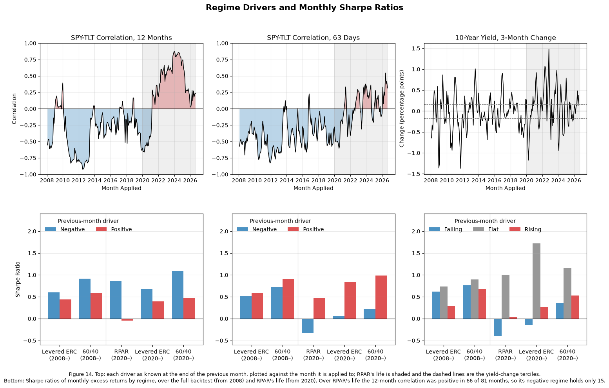

### Reading Figure 14

*Top row: the drivers.* Each panel plots one driver against the month it is applied to, so the point at, say, March 2022 is the value known at the close of February 2022. The gray band marks `RPAR`'s life, from 2020-01.

* **Correlation panels (left and middle):** red fill marks the positive regime and blue the negative one. The question to ask is how often the color changes.
  * The 12-month correlation was negative almost continuously from 2008 to 2020, turned positive in 2021 and has stayed there. Its regimes are a few long runs, not many separate months.
  * The 63-day correlation flips more often, and it was still negative going into the first half of 2022.
* **Yield panel (right):** the dashed lines are the tercile breakpoints, −0.17 and +0.16 percentage points. A month above the upper line is "Rising", below the lower line "Falling", and between them "Flat". The series jumps around with no runs. Its largest rise, about 1.5 points in 2022, falls inside `RPAR`'s life, while its largest falls came in 2008–2011.

*Bottom row: Sharpe ratios by regime.* Each panel sits below the driver it splits on. Each group of bars is one strategy in one sample: "(2008–)" is the full backtest and "(2020–)" is `RPAR`'s life, separated by the vertical line. The colors match the top row: blue is the regime hypothesized to be good (negative correlation, falling yields), red the one hypothesized to be bad, and gray the flat tercile.

* **Within one group:** a taller blue bar means the strategy did better after the good regime, as hypothesized. Left panel: blue is taller in every group. Middle panel: red is taller in every group, the reverse of the hypothesis. Right panel: no consistent order.
* **Across the vertical line:** comparing the same strategy in the two samples shows whether a pattern depends on the period. 6.2 tests this properly, on samples that do not overlap.
* **Caution:** the bars hide how many months each one rests on. `RPAR`'s blue bar in the left panel is only 15 months, all from one run in 2020–21. Check the Months column of the tables before reading much into a bar.

**Choice.** We use the stock-bond correlation, at both horizons, and the three-month change in the 10-year yield. Risk parity's case rests on stocks and bonds offsetting each other, so the correlation tests that assumption. The levered ERC portfolio and `RPAR` hold their largest weights in duration (`TIP` and `TLT`, 4.1 and 4.4), and those sleeves did the most damage in 2022 (5.3), so the yield change tests that exposure directly. We left out the realized volatilities: ERC already resets its weights to trailing volatility each month, which partly absorbs a volatility signal.

**Construction.** Every driver is measured at the last close of month $t-1$ and applied to month $t$.

* **12-month correlation:** `SPY` and `TLT` returns from the `monthly returns` sheet, months $t-12$ to $t-1$.
* **63-day correlation:** daily returns over the 63 trading days ending on the last trading day of month $t-1$.
* **Yield change:** the 10-year zero-coupon yield on the last date of month $t-1$ minus its value at the end of month $t-4$, in percentage points. The yields end 2026-07-31, so this driver's last month is August 2026.
* **Returns:** monthly returns compound the daily ones within each calendar month (for `RPAR` this matches the `monthly returns` sheet), and excess returns subtract `SHV` compounded over the same month. Only full months are used: 2008-02 to 2026-09 for the backtest and 2020-01 to 2026-09 for `RPAR`.
* **Regimes:** the correlations are split at zero. The yield-change terciles are set over the backtest's 223 months, at −0.17 and +0.16 percentage points. We apply the same breakpoints to `RPAR`'s life, so "rising" means the same thing in both samples. With them, `RPAR`'s life has 22 falling, 22 flat and 36 rising months. The breakpoints use the whole sample, so they describe regimes and are not a tradable rule; each month's driver value is known in advance.
* **Extra rows:** the tables also show the levered ERC and 60/40 over `RPAR`'s life, so 6.2 can compare the samples on the same strategies.

**What the tables show** (interpretation in 6.2)

* **12-month correlation:** every strategy had a higher Sharpe ratio after negative-correlation months, in both samples.
  * Full backtest: levered ERC 0.60 against 0.44; 60/40 0.91 against 0.58.
  * `RPAR`'s life: `RPAR` 0.86 against −0.05. But the correlation was negative before only 15 of `RPAR`'s 81 months.
* **63-day correlation:** the direction reverses. Months after a positive correlation had the higher Sharpe ratio for every strategy.
  * Full backtest: the gap is small (levered ERC 0.58 against 0.52; 60/40 0.90 against 0.72).
  * `RPAR`'s life: the gap is large (`RPAR` 0.47 against −0.32; levered ERC 0.84 against 0.06).
  * The two horizons share a sign in 79% of backtest months and 69% of `RPAR`'s.
* **Yield change:**
  * Full backtest: rising-yield months were the levered ERC's weakest tercile (Sharpe 0.30, against 0.61 falling and 0.74 flat), while 60/40 barely varied (0.68 to 0.90).
  * `RPAR`'s life: the flat tercile was best for all three strategies and the falling tercile worst, with `RPAR` at −0.39 and the levered ERC at −0.14.
* **Volatility:** it differs by at most five points across regimes, so the Sharpe differences come mostly from the means.
* **Sample size:** a regime holds 15 to 41 months over `RPAR`'s life. With so few months, a Sharpe ratio's standard error is roughly $\sqrt{12/n}$, about 0.5 to 0.9, so most of these differences are within noise.

**The tables.**

* ***Months in each regime:*** comes first because every Sharpe ratio in the next tables is only as reliable as the number of months behind it. It shows just 15 negative-correlation months over `RPAR`'s life, and a 22/22/36 tercile split.
* ***The three regime tables:*** the statistics the question asks for, one table per driver.

## 6.2

> Which drivers separate good months from bad, for which strategies, and does the separation hold in both samples? Compare the two drivers in one concise interpretation, including both horizons if you chose stock-bond correlation.

<table>
  <caption>Good regime against bad, in two non-overlapping samples. Correlation with Driver uses the driver's value, not its regime</caption>
  <thead>
    <tr>
      <th>&nbsp;</th>
      <th>&nbsp;</th>
      <th>&nbsp;</th>
      <th>Good Regime</th>
      <th>Good / Bad Months</th>
      <th>Good Spells</th>
      <th>Sharpe, Good</th>
      <th>Sharpe, Bad</th>
      <th>Mean Difference (Good - Bad)</th>
      <th>t-stat</th>
      <th>Correlation with Driver</th>
    </tr>
    <tr>
      <th>Driver</th>
      <th>Sample</th>
      <th>Strategy</th>
      <th>&nbsp;</th>
      <th>&nbsp;</th>
      <th>&nbsp;</th>
      <th>&nbsp;</th>
      <th>&nbsp;</th>
      <th>&nbsp;</th>
      <th>&nbsp;</th>
      <th>&nbsp;</th>
    </tr>
  </thead>
  <tbody>
    <tr>
      <th rowspan="5">Stock-Bond Correlation, 12 Months</th>
      <th rowspan="2">Before RPAR</th>
      <th>Levered ERC</th>
      <td>Negative</td>
      <td>122 / 21</td>
      <td>7</td>
      <td>0.58</td>
      <td>0.59</td>
      <td>+0.71%</td>
      <td>+0.08</td>
      <td>-0.01</td>
    </tr>
    <tr>
      <th>60/40</th>
      <td>Negative</td>
      <td>122 / 21</td>
      <td>7</td>
      <td>0.89</td>
      <td>0.92</td>
      <td>-2.13%</td>
      <td>-0.26</td>
      <td>-0.02</td>
    </tr>
    <tr>
      <th rowspan="3">RPAR's life</th>
      <th>RPAR</th>
      <td>Negative</td>
      <td>15 / 66</td>
      <td>1</td>
      <td>0.86</td>
      <td>-0.05</td>
      <td>+11.36%</td>
      <td>+0.90</td>
      <td>-0.10</td>
    </tr>
    <tr>
      <th>Levered ERC</th>
      <td>Negative</td>
      <td>15 / 66</td>
      <td>1</td>
      <td>0.68</td>
      <td>0.40</td>
      <td>+5.09%</td>
      <td>+0.37</td>
      <td>-0.08</td>
    </tr>
    <tr>
      <th>60/40</th>
      <td>Negative</td>
      <td>15 / 66</td>
      <td>1</td>
      <td>1.08</td>
      <td>0.48</td>
      <td>+8.63%</td>
      <td>+0.70</td>
      <td>-0.04</td>
    </tr>
    <tr>
      <th rowspan="5">Stock-Bond Correlation, 63 Days</th>
      <th rowspan="2">Before RPAR</th>
      <th>Levered ERC</th>
      <td>Negative</td>
      <td>137 / 6</td>
      <td>6</td>
      <td>0.67</td>
      <td>-2.58</td>
      <td>+24.62%</td>
      <td>+2.49</td>
      <td>-0.07</td>
    </tr>
    <tr>
      <th>60/40</th>
      <td>Negative</td>
      <td>137 / 6</td>
      <td>6</td>
      <td>0.92</td>
      <td>0.05</td>
      <td>+7.57%</td>
      <td>+0.82</td>
      <td>-0.05</td>
    </tr>
    <tr>
      <th rowspan="3">RPAR's life</th>
      <th>RPAR</th>
      <td>Negative</td>
      <td>40 / 41</td>
      <td>8</td>
      <td>-0.32</td>
      <td>0.47</td>
      <td>-10.78%</td>
      <td>-1.04</td>
      <td>+0.03</td>
    </tr>
    <tr>
      <th>Levered ERC</th>
      <td>Negative</td>
      <td>40 / 41</td>
      <td>8</td>
      <td>0.06</td>
      <td>0.84</td>
      <td>-9.90%</td>
      <td>-1.03</td>
      <td>+0.00</td>
    </tr>
    <tr>
      <th>60/40</th>
      <td>Negative</td>
      <td>40 / 41</td>
      <td>8</td>
      <td>0.21</td>
      <td>0.98</td>
      <td>-8.73%</td>
      <td>-1.01</td>
      <td>+0.03</td>
    </tr>
    <tr>
      <th rowspan="5">10-Year Yield, 3-Month Change</th>
      <th rowspan="2">Before RPAR</th>
      <th>Levered ERC</th>
      <td>Falling</td>
      <td>53 / 38</td>
      <td>20</td>
      <td>0.93</td>
      <td>0.36</td>
      <td>+7.93%</td>
      <td>+1.10</td>
      <td>-0.02</td>
    </tr>
    <tr>
      <th>60/40</th>
      <td>Falling</td>
      <td>53 / 38</td>
      <td>20</td>
      <td>0.95</td>
      <td>0.97</td>
      <td>+1.23%</td>
      <td>+0.21</td>
      <td>+0.03</td>
    </tr>
    <tr>
      <th rowspan="3">RPAR's life</th>
      <th>RPAR</th>
      <td>Falling</td>
      <td>22 / 36</td>
      <td>11</td>
      <td>-0.39</td>
      <td>0.04</td>
      <td>-4.83%</td>
      <td>-0.40</td>
      <td>+0.07</td>
    </tr>
    <tr>
      <th>Levered ERC</th>
      <td>Falling</td>
      <td>22 / 36</td>
      <td>11</td>
      <td>-0.14</td>
      <td>0.27</td>
      <td>-5.24%</td>
      <td>-0.45</td>
      <td>+0.05</td>
    </tr>
    <tr>
      <th>60/40</th>
      <td>Falling</td>
      <td>22 / 36</td>
      <td>11</td>
      <td>0.36</td>
      <td>0.52</td>
      <td>-2.73%</td>
      <td>-0.26</td>
      <td>+0.01</td>
    </tr>
  </tbody>
</table>

<table>
  <caption>Correlation of monthly excess returns with each driver and with the same quantity measured over the same month</caption>
  <thead>
    <tr>
      <th>&nbsp;</th>
      <th>&nbsp;</th>
      <th>Yield Change, Previous 3 Months (Driver)</th>
      <th>Yield Change, Same Month</th>
      <th>SPY-TLT Correlation, Previous 63 Days (Driver)</th>
      <th>SPY-TLT Correlation, Same Month</th>
    </tr>
    <tr>
      <th>Sample</th>
      <th>Strategy</th>
      <th>&nbsp;</th>
      <th>&nbsp;</th>
      <th>&nbsp;</th>
      <th>&nbsp;</th>
    </tr>
  </thead>
  <tbody>
    <tr>
      <th rowspan="2">Before RPAR</th>
      <th>Levered ERC</th>
      <td>-0.02</td>
      <td>-0.56</td>
      <td>-0.07</td>
      <td>-0.05</td>
    </tr>
    <tr>
      <th>60/40</th>
      <td>+0.03</td>
      <td>-0.07</td>
      <td>-0.05</td>
      <td>+0.09</td>
    </tr>
    <tr>
      <th rowspan="3">RPAR's life</th>
      <th>RPAR</th>
      <td>+0.07</td>
      <td>-0.74</td>
      <td>+0.03</td>
      <td>-0.20</td>
    </tr>
    <tr>
      <th>Levered ERC</th>
      <td>+0.05</td>
      <td>-0.62</td>
      <td>+0.00</td>
      <td>-0.18</td>
    </tr>
    <tr>
      <th>60/40</th>
      <td>+0.01</td>
      <td>-0.54</td>
      <td>+0.03</td>
      <td>-0.08</td>
    </tr>
  </tbody>
</table>

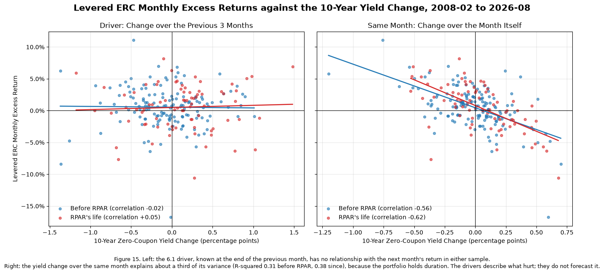

### Reading Figure 15

*What is plotted.* Each dot is one month from 2008-02 to 2026-08: the levered ERC's monthly excess return (vertical axis) against a change in the 10-year zero-coupon yield (horizontal axis). Blue dots are before `RPAR`, red dots are `RPAR`'s life. Each line is a least-squares fit for its sample, and the legend gives the correlation.

* **Left panel:** the horizontal axis is the 6.1 driver, the yield change over the three months ending at the previous month-end. It is known before the month starts, so this panel asks whether the driver forecasts the return.
* **Right panel:** the horizontal axis is the yield change during the same month. It is not known in advance, so this panel asks whether yields explain the return after the fact.
* **Axes:** the two panels share the vertical axis but not the horizontal one. Three-month changes run to about ±1.5 points, one-month changes to about ±0.7.

*How to read it.* A cloud sloping down means months of rising yields went with losses. A flat line means no relationship.

* **Left panel, the driver:** both lines are flat (correlations −0.02 and +0.05). Knowing the previous three months' yield move tells you nothing about the next month's return, in either sample.
* **Right panel, the same month:** both lines slope down (correlations −0.56 and −0.62).
  * The slopes are −6.9% and −8.1% of return per percentage point of yield, so the portfolio behaved roughly as if it held 7 to 8 years of 10-year-equivalent duration.
  * The red line is a little steeper. That is consistent with the bond sleeves offsetting less of the move since 2020.

*Why it matters.* The relationship is real but simultaneous: rate moves hit the portfolio in the month they happen and do not continue into the next. That is why the regime splits in 6.1 and 6.2 find so little. A driver measured at $t-1$ can describe the environment, but it cannot see the move that does the damage.

**Neither driver separates good months from bad in a way that holds in both samples.** We test them on two non-overlapping samples, the backtest before `RPAR` (2008-02 to 2019-12) and `RPAR`'s life. The good regimes were fixed in advance: negative stock-bond correlation and falling yields. The 6.1 full-backtest sample contains `RPAR`'s life, so it is not a second test. No difference across these splits has a |t| above 1.1 except one cell built on six months. The correlation between a driver's value and the next month's excess return is between −0.10 and +0.07 for every strategy in both samples.

* **12-month correlation:** no effect before 2020. The levered ERC's Sharpe ratio was 0.58 after negative months and 0.59 after positive ones; 60/40's was 0.89 and 0.92. Over `RPAR`'s life, negative months were better (`RPAR` 0.86 against −0.05, t = 0.90). But all 15 of those months are one spell, January 2020 to March 2021, the recovery from the COVID drawdown. This one episode is also the source of the full-backtest difference in 6.1, so the evidence is close to a single observation.
* **63-day correlation:** the result reverses between samples.
  * Before 2020 the correlation was positive in only six isolated months. The levered ERC lost money in four of them, which gives a Sharpe ratio of −2.58 and the one large t-statistic (2.49).
  * Over `RPAR`'s life, negative-correlation months were the worse ones for all three strategies (t ≈ −1.0). The cause is 2022: the 63-day correlation was still negative before seven of its months, including January to June. Excluding 2022, `RPAR` averaged 5.0% a year after negative months and 6.8% after positive ones.
  * The two horizons share a sign in 69% to 79% of months, but the 12-month split amounts to 2020 against everything after, while the 63-day split changes sign every few months (16 spells over `RPAR`'s life). The two horizons point opposite ways over `RPAR`'s life, which is another sign that neither result is robust.
* **Yield change:** before 2020, falling-yield months were better for the levered ERC (0.93 against 0.36, t = 1.10) but not for 60/40 (0.95 against 0.97). Over `RPAR`'s life the order reverses: falling-yield months were the worst tercile for `RPAR` (−0.39) and the levered ERC (−0.14). The flat tercile's lead in 6.1 does not hold across samples either.

**Comparing the two drivers.** Both describe what hurts risk parity, but neither forecasts it.

* **The yield change matters, but in the same month.** The 10-year yield's change over month $t$ is correlated −0.56 with the levered ERC's excess return before 2020, −0.62 since, and −0.74 with `RPAR`'s (Figure 15). The change over the previous three months, which is all that is known in advance, has a correlation near zero. Rate moves hit a duration-heavy portfolio immediately and then do not persist. For 60/40 the same-month link appears only after 2020 (−0.07 before, −0.54 since), because stocks and bonds stopped offsetting each other.
* **The stock-bond correlation describes the environment rather than the next month.** It is persistent, which makes each regime a few long episodes rather than many independent months. Its switch to positive from 2021 coincides with risk parity's weakest period. That fits the 5.4 diagnosis of 2022, when the bonds and TIPS stopped diversifying. As a timing signal it fails at both horizons. The 12-month correlation turned positive in April 2021, ahead of 2022, but stayed positive through the recovery, so positive months still earned the levered ERC a Sharpe ratio of 0.40. The 63-day correlation turned only after the damage had started. The same-month stock-bond correlation is only weakly related to returns (−0.20 to +0.09).
* **Which strategies:** both drivers matter most for the duration-heavy portfolios, `RPAR` and the levered ERC, and for 60/40 only once the stock-bond hedge failed. None of the splits is strong or stable enough to justify switching allocations on.

# 7. The Allocation

Choose the evaluation criteria, cost assumptions, allocation rule, and comparison window. Different allocations and recommendations can be supported by the evidence; explain the choices that determine yours.

**The tables.**

* ***Good regime against bad:*** the formal test. It fixes the hypothesis in advance, uses two non-overlapping samples, and reports t-statistics and the number of separate spells, that is, how many independent episodes stand behind each regime.
* ***Correlation with each driver and with the same quantity in the same month:*** separates "describes" from "forecasts". The same-month yield change is strongly related to returns (−0.54 to −0.74 where it matters); the drivers, known in advance, are near zero.

## 7.1

> Before computing any Section 7 result, write a dated markdown cell stating
>
> * at least three pass-fail criteria a strategy must meet for you to run it, each numeric and tied to a statistic from Sections 1 to 6
> * a cost per unit of one-way turnover
> * a borrowing spread over `SHV` on levered exposure
>
> Give a source or a one-sentence rationale for each cost. Keep the original declaration. Record any revision in a second dated cell. The design uses evidence from the full history; Section 7 is a retrospective evaluation, not an untouched test.

**Declaration, 2026-10-30.** Written before any Section 7 result was computed. The thresholds use evidence from Sections 1 to 6, which cover the full history, so Section 7 is a retrospective check against these thresholds, not an untouched test.

**Pass-fail criteria.** A strategy must pass all four, on the window it is evaluated over, for us to run it. Each comparison with 60/40 uses the same window, and the live funds' returns are already net of their fees.

1. **Sharpe ratio above the diversification hurdle.** Net Sharpe ratio > (correlation of its daily returns with 60/40) × (60/40's Sharpe ratio).
   * *Why this hurdle:* adding a small weight of a strategy to 60/40 raises 60/40's Sharpe ratio only if the strategy clears it.
   * *Reference values:* 60/40's Sharpe ratio was 0.66 over the full backtest (4.2) and 0.57 over `RPAR`'s life (4.4). `RPAR`'s daily correlation with 60/40 was 0.70 (Figure 1). Together those put the hurdle near 0.40.
2. **Maximum drawdown no deeper than 60/40's.**
   * *Reference values:* 60/40's maximum drawdown was −30.8% over the full backtest (4.2) and −21.0% over `RPAR`'s life (1.1).
   * *Why:* a risk-balanced portfolio is sold on avoiding the deep losses of a stock-heavy one. If it does not, its lower Sharpe ratio buys nothing.
3. **2022 calendar-year total return no worse than 60/40's −16.4%** (1.1, 4.2).
   * *Why:* 5.3 and 5.4 identified 2022, when stocks and bonds fell together, as the scenario risk parity is most exposed to.
   * *Reference values:* `RPAR` lost 22.8% that year and the unlevered ERC 11.7%.
4. **Daily correlation with 60/40 of at most 0.80.**
   * *Why:* above that level a strategy is mostly a re-levered 60/40, which `NTSX` (correlation 0.97, Figure 1) already offers for a 0.20% fee.
   * *Reference values:* the risk-parity products sit at 0.70 to 0.75 (Figure 1).

**Costs.** These apply to our strategy and to the levered ERC portfolio. The live funds already bear their own costs.

* **Trading: 0.10% per unit of one-way turnover** (10 basis points of the value traded).
  * *Rationale:* all five ETFs are large, exchange-listed U.S. funds. 10 basis points is a conservative allowance for half the bid-ask spread plus market impact and commissions, set high enough to cover `DBC`, the least liquid of them.
* **Borrowing: 0.75% a year over `SHV`** on the borrowed amount (gross exposure minus net asset value), charged daily.
  * *Source:* Interactive Brokers' IBKR Pro USD margin rates are its benchmark rate plus 1% on balances from \$100,000 to \$1 million, plus 0.75% from \$1 million to \$50 million, and plus 0.5% above that (interactivebrokers.com, Margin Rates and Financing, accessed 2026-10-30). We take the middle tier as the cost for an allocator of moderate size.
  * *A conservative choice:* financing through Treasury futures, as `RPAR` does, would usually be cheaper.

At the 4.3 levered ERC's leverage (1.55x) and turnover (0.35 a year), these costs come to about 0.45% a year. That is below `RPAR`'s 0.52% expense ratio, so running the rule directly is not ruled out by cost.

<table>
  <caption>Pass-fail criteria declared 2026-10-30</caption>
  <thead>
    <tr>
      <th>&nbsp;</th>
      <th>Rule</th>
    </tr>
  </thead>
  <tbody>
    <tr>
      <th>Sharpe above diversification hurdle</th>
      <td>Net Sharpe> correlation with 60/40 x 60/40's Sharpe</td>
    </tr>
    <tr>
      <th>Max drawdown no deeper than 60/40's</th>
      <td>Max drawdown>= 60/40's max drawdown</td>
    </tr>
    <tr>
      <th>2022 return no worse than 60/40's</th>
      <td>2022 calendar-year total return>= 60/40's (-16.4%)</td>
    </tr>
    <tr>
      <th>Correlation with 60/40 at most 0.80</th>
      <td>Daily return correlation with 60/40 <= 0.80</td>
    </tr>
  </tbody>
</table>

```text
Trading cost 0.10% per unit of one-way turnover; borrowing spread 0.75% a year over SHV on the borrowed amount
```

## 7.2

> Build one risk-balanced strategy you would run, from the asset-class ETFs and, if you choose, a sleeve of `DBMF` or another live fund. Any signal uses information available at the month-end before it acts. State the rule in full. Backtest it over the longest window the rule allows and report
>
> * annualized mean and volatility, Sharpe ratio and maximum drawdown, plus any other metric needed to apply your criteria
> * one-way turnover per year
> * returns gross and net of the costs declared in 7.1

**The rule: trend-filtered ERC at a 10% volatility target**

At the close of each month-end $t-1$, using only data through that close, set the positions held through month $t$:

1. **Weights.** Compute ERC weights $\boldsymbol{w}$ on `SPY`, `TLT`, `TIP`, `GLD` and `DBC` from the sample covariance of the trailing 252 daily returns, exactly as in 4.1. The weights sum to one.
2. **Leverage.** Forecast the portfolio's volatility as $\hat\sigma = \sqrt{252\,\boldsymbol{w}'\hat\Sigma\boldsymbol{w}}$ from the same covariance. Set $L = \min(10\% / \hat\sigma,\ 2)$.
3. **Trend filter.** For each asset, sum its daily excess returns over `SHV` across the trailing 252 days.
   * If the sum is positive, the asset's position is $L\,w_i$.
   * If not, its position is zero and that share of capital stays in `SHV`.
   * The filter is applied after the leverage is set, so a filtered asset's risk is not handed to the others.
4. **Cash and borrowing.** Cash is one minus the sum of positions. When the positions sum to more than one, the difference is borrowed at `SHV` plus the 0.75% spread declared in 7.1.
5. **Between resets.** Positions are held without trading until the next month-end, so weights and leverage drift.

**Costs (7.1)**

* Trading: 0.10% times the one-way turnover at each reset, counting changes in weights, leverage and filter switches.
* Financing: 0.75% a year on the amount borrowed.

**Window.** The first month-end with 252 days of history for all five ETFs is 2007-02-28, so the backtest runs from 2007-03-01 to 2026-10-23. That is the longest window the rule allows, about eleven months longer than the 4.1 backtest.

**Why this rule**

* **ERC as the base:** it balances risk across the five asset classes, and 4.4 found that `RPAR`, with a similar allocation, trailed this simplified ERC benchmark, so running the rule directly is a reasonable starting point.
* **The volatility target:** it replaces 4.3's single full-sample leverage, which was chosen with hindsight, with one set from data known at the time. 10% sits just below 60/40's 11.3%. The filter then lowers realized risk further, which helps the drawdown and 2022 comparisons; the Sharpe-ratio criterion does not depend on scale.
* **The 2x cap:** it limits financing risk when the bond sleeves look calm. It is similar to `UPAR`'s 1.6 to 1.8 times exposure.
* **The trend filter:** this targets the failure found in 5.3 and 5.4. In 2022 the bond and TIPS sleeves, ERC's largest, fell for months while the trailing covariance still showed them diversifying. 6.2 found that regime drivers known in advance do not time individual months. A trend filter makes no forecast: it steps aside once an asset has lost money over a year, and 3.2 showed a trend rule on these same ETFs captures part of `DBMF`.
* **No `DBMF` sleeve:** it would cut the backtest to the 2020s, about six years, while the filter covers the full history.

<table>
  <caption>Trend-filtered ERC at a 10% volatility target, 2007-03-01 to 2026-10-23; costs 0.10% per unit of turnover and 0.75% a year on borrowing</caption>
  <thead>
    <tr>
      <th>&nbsp;</th>
      <th>Annualized Mean</th>
      <th>Annualized Volatility</th>
      <th>Sharpe Ratio</th>
      <th>Max Drawdown</th>
      <th>Peak Date</th>
      <th>Trough Date</th>
      <th>Recovery Date</th>
      <th>2022 Return</th>
      <th>Correlation with 60/40</th>
      <th>Sharpe Hurdle</th>
      <th>One-Way Turnover per Year</th>
      <th>Average Gross Exposure</th>
      <th>Annual Cost</th>
    </tr>
  </thead>
  <tbody>
    <tr>
      <th>Strategy, net</th>
      <td>7.25%</td>
      <td>8.77%</td>
      <td>0.65</td>
      <td>-22.74%</td>
      <td>2020-03-06</td>
      <td>2020-03-18</td>
      <td>2020-08-06</td>
      <td>-6.79%</td>
      <td>0.39</td>
      <td>0.24</td>
      <td>1.33</td>
      <td>1.06</td>
      <td>0.33%</td>
    </tr>
    <tr>
      <th>Strategy, gross</th>
      <td>7.58%</td>
      <td>8.77%</td>
      <td>0.69</td>
      <td>-22.73%</td>
      <td>2020-03-06</td>
      <td>2020-03-18</td>
      <td>2020-08-06</td>
      <td>-6.60%</td>
      <td>0.39</td>
      <td>0.24</td>
      <td>1.33</td>
      <td>1.06</td>
      <td>0.00%</td>
    </tr>
    <tr>
      <th>ERC, unlevered (4.2)</th>
      <td>5.93%</td>
      <td>7.20%</td>
      <td>0.60</td>
      <td>-17.97%</td>
      <td>2022-03-08</td>
      <td>2022-10-20</td>
      <td>2024-07-16</td>
      <td>-11.70%</td>
      <td>0.60</td>
      <td>0.38</td>
      <td>—</td>
      <td>1.00</td>
      <td>—</td>
    </tr>
    <tr>
      <th>60/40</th>
      <td>8.70%</td>
      <td>11.25%</td>
      <td>0.63</td>
      <td>-31.41%</td>
      <td>2007-12-10</td>
      <td>2009-03-09</td>
      <td>2010-09-20</td>
      <td>-16.38%</td>
      <td>1.00</td>
      <td>0.63</td>
      <td>—</td>
      <td>1.00</td>
      <td>—</td>
    </tr>
  </tbody>
</table>

```text
Leverage before the filter: median 1.59x, at the 2x cap in 19% of months. Months with net borrowing: 56%; with every asset filtered out: 1%.
Share of months each asset was filtered out: SPY 16%, TLT 44%, TIP 37%, GLD 28%, DBC 48%
Annual cost: trading 0.13%, financing 0.20%
```

```text
Months in which the filter raised the forecast volatility: 6 of 236
```

<table>
  <caption>Sensitivity to the rule's settings, net of costs, same window</caption>
  <thead>
    <tr>
      <th>&nbsp;</th>
      <th>Annualized Mean</th>
      <th>Annualized Volatility</th>
      <th>Sharpe Ratio</th>
      <th>Max Drawdown</th>
      <th>2022 Return</th>
      <th>Correlation with 60/40</th>
      <th>One-Way Turnover per Year</th>
    </tr>
  </thead>
  <tbody>
    <tr>
      <th>Chosen (10%, 2x, 12-month filter)</th>
      <td>7.25%</td>
      <td>8.77%</td>
      <td>0.65</td>
      <td>-22.74%</td>
      <td>-6.79%</td>
      <td>0.39</td>
      <td>1.33</td>
    </tr>
    <tr>
      <th>No trend filter</th>
      <td>7.28%</td>
      <td>10.95%</td>
      <td>0.52</td>
      <td>-29.07%</td>
      <td>-15.30%</td>
      <td>0.58</td>
      <td>0.48</td>
    </tr>
    <tr>
      <th>8% target</th>
      <td>6.26%</td>
      <td>7.19%</td>
      <td>0.65</td>
      <td>-18.82%</td>
      <td>-5.24%</td>
      <td>0.39</td>
      <td>1.12</td>
    </tr>
    <tr>
      <th>12% target</th>
      <td>8.08%</td>
      <td>9.85%</td>
      <td>0.66</td>
      <td>-22.74%</td>
      <td>-8.35%</td>
      <td>0.38</td>
      <td>1.45</td>
    </tr>
    <tr>
      <th>1.5x cap</th>
      <td>6.83%</td>
      <td>7.73%</td>
      <td>0.68</td>
      <td>-17.24%</td>
      <td>-6.76%</td>
      <td>0.38</td>
      <td>1.11</td>
    </tr>
    <tr>
      <th>6-month filter</th>
      <td>7.43%</td>
      <td>8.46%</td>
      <td>0.69</td>
      <td>-22.74%</td>
      <td>-6.92%</td>
      <td>0.31</td>
      <td>1.88</td>
    </tr>
  </tbody>
</table>

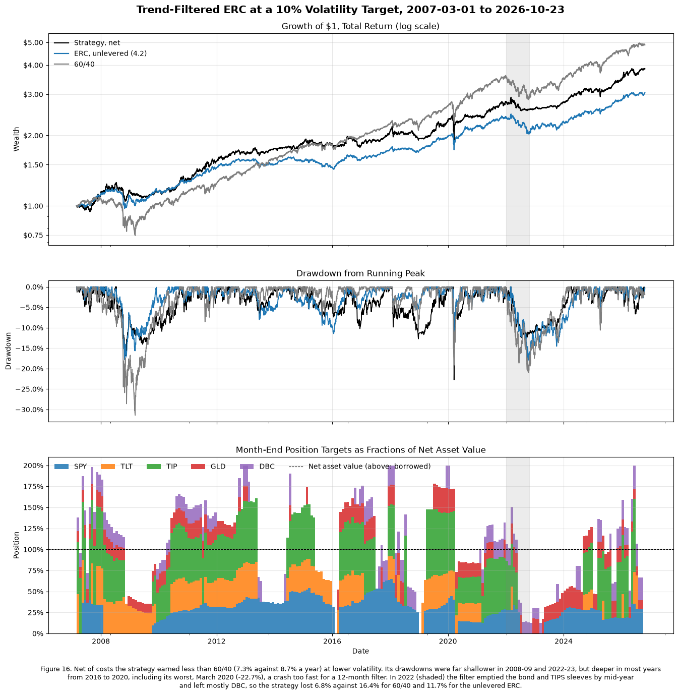

### Reading Figure 16

*Top: growth of \$1.* Total return from 2007-03-01, net of the 7.1 costs for the strategy, on a log scale: equal vertical distances are equal percentage gains. Black is the strategy, blue the unlevered ERC from 4.2, gray 60/40. A line that ends higher compounded more. Its slope at any point is its return then.

*Middle: drawdowns.* How far each line sits below its own previous peak, the same measure as Figure 2. Compare depths across the whole period, not just the single worst dip.

*Bottom: what the strategy held.* The month-end targets, as fractions of net asset value, held through the following month.

* **Total height:** above the dashed line at 100%, the strategy is borrowing. Below it, the rest of the capital is in `SHV`.
* **A missing color:** that asset's 12-month excess return was not positive, so the filter moved it to cash.
* **A short stack:** most assets were filtered out at once. Late 2008 and July to October 2022 are the clearest cases.

*What to notice*

* **2008–09 and 2022 (shaded):** the black drawdown is far shallower than the gray one. The bottom panel shows why. In 2022 `TLT` was already out from late 2021 (except for one month), `TIP` and `SPY` left by mid-year, and by July only `DBC` was held.
* **March 2020:** the black line has its deepest, sharpest drop. The positions were set at the end of February at the 2x leverage cap, a gross exposure of 1.72x with `DBC` already filtered out, before any other trend had turned. A 12-month filter cannot react within weeks.
* **2016 to 2019:** the black drawdowns are often deeper than 60/40's. Assets moving in and out on short-lived trends cost money (whipsaw), which is the price of the protection above.
* **The top panel:** 60/40 ends higher. The strategy's case is risk, not return: lower volatility, much smaller losses in the two worst bond-and-stock years, and a correlation with 60/40 of 0.39.

**Results, 2007-03-01 to 2026-10-23, net of costs**

| | Strategy (net) | Strategy (gross) | 60/40 |
|---|---:|---:|---:|
| Annualized mean | 7.25% | 7.58% | 8.70% |
| Annualized volatility | 8.77% | 8.77% | 11.25% |
| Sharpe ratio | 0.65 | 0.69 | 0.63 |
| Maximum drawdown | −22.7% | −22.7% | −31.4% |
| 2022 total return | −6.8% | −6.6% | −16.4% |

* **Maximum drawdown:** −22.7% from 2020-03-06 to 2020-03-18, recovered by 2020-08-06. 60/40's (−31.4%) was in 2008–09.
* **The criteria metrics:** correlation with 60/40 is 0.39, so the Sharpe hurdle is 0.39 × 0.63 = 0.24. 7.4 applies the criteria.

**Turnover and costs**

* **Turnover:** 1.33 a year one way, almost four times the 4.3 levered ERC's 0.35. Filter switches account for most of it: an asset leaving or re-entering trades its whole position.
* **Costs:** 0.33% a year, 0.13% trading and 0.20% financing. That costs 0.04 of Sharpe ratio, and comes in below `RPAR`'s 0.52% expense ratio.

**What the strategy actually held**

* **Leverage:** the target set a median leverage of 1.59x, at the 2x cap in 19% of months.
* **The filter:** it kept a large share in cash. Average gross exposure was only 1.06x, and the strategy borrowed in 56% of months.
* **How often each asset was out:** `SPY` 16% of months, `GLD` 28%, `TIP` 37%, `TLT` 44%, `DBC` 48%.
* **Realized volatility:** 8.8%, below the 10% target for the same reason. Volatility is targeted before the filter. Removing positions lowered the forecast volatility in all but 6 of 236 months; the exceptions are months when the asset removed had been hedging the others.

**Against the unlevered ERC over the same window**

* **Better:** Sharpe ratio 0.65 against 0.60; 2022 −6.8% against −11.7%; correlation with 60/40 0.39 against 0.60.
* **Worse:** maximum drawdown −22.7% against −18.0%. Exposure was near its highest going into 2020: at the 2x cap at the end of 2019 and 1.72x at the end of February 2020. March 2020 then fell too fast for the filter.

**Sensitivity**

* **Changing one setting:** an 8% or 12% target, a 1.5x cap or a 6-month filter keeps the net Sharpe ratio between 0.65 and 0.69, the 2022 return between −5.2% and −8.3%, and the correlation with 60/40 between 0.31 and 0.39.
* **Removing the filter:** this is what matters. A volatility-targeted ERC without it has a Sharpe ratio of 0.52, a −29.1% maximum drawdown and −15.3% in 2022, close to 60/40's. Leverage alone, after financing costs, does not improve ERC.

**Caveats**

* **Hindsight:** the filter was chosen knowing that 2022 hurt risk parity, and 3.2 found trend works on these ETFs. The stable sensitivity results show the result is not tuned to one setting, but not that it is out of sample.
* **Lower return than 60/40:** it earns less, so an investor who needs 60/40's return would have to run it at a higher target, with more borrowing.
* **Fast crashes:** they remain its weak point, as March 2020 shows.

**The table.** *Sensitivity to the rule's settings* changes one setting at a time, to show the result is not tuned to the chosen parameters. Its no-filter row isolates what the trend filter contributes.

## 7.3

> Place your strategy beside `RPAR`, `ALLW`, `NTSX`, `DBMF`, the levered ERC portfolio from 4.3 and 60/40 on one common window you choose. Report
>
> * annualized mean and volatility, Sharpe ratio and maximum drawdown, net of your declared costs where leverage or turnover applies; add any metric needed for your criteria
> * the pairwise correlations of daily returns on the common window

<table>
  <caption>Common window 2019-12-16 to 2026-10-23. Net of the 7.1 costs for the 7.2 strategy and the levered ERC; fund returns are net of their fees. ALLW starts 2025-03-07, so its statistics, correlation and hurdle use its own shorter sample, against 60/40 on the same dates</caption>
  <thead>
    <tr>
      <th>&nbsp;</th>
      <th>First Return</th>
      <th>Annualized Mean</th>
      <th>Annualized Volatility</th>
      <th>Sharpe Ratio</th>
      <th>Max Drawdown</th>
      <th>Peak Date</th>
      <th>Trough Date</th>
      <th>Recovery Date</th>
      <th>2022 Return</th>
      <th>Correlation with 60/40</th>
      <th>60/40 Sharpe, Same Dates</th>
      <th>60/40 Max Drawdown, Same Dates</th>
      <th>Sharpe Hurdle</th>
    </tr>
  </thead>
  <tbody>
    <tr>
      <th>7.2 Strategy</th>
      <td>2019-12-16</td>
      <td>8.16%</td>
      <td>9.32%</td>
      <td>0.58</td>
      <td>-22.74%</td>
      <td>2020-03-06</td>
      <td>2020-03-18</td>
      <td>2020-08-06</td>
      <td>-6.79%</td>
      <td>0.55</td>
      <td>0.57</td>
      <td>-21.02%</td>
      <td>0.31</td>
    </tr>
    <tr>
      <th>RPAR</th>
      <td>2019-12-16</td>
      <td>4.32%</td>
      <td>12.56%</td>
      <td>0.13</td>
      <td>-30.14%</td>
      <td>2021-11-09</td>
      <td>2022-10-20</td>
      <td>2026-01-26</td>
      <td>-22.80%</td>
      <td>0.70</td>
      <td>0.57</td>
      <td>-21.02%</td>
      <td>0.40</td>
    </tr>
    <tr>
      <th>ALLW</th>
      <td>2025-03-07</td>
      <td>12.80%</td>
      <td>12.10%</td>
      <td>0.74</td>
      <td>-8.78%</td>
      <td>2025-04-02</td>
      <td>2025-04-08</td>
      <td>2025-06-02</td>
      <td>—</td>
      <td>0.75</td>
      <td>0.84</td>
      <td>-8.15%</td>
      <td>0.63</td>
    </tr>
    <tr>
      <th>NTSX</th>
      <td>2019-12-16</td>
      <td>13.25%</td>
      <td>19.08%</td>
      <td>0.55</td>
      <td>-31.34%</td>
      <td>2021-12-27</td>
      <td>2022-10-14</td>
      <td>2024-06-12</td>
      <td>-25.84%</td>
      <td>0.97</td>
      <td>0.57</td>
      <td>-21.02%</td>
      <td>0.55</td>
    </tr>
    <tr>
      <th>DBMF</th>
      <td>2019-12-16</td>
      <td>9.47%</td>
      <td>12.46%</td>
      <td>0.54</td>
      <td>-20.44%</td>
      <td>2022-10-20</td>
      <td>2023-03-24</td>
      <td>2025-12-19</td>
      <td>21.53%</td>
      <td>0.10</td>
      <td>0.57</td>
      <td>-21.02%</td>
      <td>0.06</td>
    </tr>
    <tr>
      <th>Levered ERC</th>
      <td>2019-12-16</td>
      <td>8.60%</td>
      <td>12.94%</td>
      <td>0.46</td>
      <td>-27.14%</td>
      <td>2022-03-08</td>
      <td>2022-10-20</td>
      <td>2025-06-17</td>
      <td>-18.86%</td>
      <td>0.67</td>
      <td>0.57</td>
      <td>-21.02%</td>
      <td>0.39</td>
    </tr>
    <tr>
      <th>60/40</th>
      <td>2019-12-16</td>
      <td>9.69%</td>
      <td>12.14%</td>
      <td>0.57</td>
      <td>-21.02%</td>
      <td>2021-12-27</td>
      <td>2022-10-14</td>
      <td>2024-02-22</td>
      <td>-16.38%</td>
      <td>1.00</td>
      <td>0.57</td>
      <td>-21.02%</td>
      <td>0.57</td>
    </tr>
  </tbody>
</table>

<table>
  <caption>ALLW's window, 2025-03-07 to 2026-10-23 (411 days)</caption>
  <thead>
    <tr>
      <th>&nbsp;</th>
      <th>Annualized Mean</th>
      <th>Annualized Volatility</th>
      <th>Sharpe Ratio</th>
      <th>Max Drawdown</th>
      <th>Peak Date</th>
      <th>Trough Date</th>
      <th>Recovery Date</th>
      <th>Correlation with 60/40</th>
      <th>60/40 Sharpe, Same Dates</th>
      <th>60/40 Max Drawdown, Same Dates</th>
      <th>Sharpe Hurdle</th>
    </tr>
  </thead>
  <tbody>
    <tr>
      <th>7.2 Strategy</th>
      <td>13.97%</td>
      <td>9.56%</td>
      <td>1.06</td>
      <td>-7.72%</td>
      <td>2025-04-02</td>
      <td>2025-04-08</td>
      <td>2025-07-18</td>
      <td>0.61</td>
      <td>0.84</td>
      <td>-8.15%</td>
      <td>0.51</td>
    </tr>
    <tr>
      <th>RPAR</th>
      <td>9.64%</td>
      <td>11.19%</td>
      <td>0.52</td>
      <td>-9.18%</td>
      <td>2026-02-27</td>
      <td>2026-10-07</td>
      <td>—</td>
      <td>0.73</td>
      <td>0.84</td>
      <td>-8.15%</td>
      <td>0.61</td>
    </tr>
    <tr>
      <th>ALLW</th>
      <td>12.80%</td>
      <td>12.10%</td>
      <td>0.74</td>
      <td>-8.78%</td>
      <td>2025-04-02</td>
      <td>2025-04-08</td>
      <td>2025-06-02</td>
      <td>0.75</td>
      <td>0.84</td>
      <td>-8.15%</td>
      <td>0.63</td>
    </tr>
    <tr>
      <th>NTSX</th>
      <td>17.59%</td>
      <td>16.65%</td>
      <td>0.83</td>
      <td>-12.29%</td>
      <td>2025-03-25</td>
      <td>2025-04-08</td>
      <td>2025-05-12</td>
      <td>0.96</td>
      <td>0.84</td>
      <td>-8.15%</td>
      <td>0.80</td>
    </tr>
    <tr>
      <th>DBMF</th>
      <td>20.83%</td>
      <td>11.31%</td>
      <td>1.50</td>
      <td>-6.10%</td>
      <td>2026-02-27</td>
      <td>2026-03-23</td>
      <td>2026-06-02</td>
      <td>0.28</td>
      <td>0.84</td>
      <td>-8.15%</td>
      <td>0.23</td>
    </tr>
    <tr>
      <th>Levered ERC</th>
      <td>14.46%</td>
      <td>10.31%</td>
      <td>1.03</td>
      <td>-8.34%</td>
      <td>2025-04-02</td>
      <td>2025-04-08</td>
      <td>2025-06-13</td>
      <td>0.63</td>
      <td>0.84</td>
      <td>-8.15%</td>
      <td>0.52</td>
    </tr>
    <tr>
      <th>60/40</th>
      <td>12.65%</td>
      <td>10.55%</td>
      <td>0.84</td>
      <td>-8.15%</td>
      <td>2025-03-25</td>
      <td>2025-04-08</td>
      <td>2025-05-12</td>
      <td>1.00</td>
      <td>0.84</td>
      <td>-8.15%</td>
      <td>0.84</td>
    </tr>
  </tbody>
</table>

<table>
  <caption>Correlations of daily returns, 2019-12-16 to 2026-10-23; pairs with ALLW from 2025-03-07</caption>
  <thead>
    <tr>
      <th>&nbsp;</th>
      <th>7.2 Strategy</th>
      <th>RPAR</th>
      <th>ALLW</th>
      <th>NTSX</th>
      <th>DBMF</th>
      <th>Levered ERC</th>
      <th>60/40</th>
    </tr>
  </thead>
  <tbody>
    <tr>
      <th>7.2 Strategy</th>
      <td>1.00</td>
      <td>0.67</td>
      <td>0.81</td>
      <td>0.51</td>
      <td>0.39</td>
      <td>0.81</td>
      <td>0.55</td>
    </tr>
    <tr>
      <th>RPAR</th>
      <td>0.67</td>
      <td>1.00</td>
      <td>0.90</td>
      <td>0.65</td>
      <td>0.01</td>
      <td>0.88</td>
      <td>0.70</td>
    </tr>
    <tr>
      <th>ALLW</th>
      <td>0.81</td>
      <td>0.90</td>
      <td>1.00</td>
      <td>0.72</td>
      <td>0.39</td>
      <td>0.88</td>
      <td>0.75</td>
    </tr>
    <tr>
      <th>NTSX</th>
      <td>0.51</td>
      <td>0.65</td>
      <td>0.72</td>
      <td>1.00</td>
      <td>0.11</td>
      <td>0.62</td>
      <td>0.97</td>
    </tr>
    <tr>
      <th>DBMF</th>
      <td>0.39</td>
      <td>0.01</td>
      <td>0.39</td>
      <td>0.11</td>
      <td>1.00</td>
      <td>0.10</td>
      <td>0.10</td>
    </tr>
    <tr>
      <th>Levered ERC</th>
      <td>0.81</td>
      <td>0.88</td>
      <td>0.88</td>
      <td>0.62</td>
      <td>0.10</td>
      <td>1.00</td>
      <td>0.67</td>
    </tr>
    <tr>
      <th>60/40</th>
      <td>0.55</td>
      <td>0.70</td>
      <td>0.75</td>
      <td>0.97</td>
      <td>0.10</td>
      <td>0.67</td>
      <td>1.00</td>
    </tr>
  </tbody>
</table>

```text
Costs on the levered ERC over the common window: 0.45% a year; on the 7.2 strategy: 0.23% a year
```

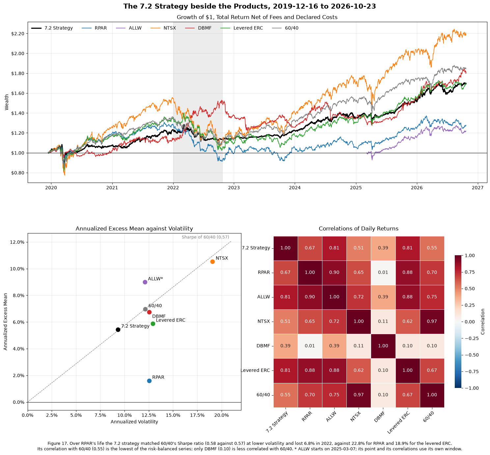

### Reading Figure 17

*Top: growth of \$1.* Each line compounds the series' total return from its first day in the window, net of fund fees, and, for the 7.2 strategy and the levered ERC, net of the 7.1 costs. A line above \$1 has made money since it started. The shaded band is the 2022 episode.

* **`ALLW` (purple) starts at \$1 on 2025-03-07,** not in 2019. Compare its slope since 2025 with the other lines, not its level.

*Bottom left: excess mean against volatility.* The same view as Figure 1, over the common window.

* **The dashed ray** is 60/40's Sharpe ratio. Points on it match 60/40 per unit of risk; points above beat it.
* **The 7.2 strategy** sits on the ray at lower volatility: the same Sharpe ratio with less risk.
* **`RPAR`** sits far below it.
* **`ALLW*`** is above it, but over a different and much shorter, much better period.

*Bottom right: correlations of daily returns.* Read as in Figure 1. Pairs with `ALLW` cover its window only.

* **The risk-parity cluster:** `RPAR`, `ALLW` and the levered ERC correlate 0.88 to 0.90.
* **The 7.2 strategy:** less tied to that cluster (0.67 with `RPAR`) and to 60/40 (0.55), because the filter often holds fewer assets.
* **Its link to `DBMF`:** 0.39, the trend component the two share.
* **`DBMF`** is close to uncorrelated with everything except `ALLW` and the 7.2 strategy.

**The window: `RPAR`'s life, 2019-12-16 to 2026-10-23.**

* **Why this window:** it is the longest one in which every series except `ALLW` has returns, and it contains both stress episodes, 2020 and 2022.
* **Why not `ALLW`'s window:** `ALLW`'s 1.6 years would drop both episodes, and the 2022 criterion with them. So `ALLW`'s figures use its own dates, against 60/40 on the same dates, and a second table puts every series on `ALLW`'s window.
* **Costs:** the 7.2 strategy and the levered ERC are net of the 7.1 costs, 0.23% and 0.45% a year here. The funds' returns are already net of their fees.
* **A caveat on the levered ERC:** its 1.55x leverage was fitted to the full backtest in 4.3, so it still has some hindsight.

| | Mean | Volatility | Sharpe | Max drawdown | 2022 | Correlation with 60/40 |
|---|---:|---:|---:|---:|---:|---:|
| 7.2 strategy (net) | 8.2% | 9.3% | 0.58 | −22.7% | −6.8% | 0.55 |
| `RPAR` | 4.3% | 12.6% | 0.13 | −30.1% | −22.8% | 0.70 |
| `ALLW`* | 12.8% | 12.1% | 0.74 | −8.8% | — | 0.75 |
| `NTSX` | 13.3% | 19.1% | 0.55 | −31.3% | −25.8% | 0.97 |
| `DBMF` | 9.5% | 12.5% | 0.54 | −20.4% | +21.5% | 0.10 |
| Levered ERC (net) | 8.6% | 12.9% | 0.46 | −27.1% | −18.9% | 0.67 |
| 60/40 | 9.7% | 12.1% | 0.57 | −21.0% | −16.4% | 1.00 |

\* From 2025-03-07. 60/40's Sharpe ratio over the same dates was 0.84.

**What the comparison shows**

* **The 7.2 strategy:**
  * It matched 60/40's Sharpe ratio (0.58 against 0.57) at lower volatility.
  * It had the best 2022 of anything but `DBMF`.
  * Its drawdown was 1.7 points deeper than 60/40's in this window. The −22.7% came in March 2020, which this window includes while 60/40's 2008 drawdown falls outside it.
  * Its Sharpe ratio is lower here than over its full backtest (0.65), because the window holds its worst episode and only one of the two years the filter helped most.
* **The rule against `RPAR`:**
  * The levered ERC, net of costs, beat `RPAR` by 0.33 of Sharpe ratio, with a correlation of 0.88, and lost 18.9% in 2022 against `RPAR`'s 22.8%.
  * `RPAR` underperformed a simplified, retrospectively built ERC benchmark. The gap may reflect implementation, but also portfolio design, financing, fees and exposures the five ETFs do not capture (4.4), so it is not a measure of implementation cost alone.
* **`NTSX`:** close to a levered 60/40, with correlation 0.97 and a similar Sharpe ratio at 1.6 times the volatility. It had the deepest 2022 loss.
* **`DBMF`:** the only real diversifier among the funds. It is close to uncorrelated with `RPAR` (0.01) and 60/40 (0.10), and gained 21.5% in 2022. Its Sharpe ratio (0.54) is slightly below 60/40's.
* **`ALLW`, on its own window:**
  * Every series did well, and `ALLW`'s 0.74 trails 60/40's 0.84, the 7.2 strategy's 1.06, the levered ERC's 1.03 and `DBMF`'s 1.50.
  * At 411 days, a Sharpe ratio's standard error is about $1/\sqrt{1.63} \approx 0.8$. None of these differences can be told apart.

**Correlations**

* **The risk-parity products are one cluster:** `RPAR`, `ALLW` and the levered ERC correlate 0.88 to 0.90.
* **The 7.2 strategy sits partly outside it:** 0.67 with `RPAR`, 0.81 with the levered ERC and with `ALLW`, and 0.55 with 60/40, because the filter often drops assets.
* **Its 0.39 with `DBMF`** is the trend component they share.

**The tables.**

* ***`ALLW`'s window:*** puts every series on `ALLW`'s 411 days, so its short record is compared like for like rather than against longer samples.
* ***Correlations of daily returns:*** show which products are really the same exposure.

## 7.4

> Judge three things separately: the allocation rule, `RPAR`'s implementation of it, and your own design. Apply the criteria from 7.1 and say which passed. Say how much weight `ALLW`'s record can carry given its length, and name one observable result over the next year that would reverse your recommendation. Half a page.

<table>
  <caption>The 7.1 criteria, each against 60/40 over the same dates. ALLW has no 2022, so it is tested on three</caption>
  <thead>
    <tr>
      <th>&nbsp;</th>
      <th>&nbsp;</th>
      <th>Start</th>
      <th>End</th>
      <th>Sharpe</th>
      <th>Hurdle</th>
      <th>1. Sharpe</th>
      <th>Max Drawdown</th>
      <th>60/40 Max Drawdown</th>
      <th>2. Drawdown</th>
      <th>2022 Return</th>
      <th>60/40 2022 Return</th>
      <th>3. 2022</th>
      <th>Correlation</th>
      <th>4. Correlation</th>
      <th>Passed</th>
    </tr>
    <tr>
      <th>Subject</th>
      <th>Window</th>
      <th>&nbsp;</th>
      <th>&nbsp;</th>
      <th>&nbsp;</th>
      <th>&nbsp;</th>
      <th>&nbsp;</th>
      <th>&nbsp;</th>
      <th>&nbsp;</th>
      <th>&nbsp;</th>
      <th>&nbsp;</th>
      <th>&nbsp;</th>
      <th>&nbsp;</th>
      <th>&nbsp;</th>
      <th>&nbsp;</th>
      <th>&nbsp;</th>
    </tr>
  </thead>
  <tbody>
    <tr>
      <th rowspan="2">The rule: levered ERC, net</th>
      <th>Full backtest</th>
      <td>2008-02-01</td>
      <td>2026-10-23</td>
      <td>0.52</td>
      <td>0.40</td>
      <td>Pass</td>
      <td>-27.6%</td>
      <td>-30.8%</td>
      <td>Pass</td>
      <td>-18.9%</td>
      <td>-16.4%</td>
      <td>Fail</td>
      <td>0.61</td>
      <td>Pass</td>
      <td>3 of 4</td>
    </tr>
    <tr>
      <th>Common window</th>
      <td>2019-12-16</td>
      <td>2026-10-23</td>
      <td>0.46</td>
      <td>0.39</td>
      <td>Pass</td>
      <td>-27.1%</td>
      <td>-21.0%</td>
      <td>Fail</td>
      <td>-18.9%</td>
      <td>-16.4%</td>
      <td>Fail</td>
      <td>0.67</td>
      <td>Pass</td>
      <td>2 of 4</td>
    </tr>
    <tr>
      <th>RPAR</th>
      <th>Common window (its life)</th>
      <td>2019-12-16</td>
      <td>2026-10-23</td>
      <td>0.13</td>
      <td>0.40</td>
      <td>Fail</td>
      <td>-30.1%</td>
      <td>-21.0%</td>
      <td>Fail</td>
      <td>-22.8%</td>
      <td>-16.4%</td>
      <td>Fail</td>
      <td>0.70</td>
      <td>Pass</td>
      <td>1 of 4</td>
    </tr>
    <tr>
      <th rowspan="2">7.2 strategy, net</th>
      <th>Full backtest</th>
      <td>2007-03-01</td>
      <td>2026-10-23</td>
      <td>0.65</td>
      <td>0.24</td>
      <td>Pass</td>
      <td>-22.7%</td>
      <td>-31.4%</td>
      <td>Pass</td>
      <td>-6.8%</td>
      <td>-16.4%</td>
      <td>Pass</td>
      <td>0.39</td>
      <td>Pass</td>
      <td>4 of 4</td>
    </tr>
    <tr>
      <th>Common window</th>
      <td>2019-12-16</td>
      <td>2026-10-23</td>
      <td>0.58</td>
      <td>0.31</td>
      <td>Pass</td>
      <td>-22.7%</td>
      <td>-21.0%</td>
      <td>Fail</td>
      <td>-6.8%</td>
      <td>-16.4%</td>
      <td>Pass</td>
      <td>0.55</td>
      <td>Pass</td>
      <td>3 of 4</td>
    </tr>
    <tr>
      <th>ALLW</th>
      <th>Its life</th>
      <td>2025-03-07</td>
      <td>2026-10-23</td>
      <td>0.74</td>
      <td>0.63</td>
      <td>Pass</td>
      <td>-8.8%</td>
      <td>-8.1%</td>
      <td>Fail</td>
      <td>—</td>
      <td>—</td>
      <td>—</td>
      <td>0.75</td>
      <td>Pass</td>
      <td>2 of 3</td>
    </tr>
    <tr>
      <th>NTSX</th>
      <th>Common window</th>
      <td>2019-12-16</td>
      <td>2026-10-23</td>
      <td>0.55</td>
      <td>0.55</td>
      <td>Fail</td>
      <td>-31.3%</td>
      <td>-21.0%</td>
      <td>Fail</td>
      <td>-25.8%</td>
      <td>-16.4%</td>
      <td>Fail</td>
      <td>0.97</td>
      <td>Fail</td>
      <td>0 of 4</td>
    </tr>
    <tr>
      <th>DBMF</th>
      <th>Common window</th>
      <td>2019-12-16</td>
      <td>2026-10-23</td>
      <td>0.54</td>
      <td>0.06</td>
      <td>Pass</td>
      <td>-20.4%</td>
      <td>-21.0%</td>
      <td>Pass</td>
      <td>21.5%</td>
      <td>-16.4%</td>
      <td>Pass</td>
      <td>0.10</td>
      <td>Pass</td>
      <td>4 of 4</td>
    </tr>
  </tbody>
</table>

```text
ALLW: 411 days (1.63 years). 
Standard error of its Sharpe ratio about 0.78; 
Of its difference from 60/40's (correlation 0.75) about 0.55. 
Years for a difference of 0.3 to reach two standard errors: about 22
```

<table>
  <caption>Six-month stretches, by ending month, in which SPY and TLT each lost more than 10%</caption>
  <thead>
    <tr>
      <th>&nbsp;</th>
      <th>SPY</th>
      <th>TLT</th>
      <th>60/40</th>
      <th>7.2 Strategy</th>
    </tr>
    <tr>
      <th>Date</th>
      <th>&nbsp;</th>
      <th>&nbsp;</th>
      <th>&nbsp;</th>
      <th>&nbsp;</th>
    </tr>
  </thead>
  <tbody>
    <tr>
      <th>2022-06</th>
      <td>-20.0%</td>
      <td>-21.9%</td>
      <td>-16.0%</td>
      <td>-6.6%</td>
    </tr>
    <tr>
      <th>2022-09</th>
      <td>-20.2%</td>
      <td>-21.6%</td>
      <td>-15.9%</td>
      <td>-8.8%</td>
    </tr>
  </tbody>
</table>

<table>
  <caption>Lower-risk 7.2 variants on the common window, net of costs</caption>
  <thead>
    <tr>
      <th>&nbsp;</th>
      <th>Sharpe</th>
      <th>Hurdle</th>
      <th>Max Drawdown</th>
      <th>60/40 Max Drawdown</th>
      <th>2022 Return</th>
      <th>Correlation</th>
      <th>1. Sharpe</th>
      <th>2. Drawdown</th>
      <th>3. 2022</th>
      <th>4. Correlation</th>
    </tr>
  </thead>
  <tbody>
    <tr>
      <th>8% target</th>
      <td>0.58</td>
      <td>0.31</td>
      <td>-18.8%</td>
      <td>-21.0%</td>
      <td>-5.2%</td>
      <td>0.55</td>
      <td>Pass</td>
      <td>Pass</td>
      <td>Pass</td>
      <td>Pass</td>
    </tr>
    <tr>
      <th>1.5x cap</th>
      <td>0.65</td>
      <td>0.32</td>
      <td>-17.2%</td>
      <td>-21.0%</td>
      <td>-6.8%</td>
      <td>0.55</td>
      <td>Pass</td>
      <td>Pass</td>
      <td>Pass</td>
      <td>Pass</td>
    </tr>
  </tbody>
</table>

**Reading criterion 1.** The Sharpe hurdle is the CAPM lecture's $\text{SR}_i = \rho\,\text{SR}_m$ with 60/40 as the benchmark. Clearing it is the same as a positive alpha in a regression of excess returns on 60/40's, up to using total-return rather than excess-return correlation (a difference of at most 0.004 here).

**The allocation rule (levered ERC, net of costs): sound idea, fails the test it most needs to pass.** It passes 3 of 4 criteria over the full backtest and 2 of 4 over the common window.

* **Passes:** its Sharpe ratio clears the diversification hurdle (0.52 against 0.40), and it is not just a re-levered 60/40 (correlation 0.61).
* **Fails 2022 on both windows:** −18.9% against −16.4%. Leverage on large duration weights is exposed to stocks and bonds falling together (5.3, 5.4).
* **Verdict:** we would not run it unconditioned.

**`RPAR` as built: fails.** It passes only the correlation test (1 of 4).

* Sharpe ratio 0.13 against a hurdle of 0.40, drawdown −30.1% against −21.0%, and 2022 −22.8% against −16.4%.
* It trails the levered ERC by 0.33 of Sharpe ratio, with a correlation of 0.88: −4.7% a year (4.4), and −3.5% a year against its own factor replica (3.3).
* **What the gap does and does not show:** the levered ERC is a simplified benchmark built in hindsight from five ETFs. `RPAR` differs from it in its holdings, index weights, leverage implementation, rebalancing, instruments, financing and fees. So the gap shows that `RPAR` underperformed this benchmark, not how much of that is implementation cost and how much is design or unmodeled exposure. The issuer's sleeve holdings and total-return index (3.3) would be needed to split it.

**Our design (7.2, net of costs): the verdict depends on which window governs.**

* **Full backtest (2007-03 to 2026-10):** passes all four. Sharpe ratio 0.65 against a hurdle of 0.24, drawdown −22.7% against −31.4%, 2022 −6.8% against −16.4%, correlation 0.39.
* **Common window:** it misses the drawdown test by 1.7 points (−22.7% against −21.0%). That window contains its worst episode, March 2020, but not 60/40's (2008).
* **Which window should govern:** the 7.1 declaration says "the window it is evaluated over" without fixing it, and the two windows give different answers.
  * **The full backtest** has 19 years, two equity crises and one bond crisis, which makes it the larger sample. But the design was chosen with this whole history in view, 2022 especially, so it flatters the rule.
  * **The common window** is the one every product shares and the closer match to what an allocator buying today would face. It holds only 6.9 years, though, and its one drawdown comparison turns on a single month, March 2020.
* **Weaknesses either way:** shocks faster than a month-end filter can react to, and a filter chosen knowing what happened in 2022.
* **Recommendation, conditional on the window:**
  * **If the full backtest governs:** the design passes all four criteria, and we would run it at the 10% target.
  * **If the common window governs:** it fails the drawdown criterion and should not be run as declared. The alternatives are to run a lower-risk version or not to run it. The 8% target and 1.5x-cap variants of 7.2 pass all four criteria on the common window (drawdowns of −18.8% and −17.2% against −21.0%; table above). But choosing one after seeing this result is a revision, not a test, and needs a dated revision cell under 7.1.
  * **Our own reading:** the full backtest, because one March 2020 shortfall of 1.7 points rests on too little evidence to overturn a 19-year record. But that is a judgment the criteria did not settle in advance, and a reader who weights recent evidence more could reasonably take the other view.

**`ALLW`'s record can carry very little weight.**

* Its 411 days give a Sharpe ratio a standard error of about 0.8. Its gap from 60/40 has a standard error of about 0.55, and a 0.3 gap would need about 22 years to reach two standard errors.
* It has no 2022 and passes 2 of the 3 criteria it can be tested on.
* What does carry weight is how it behaves: daily correlations of 0.88–0.90 with `RPAR` and the levered ERC. The rule's 2022 failure should be assumed to apply to it until it shows otherwise.

**Reference products.** `DBMF` passes all four criteria over `RPAR`'s life, and `NTSX` none. `DBMF` is the natural candidate for a later revision, as a sleeve.

**What would reverse the recommendation.** Over the next year, a six-month stretch in which `SPY` and `TLT` each lose more than 10%, the 2022 pattern, and the strategy, net of costs, still loses more than 60/40.

* **Why this test:** that is the scenario the filter exists for.
* **History:** in this data it happened only in the stretches ending June and September 2022. The strategy lost 6.6% and 8.8% against about 16% for 60/40.
* **Why not a milder test:** a milder version, with both merely falling, fired in 2015 and 2025 with small differences either way, so it would not separate the strategy from 60/40.
* **What it would mean:** if the strategy loses more than 60/40 in a joint selloff this severe, its case over 60/40 is gone.

**The tables.**

* ***The criteria table:*** applies each criterion to each subject on each window, so every pass and fail above can be checked.
* ***Six-month stretches in which `SPY` and `TLT` each lost more than 10%:*** the history behind the reversal test. It occurred only in 2022, and the strategy passed it then.
* ***Lower-risk variants on the common window:*** the evidence behind the conditional recommendation, showing which versions pass if the common window governs.
